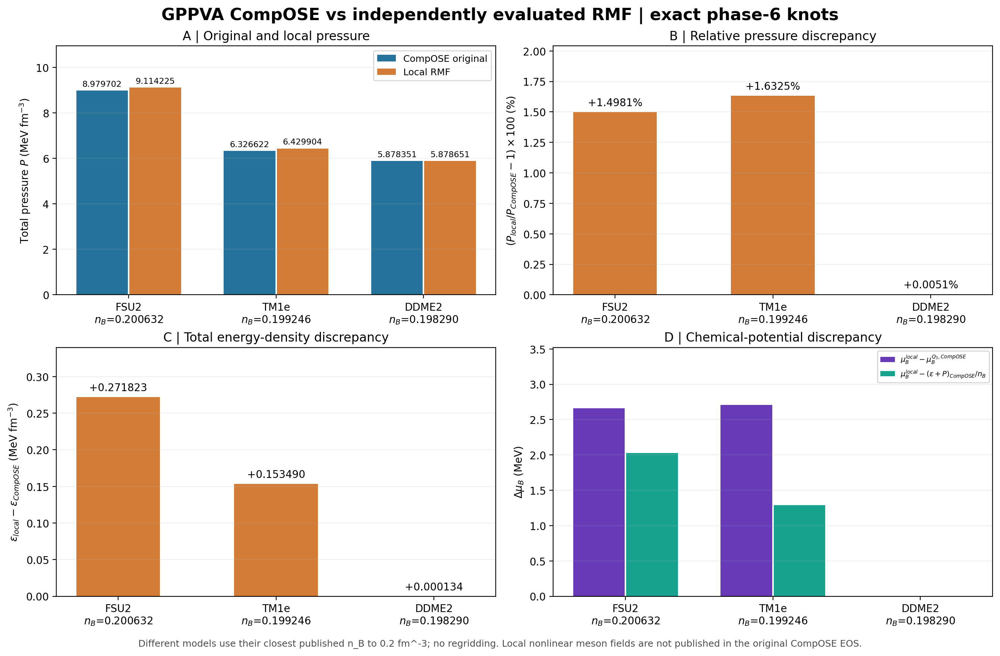
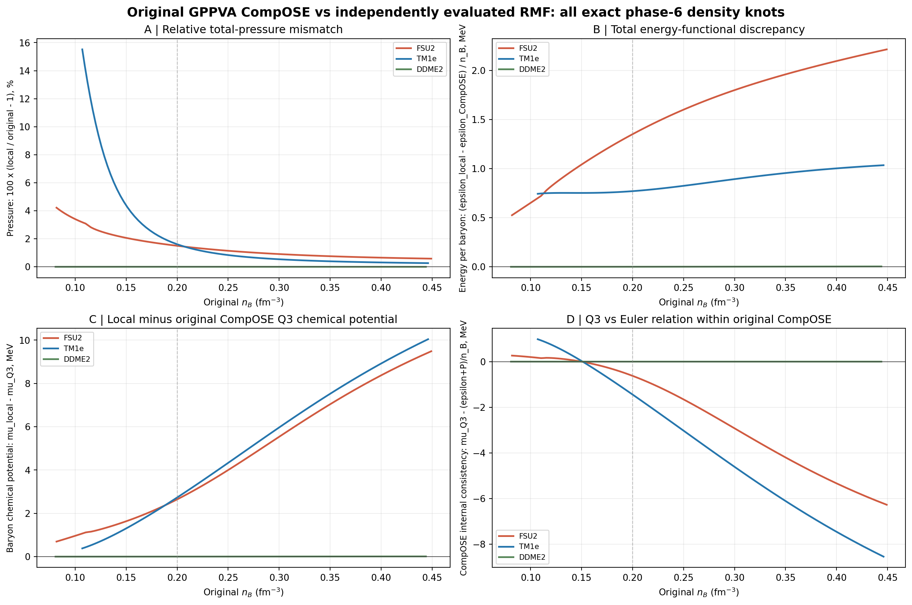

# COWLING-RMF-ONEPOINT-06: original-author uniform RMF, CompOSE and component-resolved checks

Date: 2026-11-19 KST. Parent commit:
`6050cf11cd7f090fcdeb82f59039366cdff62678`.
Work branch: `research/cowling-rmf-onepoint-audit-20261119`.
Pre-registered frozen protocol:
`docs/COWLING_RMF_ONEPOINT_PROTOCOL_20261119.md`.

**Scope:** Obtain at least one independently published original author uniform
EOS row or public generator, compare the local RMF's mean fields and individual
energy-pressure terms without adjusting parameters, and make explicit
figures/tables for the original GPPVA CompOSE-vs-local discrepancy.
**Result:** Independent original-author **TM1e uniform EOS4 (Shen et al. 2020)
single source row was obtained and compared**; the original Pais GPPVA
FSU2/TM1e generator and its meson-field component outputs remain unavailable
in the inspected official source package. They are not invented or inferred
from a near match to Shen or Tolos.

## I. Source identity and evidence types

1. **Original GPPVA(Pais) unified EOS:** Official CompOSE provider original
   packages FSU2, TM1e and DDME2, complete unmodified `eos.nb`,
   `eos.thermo`, `eos.compo` (identified against the separate Zenodo
   archive in stage 04). Original `Iphase=6` **exact source knots** selected
   near `n_B=0.2 fm^-3`. The source bundles contain total
   `n_B,P,epsilon,Yp,Ye,Ymu,Q3,Q4,Q5`, but provide no `eos.micro`
   containing mean fields or term-by-term pressures. Official provenance:
   - https://compose.obspm.fr/eos/215 (GPPVA FSU2)
   - https://compose.obspm.fr/eos/221 (GPPVA TM1e)
   - https://compose.obspm.fr/eos/218 (GPPVA DDME2)
   - https://doi.org/10.1140/epja/s10050-022-00847-y (CompOSE reference manual).
   The original physical generator's exact source code was not obtained;
   do not infer that its unpublished source does not exist.
2. **Independent TM1e model-author bulk EOS:** H. Shen, F. Ji, J. Hu and
   K. Sumiyoshi (2020) EOS4 original 0-K table
   `https://user.numazu-ct.ac.jp/~sumi/eos/table4/eos4.t00.gz`.
   This **is not the Pais GPPVA generator**. It provides `M^*`,
   `P`, `F/A`, `mu_n,mu_p`, and `n,Yp` for fixed
   0-K uniform nucleons. SHA-256 of original compressed file:
   `346b2701f7372817c516c3c945fdee0b3da5af9f08e2fe83f743951d1b5ebaef`,
   size 323,171 bytes, 7,150 numeric table rows.
   - Guide: https://user.numazu-ct.ac.jp/~sumi/eos/table4/guide_EOS4.pdf
   - Original published dataset: https://zenodo.org/records/3612487
   - The author original binary is retained **locally only** and is *not*
     re-published by this branch.
3. **Independent original FSU2 nuclear-matter summary:** Tolos, Centelles,
   Ramos, ApJ 834:3 (2017) Table 1, `n_0=0.1505 fm^-3`,
   `M^*/M=0.593` in symmetric matter and
   `P_PNM=5.81 MeV/fm^3` at n0. This is a low-precision, published
   nuclear-matter benchmark rather than an FSU2 full beta EOS or original
   source fields.
   - https://diposit.ub.edu/dspace/bitstream/2445/116038/1/669453.pdf
4. **Local numerical source:** `gppva_rmf.py` for FSU2/TM1e, the
   Fortran native DDME2 reference for its control, and a separate **Fortran
   component evaluator** `fortran_eos/app/rmf_original_onepoint_components.f90`
   that receives *local stationary meson fields* and independently calculates
   their Fermi integrals, meson potential contributions and EOM residuals.
   Do not claim this Fortran evaluator independently solves the local
   mean-field boundary value problem: it independently evaluates the
   analytical terms at the same local stationary field values.

## II. Exact original GPPVA CompOSE core at nB approximately 0.2

All pressures/energies have units MeV/fm³, chemical potentials MeV.
`Delta` **always denotes local minus original CompOSE**.
No interpolation or energy offset was used.

| Source model | Original nB [fm^-3] | P provider | P local | ΔP | ΔP/P provider |
|:--|--:|--:|--:|--:|--:|
| FSU2 | 0.20063192 | 8.979701903 | 9.114224776 | +0.134522872 | +1.498077% |
| TM1e | 0.19924618 | 6.326621514 | 6.429904002 | +0.103282488 | +1.632506% |
| DDME2 | 0.19828963 | 5.878351404 | 5.878651405 | +0.000300001 | +0.005103% |

| Model | ε original | ε local | local−original Δε | local−original Δmu(Q3) | local−original Δmu(Euler) |
|:--|--:|--:|--:|--:|--:|
| FSU2 | 194.025955682 | 194.297779072 | +0.271823390 | +2.659726966 | +2.025332075 |
| TM1e | 190.969430936 | 191.122921031 | +0.153490095 | +2.708572038 | +1.288720230 |
| DDME2 | 190.320342524 | 190.320476974 | +0.000134450 | +0.002186435 | +0.002190993 |

Source `mu_B(Q3)` and the source's own
`(epsilon+P)/n_B` are distinct because the original source
table itself has nonzero Euler residuals (FSU2 +0.634395 MeV
for Euler−Q3, TM1e +1.419852 MeV). They **must not be
silently interchanged**. Original Q4-Q5-derived electron
chemical potentials also disagree with a free electron
gas computed from the source Ye by −2.153806 MeV (FSU2),
−1.272893 MeV (TM1e), versus only −0.004522 MeV (DDME2).

### Original single-point visual chart



- PNG: `data/cowling_original_rmf_onepoint_20261119/figures/COMPOSE_vs_LOCAL_RMF_exact_onepoint.png`
- Editable vector graphic: same prefix `.svg`
- Exact tabular CSV: same prefix `.csv`
- Hash-bound receipt: `figures/FIGURE_RECEIPT.json`

### Complete exact source-density trend



Across all *original* phase-6 sampled density rows in the independently
verified stage-05 source audit: FSU2 **75**, TM1e **63**, DDME2 **75**
total **213 original density knots** in `0.08–0.45 fm^-3`.
Pressure maximum absolute relative discrepancy across this entire
bounded support is 4.2213%, 15.5182%, 0.005156%, respectively.
The plotted source rows are independently sampled at their exact
individual source density knots, **not a common interpolated mesh**.

- PNG and SVG: `figures/COMPOSE_vs_LOCAL_RMF_original_density_trend.{png,svg}`
- Complete 213-point numeric CSV:
  `figures/COMPOSE_vs_LOCAL_RMF_original_density_trend.csv`
- Hash-bound source and chart receipt:
  `figures/DENSITY_TREND_RECEIPT.json`

## III. Independent original TM1e author one-point comparison

Published zero-T original EOS4 table row (author fixed-Yp; not
Pais source beta-equilibrium output), **without interpolating
either density or proton fraction**:

`log10(rho_B/(g/cm^3))=14.5`,
`n_B=0.1904367 fm^-3`, `Yp=0.10`,
`T=0`; source free-neutron/proton fractions are 0.9/0.1,
no heavy nuclei and no alpha clusters. The original table gives
**baryons-only** matter. The local comparison intentionally omits
electrons/muons; do not mistake these results for total
charge-neutral beta equilibrium.

| Primitive / observable | Original author TM1e | Local TM1e published-parameter RMF | local−author |
|:--|--:|--:|--:|
| M* [MeV] | 523.861600 | 523.863480 | +0.00188049 |
| P_B [MeV fm^-3] | 4.639332 | 4.63928227 | −0.000049729 |
| F/A−938 [MeV] | 8.674307 | 8.677335606 | +0.003028606 |
| mu_n−938 [MeV] | +45.170140 | +45.17455251 | +0.00441251 |
| mu_p−938 [MeV] | −76.172810 | −76.18479026 | −0.01198026 |

The TM1e original functional defines
`M*=M+g_sigma*sigma_author`,
where the local code uses `M*=M-g_sigma*phi`;
thus `sigma_author=-phi`. Independent scalar field from
published `M^*`:

- **Source-derived author sigma**: −41.29449890 MeV.
- **Locally solved sigma in author sign**: −41.29431139 MeV.
- Difference (local − author-derived): +0.00018751 MeV.

This scalar field was *derived from the author original
published effective mass*, not read from a published
mean-field column. It is a source-backed independent
model-level comparison, not source-equivalent Pais GPPVA.

The separate original FSU2 literature benchmark:
`n0=.1505`; source rounded SNM M*/M=.593 vs local
.59293669; source PNM pressure 5.81 vs local
5.81943771 MeV fm^-3. Three-digit source precision
restricts the meaning of the corresponding
source-derived scalar field.

## IV. Explicit individual local RMF contributions and Fortran parity

Convention: `(-,+,+,+)` spacetime signature, density in fm^-3;
`hbar c=197.3269804 MeV fm`, `c` retained in mass energy
interpretation. Local `phi>0`, `omega,rho` in MeV, canonical
rho vertex `g_rho tau_3/2`. In the on-shell algebra,

```text
  U = (ms² phi²)/2 + (a3 phi³)/3 + (a4 phi⁴)/4
  W = (mw² omega²)/2 + (mr² rho²)/2
      + (b4 omega⁴)/4 + cross omega² rho²

  epsilon_total =
      epsilon_kin,n + epsilon_kin,p + epsilon_e + epsilon_mu
      + U/(hbar*c)^3 - W/(hbar*c)^3
      + gw*omega*nB + (gr*rho/2)*(np-nn)

  P_total =
      P_kin,n + P_kin,p + P_e + P_mu
      + (W-U)/(hbar*c)^3       [no DD rearrangement for FSU2/TM1e]

  on stationary fields:
      epsilon_omega4=3 P_omega4
      epsilon_omega-rho-mixed=3 P_omega-rho-mixed.
```

At local beta equilibrium, at each provider original approximate 0.2
fm^-3 source knot, the local `sigma_author=-phi`, omega and rho
mean fields are:

| Model | nB [fm^-3] | phi [MeV] | omega0 [MeV] | rho30 [MeV] | M* [MeV] |
|:--|--:|--:|--:|--:|--:|
| FSU2 | 0.20063192 | 44.41044734 | 28.56077118 | −8.73920364 | 477.27164617 |
| TM1e | 0.19924618 | 42.48439268 | 27.57436878 | −3.51942778 | 511.92827427 |

**These are LOCAL solved fields, not published original GPPVA meson fields.**

| Pressure component [MeV fm^-3] | local FSU2 | local TM1e |
|:--|--:|--:|
| neutron+proton kinetic | +7.74234359 | +7.74365175 |
| electron+muon kinetic | +0.80112396 | +0.40557688 |
| scalar sigma mass+cubic+quartic | −38.04422331 | −35.50682205 |
| omega+rho mass terms | +35.39604415 | +30.81298830 |
| omega quartic + mixed omega-rho | +3.21893639 | +2.97450913 |
| **sum = local P_total** | **9.11422478** | **6.42990400** |
| **original GPPVA source P_total** | **8.97970190** | **6.32662151** |

The component origin is the **local RMF code only**.
No decomposition of the original provider's P into
meson terms is possible without the author's field state
or generator, even though its original *total* P and
epsilon are available.

Independent separate GNU Fortran program
`fortran_eos/app/rmf_original_onepoint_components.f90`
was compiled with `-fcheck=all -Wall -Wextra`. For two
models × (local beta equilibrium, original printed
composition) plus the author fixed-Yp TM1e row,
**five independent evaluations** gave:

- Maximum term-by-term Fortran − Python discrepancy:
  `1.14e-13 MeV/fm³`.
- Total `P,epsilon` recomposition discrepancies:
  typically zero at floating-point precision.
- Scalar, omega and rho field equation residuals
  `<1e-8 fm^-3` in every verified case.

These are implementation/derivation checks at identical
local field values, not independent original-Pais
generator equality or independent fields obtained
from an unavailable author file.
Detailed per-component traces:
`FORTRAN_COMPONENT_PARITY.json`,
`FSU2_LOCAL_ONLY_COMPONENTS.csv` and
`TM1e_LOCAL_ONLY_COMPONENTS.csv`.

## V. Claim gate and smallest remaining source request

| Claim | Gate |
|:--|:--|
| Original exact CompOSE source vs local P/epsilon/Y and Q3/Q4 | **NUMERICALLY_CHECKED** |
| 2020 Shen TM1e author 0-K uniform fixed-Yp table vs local | **INDEPENDENT_AUTHOR_NUMERICALLY_CHECKED** |
| FSU2 publication saturated M* and PNM pressure | **LITERATURE_SUPPORTED + NUMERICALLY_CHECKED** |
| Local FSU2/TM1e mean-field component calculations | **DERIVED + IMPLEMENTATION_VERIFIED** |
| Full exact-density CompOSE trend, 213 points, source hashes | **EXISTING_SOURCE_DATA_VERIFIED + VISUALIZED** |
| Original Pais GPPVA mean fields and term-by-term original P/epsilon | **UNRESOLVED: original eos.micro/generator not obtained** |
| Original GPPVA microphysical Maxwell source-equivalent result | **NOT CLAIMED** |

**One minimally sufficient original-provider request per model:**

For GPPVA(FSU2) at original `n_B=0.20063192 fm^-3`
and GPPVA(TM1e) at `n_B=0.19924618 fm^-3`,
at the original zero-temperature beta-equilibrium
composition (same original Yp, Ye, Ymu),
please provide the existing generator's stationary
`sigma, omega0, rho03` mean fields (units and signs),
`Mstar`, `mu_n,mu_p,mu_e,mu_mu`, the
neutron/proton scalar densities, and **individual
energy/pressure contributions** from nucleon kinetic
parts, free leptons, sigma mass/self-interactions,
omega/rho quadratic, omega quartic and mixed
omega-rho. Alternatively provide the exact
generator code revision, coupling parameter table
(including mixed term and rho vertex convention),
and a full machine-readable one-row diagnostic.

This *one-row provider state* is the smallest
source-located input that can distinguish a local
coupling/equation convention issue from a
generator normalization or output-column issue.
The author source code or field record has not been
received: this stage does **not** send an e-mail
or claim outside-source availability.

## VI. Reproducibility

The isolated parent commit, exact source hashes,
read-only source derivative artifacts and status
are preserved in JSON under
`data/cowling_original_rmf_onepoint_20261119/`.
Full original CompOSE source archives/PDFs and
the original Shen binary remain local untracked inputs,
not silently republished. Rehydration of Shen's original
publicly shared binary requires:

```bash
export OPENBLAS_NUM_THREADS=1 OMP_NUM_THREADS=1 PYTHONPATH=python_frontend
python3 scripts/fetch_shen_eos4_t00_20261119.py
python3 scripts/run_cowling_original_rmf_onepoint_20261119.py
python3 scripts/plot_cowling_rmf_compose_onepoint_20261119.py
python3 scripts/plot_cowling_compose_density_trend_20261119.py
python3 scripts/check_rmf_onepoint_fortran_parity_20261119.py
python3 -m pytest -q python_frontend/tests/test_cowling_rmf_onepoint_20261119.py \
  python_frontend/tests/test_cowling_rmf_onepoint_evidence_20261119.py \
  python_frontend/tests/test_cowling_rmf_onepoint_figure_20261119.py
```

The separate Fortran code re-evaluates the scalar/vector/free-gas
expressions at locally solved fields; it does not solve the original
GPPVA source's homogeneous fields independently. For release-level
claims, verify the actual test and compiler receipts and exact source
hashes rather than relying only on this narrative.
