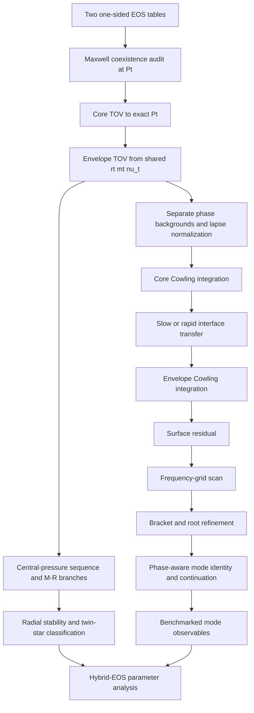

# Native sharp-Maxwell research DAG and next gates

Authority:
- Repository: `cosmosapjw-quantum/NS_Cowling`
- Branch: `research/maxwell-native-fortran-v1`
- Latest branch/workflow/documentation head: `22b0faa3c69150f3ae4fffcd2a6cae5d8231bb6c`
- Exact code-bearing implementation head: `f8678cb13a18f63bad9f8db65c4cd3e66e491ad3`
- PR #3 remains open, draft and unmerged.

## Current dependency graph

## Gate ledger

| Node | Status | What is actually established |
|---|---|---|
| A-B: two-phase coexistence input | PASS_SYNTHETIC_TABLE | Two normalized T14 phase tables load and pass admission. One-sided states at (P_t) satisfy pressure/chemical-potential coexistence, positive jump ordering and cold first-law closure. Tables are generated analytic fixtures, not a real CompOSE hybrid pair. |
| C-E: phase-segmented TOV | PASS_SYNTHETIC_TABLE | Callback and normalized-table fixtures verify exact (P_t) endpoint/restart, shared geometric state and lapse normalization. Synthetic CLI gives (M=9.6357\times10^{-4}M_\odot^{\rm nominal}), (R=642.793\,\mathrm{m}), and (r_t=332.172\,\mathrm{m}). |
| F-I: native Cowling interface shot | PASS_SYNTHETIC_TABLE | (ell=2), single 1800 Hz trial, both slow and rapid transfer maps, plus the single-shot production CLI. Pressure-perturbation continuity is below (10^{-9}); the CLI sides agree at about (3.2\times10^{-16}) relative. |
| Production generic dispatch | PASS_BOUNDED_SYNTHETIC | `ns_production_solvers` exports `solve_tov_star` overloads for smooth EOS and high/low Maxwell callbacks, and `solve_cowling_spectrum` overloads for smooth background/profile and Maxwell star. Existing TOV, normalized-table TOV, smooth spectrum and Maxwell case adapters route through these APIs. The smooth TOV optional `eos_events(:)` argument is preserved. |
| J1: Maxwell frequency-grid scan | PASS_BOUNDED_SYNTHETIC_NO_ROOT | Slow/rapid scans and `maxwell_table_spectrum` preserve all trial states. CLI scans 1799, 1800 and 1801 Hz; all three trials succeed. Residuals are approximately 0.989787, 0.993524 and 0.996295, all positive. The scan reports 0 brackets, 0 roots and no unresolved candidates. This is a successful no-root scan only. |
| J2: Maxwell bracket/root refinement | IMPLEMENTED_NOT_POSITIVE_ROOT_VERIFIED | Sign/near brackets are refined with bisection and the final shot is rerun. The current physical fixture has no bracket, so the positive-root/bisection branch is not yet exercised by exact-head tests. |
| J3: Maxwell mode identity / continuation | NOT_STARTED | Root family labels remain `unresolved`; no (f), (p_1), or interface-mode claim. Requires phase-aware node/overlap diagnostics and continuation across frequency and conversion prescription. |
| K-L: M-R branches / radial stability | NOT_STARTED | The Seidov ratio is only a local onset diagnostic. |
| M-N: data benchmarks / inference | BLOCKED_BY_UPSTREAM | No realistic hybrid EOS benchmark or verified mode data cohort is attached to this implementation. |
| Real CompOSE high-/low-phase pair | NOT_STARTED | Requires provenance, units, crust/core matching, source-backed (P_t) coexistence construction and full EOS-domain admission. |

## Exact-head evidence

Both workflow events check branch head `22b0faa3c69150f3ae4fffcd2a6cae5d8231bb6c`:

- Push [42585358415](https://github.com/cosmosapjw-quantum/NS_Cowling/actions/runs/42585358415): success; artifact 13658722733; SHA-256 `26313f4315af74718f5fa9d1687658ef603c405807b2f7d44d27057fa38242a1`.
- Pull request [42585366571](https://github.com/cosmosapjw-quantum/NS_Cowling/actions/runs/42585366571): success; artifact 13659056245; SHA-256 `12afce4e910c53b9a0dda180826bea2a98a5986562df0866bb7f9a26da219412`.
- GNU Fortran 16.2.0; FPM 0.13.0; runtime checks `-fcheck=all`.
- `cell_checks`: 12; `maxwell_checks`: 22; `maxwell_table_checks`: 74.
- Production build, `maxwell_table_cowling` and `maxwell_table_spectrum` CLI smoke all passed.

The earlier malformed workflow commit `42b5936136f8021ee9548cd5e6d07ef437baa112` generated a failed Actions run with no jobs. The workflow was restored from the last clean blob, structurally checked for unique steps and committed in `22b0faa...`; both exact-head events then passed. This failed authoring attempt is retained and not counted as validation.

## Next implementation order

1. Find or construct a reproducible physical synthetic-star frequency interval with an isolating residual sign bracket; test bisection, fresh root shooting, residual closure and root-tolerance refinement. Do not hardcode or assume an eigenfrequency. If no robust root exists in the current fixture, expose a small test seam for the bracket/refinement component while retaining the real scanner tests.
2. Cross-check native table-backed TOV against the existing independent Python/SciPy phase-aware reference with identical EOS knots, constants, cutoff, (P_c) and (P_t). Compare (r_t,m_t,M,R) and one-sided metric/thermodynamic values.
3. Add tolerance-refinement studies for core/envelope TOV, core/envelope Cowling, interface transfer and root refinement.
4. Add negative table/provider/CLI tests: out-of-range (P_t), chemical-potential mismatch, reversed jump, first-law failure, failed callbacks and incomplete frequency scans.
5. Add phase-aware node/overlap diagnostics and mode continuation before assigning (f), (p_1), or interface-mode labels.
6. Add central-pressure continuation, M-R branch analysis and radial stability only after the background and EOS gates.
7. Attach realistic source-backed hybrid EOS only after provenance, units, crust/core matching, coexistence and full-domain admission are audited.

## Stop conditions

- Stop before TOV integration if the phases do not coexist at the declared (P_t).
- Stop before interpreting a Cowling root if the background is not independently verified or the interface map fails its jump conditions.
- Do not call a single-frequency residual an eigenfrequency.
- Do not treat a successful finite-grid no-root scan as a complete spectrum.
- Do not assign a mode-family identity solely by root ordering.
- Do not infer stable branches from the Seidov ratio alone.
- Do not combine sharp discontinuity results with the 234-row smooth-matching cohort.
- Do not apply the 33-path v5 overlay without checking its recorded base SHA and all old-blob identities against the current branch.

## Current stop point

The production generic TOV/Cowling dispatch, smooth-profile dispatch, normalized-table Maxwell integration, slow/rapid no-root frequency scans and both production CLI routes are verified on generated analytic phase tables. Positive-root bisection, mode identity, independent Python/SciPy cross-validation, tolerance refinement, negative admission tests and realistic CompOSE execution remain open.
