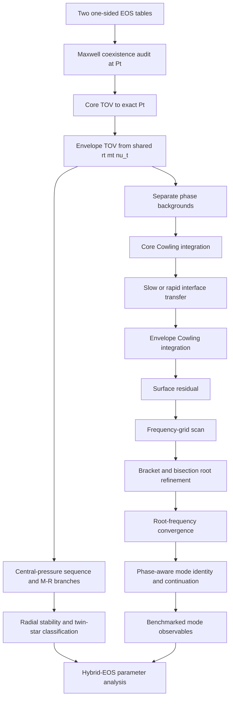

# Native sharp-Maxwell research DAG and next gates

Authority:
- Repository: `cosmosapjw-quantum/NS_Cowling`
- Branch: `research/maxwell-native-fortran-v1`
- Exact code/test head: `9e92655a8277922f312f4c31df8e331e8c12df1b`
- Exact workflow head tested by both push and PR CI: `ec4527f0d518f6ba19f57eb42d8a8eb00b98dfca`
- PR #3 remains open, draft and unmerged.

## Current dependency graph

## Gate ledger

| Node | Status | What is actually established |
|---|---|---|
| A-B: two-phase coexistence input | PASS_SYNTHETIC_TABLE | Two normalized T14 phase tables load and pass admission. One-sided states at (P_t) satisfy pressure/chemical-potential coexistence, positive jump ordering and cold first-law closure. These are generated analytic fixtures, not a real CompOSE hybrid pair. |
| C-E: phase-segmented TOV | PASS_SYNTHETIC_TABLE | Callback and normalized-table fixtures verify exact (P_t) endpoint/restart, shared geometric state and lapse normalization. Fixture outputs are not astrophysical predictions. |
| F-I: native Cowling interface shot | PASS_SYNTHETIC_TABLE | (ell=2), slow and rapid transfer maps; table-backed 1800 Hz shots and production CLI. Interface pressure-perturbation continuity passes the stated test tolerances. |
| Production generic dispatch | PASS_BOUNDED_SYNTHETIC | `ns_production_solvers` exports smooth/Maxwell overloads for `solve_tov_star` and smooth background/profile plus Maxwell overloads for `solve_cowling_spectrum`. Existing smooth TOV, table-star and smooth spectrum cases route through the generic APIs. Smooth optional `eos_events(:)` is preserved. |
| J1: Maxwell frequency-grid scan | PASS_BOUNDED_SYNTHETIC | Slow and rapid each scan 41 frequencies from 100 to 20,000 Hz on generated analytic two-phase tables. All trial shots succeed. Each conversion prescription has 2 sign brackets. This is a bounded search over the supplied finite grid. |
| J2: positive-root refinement | PASS_SYNTHETIC_SLOW_AND_RAPID | All four brackets are refined by bisection and followed by fresh Cowling shots. Slow roots: 1764.8989380477 Hz ((R_s=-6.9575\times10^{-7})) and 4937.6449322607 Hz ((R_s=9.3334\times10^{-8})). Rapid roots: 4937.0162338857 Hz ((R_s=8.5331\times10^{-9})) and 19493.6326018255 Hz ((R_s=3.8951\times10^{-7})). All roots valid, status `ok`. |
| J3: root-frequency convergence | NOT_VERIFIED | Current run uses one ODE/root-tolerance configuration. Need independent ODE tolerance and frequency-grid/root-tolerance refinement, with a convergence envelope. |
| J4: mode identity / continuation | UNRESOLVED | Every returned family label remains `unresolved`. No f-mode, p1-mode or interface-mode identity is asserted. Need phase-aware node/overlap diagnostics and continuation. |
| K-L: M-R branches / radial stability | NOT_STARTED | The Seidov ratio is only a local onset diagnostic; no stable sequence or twin-star analysis. |
| M-N: data benchmarks / inference | BLOCKED_BY_UPSTREAM | No realistic hybrid EOS benchmark or verified mode data cohort is attached to this implementation. |
| Real CompOSE high-/low-phase pair | NOT_STARTED | Requires provenance, units, crust/core matching, source-backed (P_t) coexistence construction and full EOS-domain admission. |

## Exact-head CI evidence

Both events tested exact workflow head `ec4527f0d518f6ba19f57eb42d8a8eb00b98dfca`, including explicit assertions that both conversions find exactly two valid roots:

- Push [42586438396](https://github.com/cosmosapjw-quantum/NS_Cowling/actions/runs/42586438396): success; artifact 13658709148; SHA-256 `02d1673cd82045aaacbae8125c74c7ce7b8896b7abe6def70e81df07331c3d04`.
- Pull request [42586446195](https://github.com/cosmosapjw-quantum/NS_Cowling/actions/runs/42586446195): success; artifact 13659137810; SHA-256 `478fb960cf8a993bb92bf2bbc544f17160b854e0f0f5ac5a28cc0b14a9ccaeaf`.
- GNU Fortran 16.2.0; FPM 0.13.0; runtime checks `-fcheck=all`.
- `cell_checks`: 12; `maxwell_checks`: 22; `maxwell_table_checks`: 74.
- Production `case_driver` build, `maxwell_table_cowling`, slow `maxwell_table_spectrum` and rapid `maxwell_table_spectrum` all passed.
- Exact code/test commit: `9e92655a8277922f312f4c31df8e331e8c12df1b`; strict workflow commit: `ec4527f0d518f6ba19f57eb42d8a8eb00b98dfca`.

## Next implementation order

1. Add independent root convergence studies. Repeat slow/rapid scans while varying ODE tolerances, maximum step, root `xtol/rtol), and frequency-grid density independently. Record root shifts and residuals. Avoid pairing slow/rapid branches by root order.
2. Cross-check table-backed native TOV against the independent Python/SciPy phase-aware reference with identical EOS knots, constants, cutoff, (P_c) and (P_t). Compare (r_t,m_t,M,R) and one-sided metric/thermodynamic values.
3. Compare Cowling phase-segmented solutions and transfer maps against the Python/SciPy reference at fixed (omega), separately for slow and rapid conversion.
4. Add negative table/provider/CLI tests: out-of-range (P_t), chemical-potential mismatch, reversed jump, first-law failure, failed callbacks and incomplete frequency scans.
5. Add phase-aware node/overlap diagnostics and mode continuation before assigning f/p1/interface labels.
6. Add central-pressure continuation, M-R branch analysis and radial stability only after the background and EOS gates.
7. Attach realistic source-backed hybrid EOS only after provenance, units, crust/core matching, coexistence and full-domain admission are audited.

## Stop conditions

- Stop before TOV integration if the phases do not coexist at the declared (P_t).
- Stop before interpreting a Cowling root if the background is not independently verified or the interface map fails its jump conditions.
- Do not call an arbitrary single-frequency residual an eigenfrequency.
- Do not treat the finite grid as a proof of spectrum completeness.
- Do not assign a mode-family identity solely by root ordering or frequency similarity.
- Do not infer stable branches from the Seidov ratio alone.
- Do not combine sharp discontinuity results with the 234-row smooth-matching cohort.
- Do not apply the 33-path v5 overlay without checking its recorded base SHA and all old-blob identities against the current branch.

## Current stop point

The native generic production TOV/Cowling dispatch and both slow/rapid positive-root refinement paths pass exact-head CI on synthetic normalized tables. Remaining gates are root-frequency convergence, independent Python/SciPy cross-validation, negative admission tests, mode identity/continuation, stable M-R sequence and realistic source-backed CompOSE execution.
