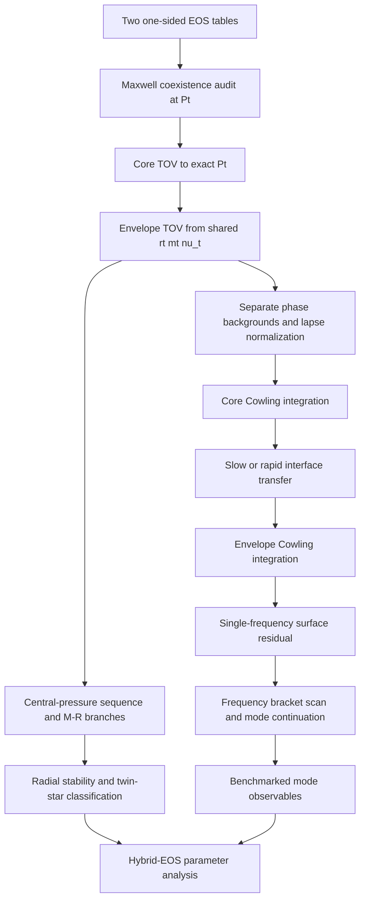

# Native sharp-Maxwell research DAG and next gates

Authority: `research/maxwell-native-fortran-v1` at verified head `98d2f9ce6033015109286e5713639c6626a6f7fb`; PR #3 is open as draft and is not merged.

## Current dependency graph

## Gate ledger

| Node | Status | What is actually established |
|---|---|---|
| A-B: two-phase coexistence input | PARTIAL | Callback-level analytic fixture verifies equal Pt, equal mu, positive jumps and cold first-law closure. Real normalized high/low tables have not yet been run end-to-end. |
| C-E: phase-segmented TOV | PASS_ANALYTIC | Separate pressure-coordinate segments, exact Pt endpoint/restart, shared geometric state, and lapse normalization. Analytic fixture passes. |
| F-I: native Cowling interface shot | PASS_BOUNDED | `ell=2`, one 1800 Hz trial, slow and rapid maps, pressure-perturbation continuity. No spectrum search. |
| CLI / table provider | BUILD_PASS_RUNTIME_OPEN | Production `case_driver` compiles and links. Actual table-driven execution remains open. |
| J: spectrum scan / mode continuation | NOT_STARTED | Requires bracket/root scan, node-count or invariant-based mode identity, and convergence tests. |
| K-L: M-R branches / radial stability | NOT_STARTED | Seidov ratio currently provides only a local onset diagnostic. |
| M-N: data benchmarks / inference | BLOCKED_BY_UPSTREAM | No realistic hybrid EOS benchmark or verified mode data cohort is attached to this implementation yet. |

## Next implementation order

1. Add two normalized-table fixtures with a shared exact transition pressure and analytically controlled coexistence. Run both through `load_normalized_table`, `init_table_eos`, `eos_table_at_pressure`, and the production case driver. Include out-of-range Pt, mismatched mu, reversed jump, and first-law failure cases.
2. Cross-check the table-driven native TOV result against the existing Python/SciPy phase-aware reference using the same EOS knots, constants, surface cutoff and central pressure. Compare interface radius/mass, total mass/radius, and one-sided metric quantities.
3. Add tolerance-refinement tests for the phase-segmented TOV profile and Cowling state at the interface. Record observed order or convergence envelope, not only one residual value.
4. Implement a frequency-bracket scanner around `shoot_maxwell_cowling`, keeping slow and rapid conversion spectra separate. Require bracket existence, stable root identity, and refinement agreement before naming an `f`, `p1`, or interface mode.
5. Add central-pressure continuation for M-R branches. Only then evaluate turning points and radial stability; keep the Seidov onset diagnostic as a separate local criterion.
6. Run a realistic hybrid EOS pair only after its source provenance, units, crust/core matching, transition pressure and chemical-potential closure have been audited. Do not reuse the 234 smooth-matching spectrum rows as true Maxwell results.

## Stop conditions

- Stop before TOV integration if the two input phases do not satisfy coexistence at the declared `P_t`.
- Stop before interpreting a Cowling root if the background is not independently verified or the interface map fails its jump conditions.
- Do not call a single-frequency residual a mode or frequency spectrum.
- Do not infer stable branches from the Seidov ratio alone.
- Do not combine this branch's discontinuous phase results with the earlier smooth `maxwell` bridge cohort.
- Do not apply the 33-path v5 overlay without checking its recorded base SHA and all old-blob identities against the current branch.

## Current stop point

The native analytic implementation has passed its exact-head GitHub Actions tests and build. The next justified unit of work is the two-normalized-table end-to-end fixture, followed by independent Python/SciPy TOV comparison. Realistic EOS cohort generation and any observational inference remain downstream.