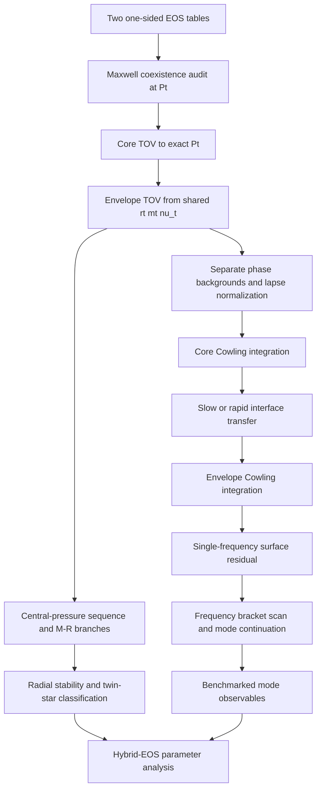

# Native sharp-Maxwell research DAG and next gates

Authority: `research/maxwell-native-fortran-v1` at code-verified head `f8678cb13a18f63bad9f8db65c4cd3e66e491ad3`; PR #3 is open as draft and is not merged. The subsequent workflow/docs commit will advance the branch head without changing this tested source.

## Current dependency graph

## Gate ledger

| Node | Status | What is actually established |
|---|---|---|
| A-B: two-phase coexistence input | PASS_SYNTHETIC_TABLE | Two normalized T14 phase tables were loaded and admitted; both one-sided queries at Pt satisfy pressure/chemical-potential coexistence, positive jump ordering and cold first-law closure. Tables are generated analytic fixtures, not a real CompOSE hybrid pair. |
| C-E: phase-segmented TOV | PASS_SYNTHETIC_TABLE | Callback and normalized-table fixtures verify exact Pt endpoint/restart, shared geometric state and lapse normalization. Production CLI gives M=9.6357e-4 nominal solar masses, R=642.793 m, r_t=332.172 m for the artificial fixture only. |
| F-I: native Cowling interface shot | PASS_SYNTHETIC_TABLE | `ell=2`, one 1800 Hz trial, both slow and rapid maps, plus slow-conversion production CLI shot. Table-backed test pressure-perturbation continuity is below 1e-9; CLI sides agree at about 3.2e-16 relative. No spectrum search. |
| CLI / table provider | PASS_SYNTHETIC_TABLE | `maxwell_table_cowling` and `maxwell_table_spectrum` execute through the real `case_driver`; both use generated analytic two-table fixtures. The spectrum CLI checks scan validity and all-trials success, not a physical eigenfrequency. |\n| Production generic dispatch | PASS_BOUNDED_SYNTHETIC | `ns_production_solvers` exports smooth/Maxwell overloads for `solve_tov_star` and smooth profile/table plus Maxwell overloads for `solve_cowling_spectrum`. Smooth TOV cases, table-star cases, smooth spectrum, and Maxwell case adapters route through these generic APIs. Runtime checks cover smooth TOV/profile dispatch and slow/rapid Maxwell scans. |
| J1: Maxwell frequency-grid scan | PASS_BOUNDED_SYNTHETIC_NO_ROOT | Native `scan_maxwell_modes` evaluates every requested frequency for slow/rapid conversion, stores trial status, detects brackets, and rejects failed/incomplete scans. The current synthetic frequency window contains no root candidate, so this proves the no-root scan path only. |\n| J2: Maxwell bracket/root refinement | IMPLEMENTED_NOT_EXERCISED_BY_FIXTURE | Sign/near brackets use the existing bisection solver and a fresh final Cowling shot; near-zero isolated samples without a bracket are unresolved. The present fixture does not produce a candidate, so the root-refinement branch lacks an exact-head positive-root test. |\n| J3: Maxwell mode identity / continuation | NOT_STARTED | Root family labels stay `unresolved`; no `f`, `p1`, or interface-mode claim. Requires phase-aware node/overlap diagnostics and continuation across frequency and conversion prescription. |
| K-L: M-R branches / radial stability | NOT_STARTED | Seidov ratio currently provides only a local onset diagnostic. |
| M-N: data benchmarks / inference | BLOCKED_BY_UPSTREAM | No realistic hybrid EOS benchmark or verified mode data cohort is attached to this implementation yet. |
| Real CompOSE high-/low-phase pair | NOT_STARTED | Requires provenance, units, crust/core matching, a source-backed Pt coexistence construction and full EOS-domain admission. |

## Next implementation order

1. Add negative provider/CLI tests for out-of-range Pt, mismatched chemical potential, reversed jump ordering and first-law closure failure. The valid two-table integration and production CLI path already pass.
2. Cross-check the synthetic table-backed native TOV result against the existing Python/SciPy phase-aware reference using identical pressure knots, constants, cutoff and central pressure. Compare interface radius/mass, total M/R and one-sided metric quantities.
3. Add tolerance-refinement tests for the phase-segmented TOV profile and Cowling state at the interface. Record a convergence envelope, not only one residual value.
4. Implement a frequency-bracket scanner around `shoot_maxwell_cowling`, keeping slow and rapid conversion spectra separate. Require bracket existence, stable root identity and refinement agreement before naming an `f`, `p1` or interface mode.
5. Add central-pressure continuation for M-R branches. Only then evaluate turning points and radial stability; keep the Seidov onset diagnostic as a separate local criterion.
6. Run a realistic hybrid EOS pair only after source provenance, units, crust/core matching, transition pressure and chemical-potential closure have been audited. Do not reuse the 234 smooth-matching spectrum rows as true Maxwell results.

## Stop conditions

- Stop before TOV integration if the two input phases do not satisfy coexistence at the declared `P_t`.
- Stop before interpreting a Cowling root if the background is not independently verified or the interface map fails its jump conditions.
- Do not call a single-frequency residual a mode or frequency spectrum.
- Do not infer stable branches from the Seidov ratio alone.
- Do not combine this branch's discontinuous phase results with the earlier smooth `maxwell` bridge cohort.
- Do not apply the 33-path v5 overlay without checking its recorded base SHA and all old-blob identities against the current branch.

## Current stop point

The native analytic and synthetic normalized-table implementations have passed exact-head tests and the production CLI smoke. The next unit of work is independent Python/SciPy cross-validation and negative table-admission tests. A source-backed realistic EOS cohort, full mode spectra and observational inference remain downstream.