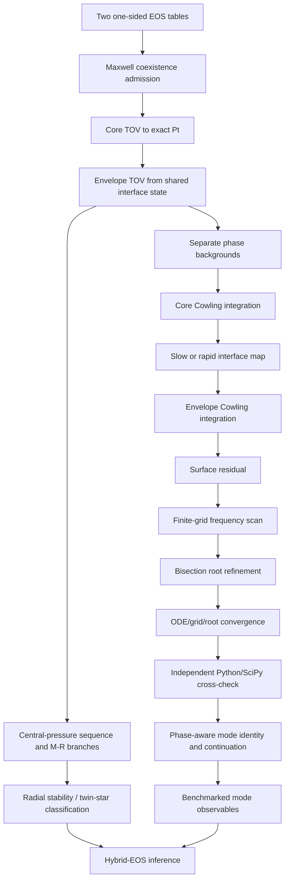

# Native sharp-Maxwell research DAG and next gates

Authority:
- Repository: `cosmosapjw-quantum/NS_Cowling`
- Branch: `research/maxwell-native-fortran-v1`
- Exact Fortran/table-test commit: `9d3ef4bfe8b018b17887504d60e25d1c94971b6e`
- Exact validator/acceptance-limit commit tested by both push and PR CI: `afcdf948f0ca6844a6c3402f66e184a46aa78978`
- PR #3 remains open, draft and unmerged.

## Dependency graph

## Gate ledger

| Node | Status | Evidence and boundary |
|---|---|---|
| A-B: phase-provider admission | PASS_SYNTHETIC_TABLE | Two normalized T14 phase tables load. At (P_t), one-sided pressure and chemical potentials agree; jump ordering is positive and the cold first-law jump identity closes. Tables are generated analytic fixtures. |
| C-E: phase-segmented TOV | PASS_SYNTHETIC_TABLE | High-density core ends at exact (P_t); low-density envelope restarts at the same (r_t,m_t,\nu_t). No interpolation crosses the density jump. |
| Production generic dispatch | PASS_BOUNDED_SYNTHETIC | `solve_tov_star` overloads smooth EOS and two Maxwell phase callbacks; `solve_cowling_spectrum` overloads smooth background/profile and Maxwell star. Existing production adapters route through these generics; optional smooth `eos_events(:)` is preserved. |
| F-I: slow/rapid Cowling interface | PASS_SYNTHETIC_TABLE | Both conversion maps pass interface-condition checks and actual production CLI shots. |
| J1-J2: positive roots | PASS_SYNTHETIC_SLOW_AND_RAPID | Forty-one points over 100-20,000 Hz; two brackets and two bisection-refined roots for each conversion. Slow: 1764.8989380477 and 4937.6449322607 Hz. Rapid: 4937.0162338857 and 19493.6326018255 Hz. Final surface residual magnitudes are below (7.0\times10^{-7}). |
| J3: root convergence | PASS_BOUNDED_SYNTHETIC | Tighter ODE rtol/step/atol setting (2e-9→2e-10, dq_max 0.05→0.025, Cowling atol 1e-12→1e-13) moves roots by at most (3.2810\times10^{-5}) relative. Increasing grid 41→81 and tightening `root_xtol` 1e-5→1e-8, `root_rtol` 1e-10→1e-12 moves them by at most (2.6561\times10^{-10}). Limits: 1e-4 and 1e-7 respectively. |
| J4: independent Python/SciPy cross-check | PASS_BOUNDED_SYNTHETIC | Same analytic table EOS passed through the independent phase-aware `MaxwellEOS`, DOP853 TOV and Cowling scan. Relative differences: M 5.47e-10, R 2.15e-10, interface radius 2.67e-10; max root-set frequency difference 5.205e-5. Admission limits: 1e-6 TOV, 1e-4 roots. |
| J5: mode identity / continuation | UNRESOLVED | Four roots remain labelled `unresolved`. Root ordering is used only to compare numerical sets, not to pair slow/rapid branches or assign f/p1/interface identities. |
| K-L: M-R branches / radial stability | NOT_STARTED | No central-pressure sequence, maximum mass, radial stability or twin-star classification. Seidov remains a local onset diagnostic only. |
| Realistic CompOSE hybrid pair | NOT_STARTED | No source-backed realistic high-/low-phase EOS has been run through this native path. |
| M-N: benchmarks / inference | BLOCKED_UPSTREAM | Requires realistic EOS cohort, mode identity and stability gates. |

## Exact-head CI

Both push and PR workflows tested exact validator head `afcdf948f0ca6844a6c3402f66e184a46aa78978`:

- Push [42588162457](https://github.com/cosmosapjw-quantum/NS_Cowling/actions/runs/42588162457): success; artifact 13659334940; SHA-256 `2f394e17b8f2afa2618322c3c634f63fb6faff81090fe14c700d66f374f165d5`.
- Pull request [42588170532](https://github.com/cosmosapjw-quantum/NS_Cowling/actions/runs/42588170532): success; artifact 13660500740; SHA-256 `05d6786c5a5e82e177646a7db72efc50d485d54d0fac45ae1cec8a499666fd8e`.

Toolchain: GNU Fortran 16.2.0, FPM 0.13.0, runtime checks with `-fcheck=all`. Test counts: 12 cell, 22 analytic Maxwell, 74 normalized-table. The workflow compiles the production case driver; executes single-shot, slow/rapid spectrum, tighter-ODE, and denser-grid/tighter-root CLI runs; and runs `scripts/validate_native_maxwell_reference.py` against the independent Python/SciPy phase-aware implementation. A machine-readable JSON report is archived as `dist/maxwell-native-convergence-reference.json`.

## Remaining research order

1. Implement phase-aware mode identity: node counts on both segments, interface-aware normalization, and overlap/continuation across frequency and slow/rapid conversion. Do not identify by root order alone.
2. Add negative provider/CLI tests: out-of-domain (P_t), chemical-potential mismatch, reversed jumps, first-law failure, callback failures, failed/incomplete scans and near-zero non-bracket candidates.
3. Compare interface transfer maps and one-sided Cowling profiles pointwise with Python/SciPy, not just final roots.
4. Add central-pressure continuation and M-R sequences, then radial stability and twin-star classification. Do not infer them from Seidov alone.
5. Attach source-backed CompOSE high-/low-phase data only after provenance, units, crust/core matching, coexistence pressure and full-domain admission are audited.

## Stop conditions

- Stop before TOV integration if the input phases do not coexist at declared (P_t).
- Stop before interpreting a Cowling root if the background or interface jump map is unverified.
- A converged surface root is not automatically an f-, p1- or interface mode.
- A finite frequency grid is not a completeness theorem.
- The synthetic fixture is not a realistic hybrid-star prediction.
- Keep the sharp density jump separate from the historical 234-row smooth-matching cohort and smooth `maxwell` compatibility bridge.
- Do not apply the 33-path v5 overlay without validating its base SHA and all old-blob identities.

## Current stop point

Native generic production dispatch, slow/rapid positive-root scans, bounded ODE/grid/root refinement and independent Python/SciPy TOV/Cowling cross-check all pass exact-head CI on the generated analytic fixture. Mode identity, pointwise perturbation comparison, negative admission tests, stable M-R sequence and realistic source-backed CompOSE integration remain open.

## Separate smooth-matching mass-response track (2026-11-09)

The mass-dependent follow-up is tracked in research/mass-dependent-cowling-v1, branched from the live feature head a09ec30d74b363652d2d1aefe990557c468679dd. It is not the native sharp-Maxwell phase-interface problem described above and does not modify PR #3.

The smooth v5 cohort has 13 crusts × 3 admitted core families × 6 smooth methods = 234 method rows / 39 fixed core-crust pairs. The historical spectra all target 1.3300106 solar masses; the prior reuse report states that zero modes were recomputed. A new runner is being added for 0.8, 1.0, 1.2, 1.33, 1.4, 1.6, 1.8 and 2.0 solar masses. It scans TOV central pressure, keeps the connected rising branch, does not bridge failed samples, passes adjacent stable-branch Pc brackets into the native target-mass solver, and computes fresh Cowling roots with the smooth W/V identity gate.

The paired estimand is delta_m(y)=100*(y_m/ybar_6-1), for y=f,p1. Incomplete six-method core/crust/mass cells are excluded, never imputed. Low-mass p1 sensitivity is already present in published work; the candidate differentiator must be a reproducible core/crust-conditioned mass-response structure plus independent numerical benchmarks. The old maxwell method token remains a smooth bridge and is not a density jump.

Implementation and node states are in docs/MASS_DEPENDENT_COWLING_DAG_20261109.md. Assumptions and publication gates are in docs/MASS_DEPENDENT_COWLING_RESEARCH_PLAN_20261109.md. No new mass-dependent result, Mmax, radial-stability result, crust mass/thickness, tidal deformability or observational inference is claimed until its own evidence gate passes.
