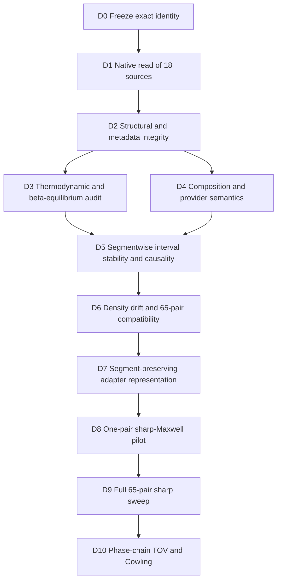

# Sharp-Maxwell 65-Pair C4 Execution DAG and Resource Plan

**Date:** 2026-11-10  
**Selected stage:** C4 only, implementation DAG, execution order, computational platform, parallelization and checkpoints.  
**Machine-readable plan:** data/sharp_maxwell_c4_execution_plan.v1.json

## 1. Stage boundary

C2 (source/code/equation mapping) and C3 (adapter/numerical design) were completed in the prior checkpoint. The next incomplete stage under the PhysMath Research Loop is C4, which plans the implementation DAG and resources. The actual physical source-admission calculations are downstream work and are not claimed complete here.

No raw EOS file is modified. The 65-pair root search remains unstarted, and historical maxwell outputs remain read-only.

## 2. Exact input and implementation inventory

Raw CompOSE sources are pinned to research/maxwell-native-fortran-v1 at a09ec30d74b363652d2d1aefe990557c468679dd. The inventory comprises 13 crusts, 5 cores, 18 EOS models, 52 raw source files (eos.nb, eos.thermo and the 13 available eos.compo files), and 6,214 thermodynamic knots. The 52 files total 1,594,597 bytes, approximately 1.52 MiB by Git tree blob size.

Existing implementation seams:
- python_frontend/compose_eos/api.py::read_compose calls the native Fortran reader and returns EOSData.
- python_frontend/compose_eos/api.py::check_consistency calls the native C1-C11 verifier.
- fortran_eos/src/compose_eos_io.f90::read_compose parses CompOSE Nadd, Iphase, particle pairs and nuclear quadruples.
- fortran_eos/src/compose_eos_verify.f90::check_consistency masks derivative stencils adjacent to every Iphase change, including when composition is absent.
- fortran_eos/src/compose_eos_phase_transition.f90::validate_phase performs analytic polynomial-extremum checks for its Hermite representation, but v1 rejects internal Iphase changes, composition-bearing inputs and nonzero Nadd.
- The production TOV/Cowling path currently uses two EOS callbacks and one sharp interface.

C5 should reuse these parser and verifier seams; it should not introduce a second CompOSE parser without a demonstrated schema gap.

## 3. Dependency DAG

D0-D7 are input/adaptation gates. D8-D10 are downstream science calculations. A physical failure is retained as a scientific status rather than collapsed into a generic execution error.

## 4. Node contracts

| Node | Work | Required acceptance/output |
| --- | --- | --- |
| D0 | Freeze branch, commit, source blobs, 65-pair identity and legacy read-only rule | Exact run_identity.json |
| D1 | Read all 18 sources through the native reader | Per-model receipts retaining Nadd/q_extra, Iphase and composition |
| D2 | Check row widths, key coverage, finite values, selected T/Yq grid, composition shape and phase boundaries | Structural audit with exact source indices |
| D3 | Evaluate P=n_B Q1, epsilon=n_B m_n(1+Q7), mu_Q3=m_n(1+Q3), mu_E=(epsilon+P)/n_B, Q2, Q5 and Q6-Q7 | Per-knot thermodynamic receipts; strict Q3-Euler gate 2e-6 unchanged |
| D4 | Check particle fractions, Y_h=Abar*Y_I, charge neutrality, baryon closure and provider declarations | Composition receipts; unknown Iphase/Nadd meanings remain unresolved |
| D5 | Split at every Iphase change; test each smooth segment including exact Hermite interval extrema | Segment stability margins, acausal intervals and connected causal-domain limits |
| D6 | Record reconstructed_n_max_rel; compare all 65 pairs for T/Yq/Il, neutrality, mass convention and common mu_B support | Density-drift and pair-compatibility receipts; no root search |
| D7 | Build a segment-preserving intermediate representation with reversible provenance | Separate adapter artifacts; original EOS bytes untouched |
| D8 | Run one least-complicated admitted pair and independently verify all roots | Unique-root pilot or retained NO_ROOT/MULTIPLE_ROOT/INPUT_REJECTED/ACAUSAL status |
| D9 | Run the exact 65-pair sweep after the pilot passes | Exactly 65 new sharp statuses, never written to legacy paths |
| D10 | Add multi-segment envelope/phase-chain support, then TOV/stable-branch/Seidov/Cowling | Separate slow/rapid conversion mode receipts |

### Internal crust boundary

All 13 crusts have an observed Iphase 0-to-7 change between knots 217 and 218. No derivative, PCHIP, Hermite cell or interpolation stencil may cross this boundary. Its physical meaning and associated density/pressure gap must be resolved from source metadata and Data Sheets. It is not automatically a Maxwell transition and must not be silently made into a smooth bridge.

The 65-pair core-crust Maxwell interface is distinct from every internal crust source boundary. The eventual stellar provider must represent both. If the internal source boundary is not pressure-compatible, record a source-domain gap rather than inventing an interpolation.

### Thermodynamic and composition treatment

Reconstruct dimensional P, epsilon and mu_B from each source's own mass header first. Any common rest-mass reference conversion must be an explicit, auditable thermodynamic transformation.

The native reader supports the present Nadd=0/1 input width and retains q_extra; the sharp builder rejects nonzero Nadd and composition-bearing inputs. The adapter must not erase these fields just to make the kernel accept a table. Provider semantics must be established first, then any thermodynamic-only projection must retain a sidecar receipt.

## 5. Resources and parallelization

**Platform:** CPU-only Linux using gfortran/Fortran 2018, FPM and the Python frontend. The existing Maxwell CI uses Python 3.13 and gfortran; the project declares Python >=3.10.

**Memory/data:** 52 source files total about 1.52 MiB and contain 6,214 thermodynamic knots. Arrays scale as O(N_knots); 2 GiB is a conservative CI budget, not a measured peak. No GPU is required.

**Execution policy:** start serially and deterministically, one EOS at a time. After parser parity and stable serialization are proven, permit at most four independent source workers locally and two on shared CI. A single coordinator owns aggregate manifest/summary writes. Avoid nested process, OpenMP and BLAS parallelism.

**Time budget:** reserve up to 20 minutes for build, parser, C1-C11 receipts and CI artifacts. This is a planning timeout, not a measured runtime.

## 6. CI integration requirement

The current maxwell-native-fortran.yml does not validate PR #4 as configured. Its pull_request base-branch filter points to research/maxwell-reference-validation-v1, while PR #4 targets research/maxwell-native-fortran-v1; the workflow also hardcodes the PR #3 branch for checkout. A dedicated .github/workflows/sharp-maxwell-source-admission.yml is required.

The new workflow should trigger for PRs targeting research/maxwell-native-fortran-v1, workflow_dispatch and pushes to the cohort branch. It must check out the event's exact PR head/merge SHA, not a fixed branch. It should build with runtime checks, run native tests and source-audit tests, produce 18 source receipts, assert 65 unique pair records, and assert zero root searches and zero TOV/Cowling runs in the source-audit job. Preserve exact head SHA, source checksums, compiler/tool versions and receipts as workflow artifacts.

## 7. Checkpoints

| Checkpoint | Trigger | Artifact |
| --- | --- | --- |
| CP0 | Before implementation | Branch/source identity and 52 input hashes |
| CP1 | Reader vertical slice on SPG_M1 and one Nadd=1 GPPVA source | Parser receipts |
| CP2 | All 18 source reads complete | Structural audit |
| CP3 | Thermodynamic and composition audits complete | Source thermo/composition receipts |
| CP4 | Segmentwise interval checks complete | Source segment receipts |
| CP5 | Pair compatibility complete | 65-pair compatibility and density-drift receipts |
| CP6 | Before full sweep | One-pair pilot receipt |

Resume from the first incomplete checkpoint. Raw bytes and previous receipts remain immutable; rerun only missing or stale derived results.

## 8. Delegation and execution status

No native subagent spawn/wait lifecycle is exposed in the live host inventory. Native delegation is NOT_RUN; no role-play or simulated child receipts are used. C4 planning is executed serially.

Completed in C4: repository/workflow readback, implementation seam identification, source inventory, DAG, resource budget, parallelization, CI trigger correction and checkpoint plan.

Not performed: source parser execution across all 18 EOS, C1-C11 source verification, whole-interval stability/causality, density reconstruction, pair compatibility execution, Maxwell roots, sharp EOS generation, TOV/Cowling or mode spectra.

## 9. Immediate next stage

C5 should implement a read-only vertical slice first: native read_compose plus C1-C11 verification on SPG_M1 and one GPPVA Nadd=1 source. Emit receipts preserving Iphase, composition and q_extra; do not edit raw sources or call the Maxwell constructor. Then extend the verified path to the remaining 16 sources.

---

## 10. C4-D3R: EOS reconstruction, smooth matching and true-Maxwell kernel validation (2026-11-11)

The original C4-D0..D10 chain remains the sole admission and downstream science DAG. C4-D3R is an additive validation gate; it does not replace C4-D3 source thermodynamic admission or C4-D4 provider composition semantics. C4-D8 one-pair pilot now depends on both C4-D7 and C4-D3R.

### 10.1 CompOSE Q3 convention correction

Use Euler baryon chemical potential for thermodynamics and the Maxwell root coordinate:

\[
\mu_E=\frac{\epsilon+P}{n_B}.
\]

The stored Q3 column is convention-dependent on the supported cold, neutrino-transparent branches:

\[
m_n(1+Q_3)=
\begin{cases}
\mu_E-Y_qm_nQ_4,&I_l=0,\\
\mu_E,&I_l=1,\quad Q_5\simeq0.
\end{cases}
\]

For Il=0, recover mu_E from stored Q3 by adding Yq*mn*Q4. Do not use the charge-shifted Q3 potential as the independent variable in P(mu_E) coexistence search. Write output Q3 using the same Il-dependent convention so the native C2 verifier remains valid.

Keep the strict 2e-6 source/reconstruction Q3/Euler admission threshold separate from the true-Maxwell v1 local kernel's 5e-4 Q3/Euler gate. These tolerances belong to different contracts; do not silently exchange or widen them.

### 10.2 Master reconstruction and smooth matching validation

C4-D3R must verify the existing native reconstruct_master first-law identities:

\[
F(x)=f/n_B,\quad x=\ln n_B,\quad Q_1=F'(x),
\]
\[
P=n_BQ_1,\quad \epsilon=n_BF,\quad \mu_E=F+Q_1,
\quad \frac{c_s^2}{c^2}=\frac{Q_1+F''}{F+Q_1}.
\]

The represented intervals must satisfy positive density, positive chemical potential, mechanical stability and causal sound speed over their full polynomial domains. Point sampling may summarize but cannot certify an interval.

The six match_crust_core methods remain historical smooth bridges: maxwell, css, cubic_F, cubic_P, quintic_F, quintic_P. The historical maxwell token remains a smooth near-pressure plateau with no density jump, no latent-energy discontinuity, is_exact_maxwell=false, and seidov_applicable=false. It is not interchangeable with construct_maxwell_transition.

### 10.3 True Maxwell regression gate

Use both analytic Il=0 and Il=1,Q5≈0 two-phase fixtures. Verify:
- input Q3/Euler convention and output Q3 serialization;
- equal Euler chemical potential and pressure at coexistence;
- strictly positive density jump for a nontrivial first-order transition;
- Delta epsilon=mu_t*Delta n_B;
- native C2 and overall output verification;
- non-overlap, no-root, tangential-root, multiple-root and endpoint-duplicate negative controls;
- full-interval stability and causality from exact Hermite polynomial extrema.

Reject unsupported Q5, composition-bearing, Nadd, internal Iphase jumps, mass-convention mismatches and Il/Yq metadata mismatches rather than projecting them away.

### 10.4 Mutation and anti-drift controls

- M0 read-only identity and source audit.
- M1 isolated changes confined to the existing implementation and C4 DAG branches.
- M2 every production fix must have a RED regression first.
- M3 thermodynamic formulas, units, composition semantics, source parser/indexing, row order, tolerance widening and production TOV/Cowling APIs require explicit human approval.
- M4 raw EOS bytes, source-authority SHA, canonical 65-pair identity, legacy outputs and C6/C6B provider semantics stay protected.
- M5 merge/release/deploy/provider contact/Dropbox require separate authorization.

Before promotion, record exact live branch heads, native source hashes, Q3 convention, root topology, interval extrema, test inventory/stdout and refreshed SHA256 manifest. Unknown provider meaning remains BLOCKED, not inferred. No 65-pair root search, TOV or Cowling run is enabled by C4-D3R alone.

### 10.5 Current bounded local evidence

A new Il=0 analytic two-phase test failed before the fix at the intended native source-Q3 validation gate and passed after the correction. The exported PR #1 source artifact built with GNU Fortran 14.2.0; the full frontend/pipeline suite passed 68 tests in 13.57 s and the native quartic-extrema test passed. The exported source had no .git metadata, so this is not a committed checkout replay. Re-fetch and rerun the exact live PR #1 head after the remote update. C4-D3R remains a required gate until the exact-head replay receipts are present.

C4-D4/C6B remains the independent provider-semantics blocker. No C4-D8 pilot or 65-pair search has been run or authorized by this validation increment.
