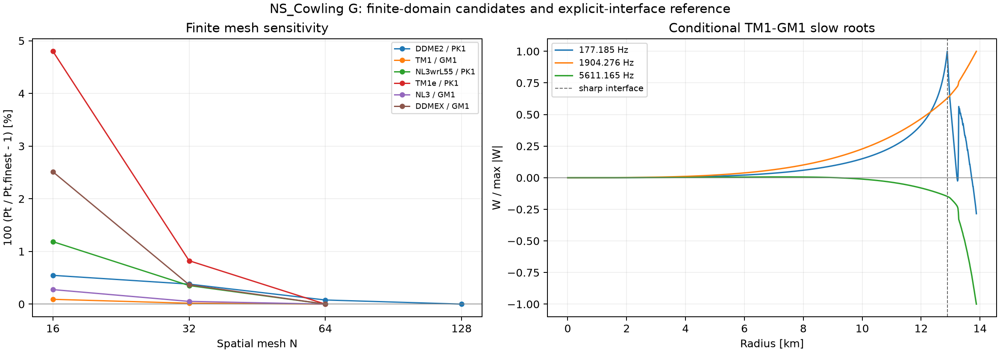

# NS_Cowling G 결과: native crust 재생성, sharp matching, stellar 접합

## 결론과 게시 상태

F commit `d89d877d50b6ae3ad4d5cdea29d5ff67e3a7d09a`를 `research/new-model-maxwell-20261117`에 push했고 remote ref의 exact SHA 일치를 확인했다. G는 `research/crust-refinement-20261117`에서 계산·검증했으며 G push는 별도 승인을 기다린다. PR/merge는 하지 않았다.

**G에서 6개 pair 유형, 23개 mesh/anchor 변형의 sharp Maxwell 출력을 검증했다.** 두 유형은 DDME2/TM1 crust 정밀화이고 네 유형은 부족한 support 보강 또는 새로운 native 대응 crust 재생성이다. 23을 독립 물리 모델 조합 수로 세지 않는다.

실제 TF 호출 776회, 요청 상태 539개 중 최종 accepted 529개다. 실패 상태와 warm restart를 보존했다. 별도 source-identity 진단에서는 148회 homogeneous native 호출을 수행했다.

## 가장 미세한 admitted sharp 후보

μ 단위 MeV, P·Δε 단위 MeV fm⁻³, n 단위 fm⁻³다. 모든 결과는 유한 계산 support에서의 접합이다.

| Native crust → core | N | μ* | P* | n− | n+ | Δε | 마지막 격자 P* 변화 |
|---|---:|---:|---:|---:|---:|---:|---:|
| DDME2 → PK1_CANONICAL | 128 | 943.105867281 | 0.01400952585 | 0.00977355895 | 0.01709310405 | 6.903105930 | 0.07838% |
| TM1_CANONICAL → GM1 | 64 | 945.250293008 | 0.13274592978 | 0.04402652029 | 0.05350910552 | 8.963416462 | 0.01678% |
| GPPVA_NL3wrL55 → PK1_CANONICAL | 64 | 943.278256791 | 0.01716204074 | 0.01160802137 | 0.01944536416 | 7.392795049 | 0.35241% |
| GPPVA_TM1e → PK1_CANONICAL | 64 | 943.275885737 | 0.01711597133 | 0.00817548994 | 0.01941448508 | 10.601473090 | 0.82399% |
| NL3_PROVIDER_PRECISION → GM1 | 64 | 943.455020372 | 0.04822584792 | 0.03135989556 | 0.03951891527 | 7.697668107 | 0.05194% |
| DDMEX_ORIGINAL_TABLE_RHO0 → GM1 | 64 | 942.297837384 | 0.01154747012 | 0.00859566622 | 0.02011354245 | 10.853269864 | 0.36711% |

마지막 열은 DDME2의 N64→128, 나머지 N32→64 차이다. Continuum error bar가 아니다. 실제 CompOSE 경로·SHA·원 출력은 `G_SUMMARY.json`, `tf_regeneration/SUMMARY.json`, `support_repair/SUMMARY.json`을 따른다.

- Native NL3wrL55/TM1e의 retained-knot 부족은 실제 같은 모델 계산으로 보강했다. 두 anchor의 점을 섞어 gap을 메우지 않았다.
- 공개 NL3/DDME-X의 원 실패는 보존했다. 새 성공은 frozen NL3/DDME-X 벡터의 native source이며 공개 표의 numerical identity나 원 자료 수리를 주장하지 않는다.
- Support 16개 출력은 독립 cubic-envelope audit도 통과했다. 최대 native/독립 μ-root 차이 3.83125e−11 MeV, 최대 압력 상대 residual 2.60664e−11이다.
- DDME2/TM1의 가장 미세한 기준점에서 profile/radius를 실제 재최적화한 density finite difference와 Euler pressure가 각각 4.711e−9, 2.600e−10 MeV fm⁻³ 이내로 일치했다.

## Mesh와 branch 판정

DDME2 N64 n=.007은 optimizer mode 8로 거절했고 gap을 넘지 않았다. N128의 .006–.014 구간은 9개 상태를 모두 실제 계산하여 connected support를 회복했다. Support 보강의 9개 거절 상태도 보존했고 다른 anchor의 실제 accepted support를 사용했다.

DDME2의 G 초기 basin은 F-selected basin과 N16에서 달랐다. 정확한 F profile을 초기값으로 한 네 anchor control에서 N32/64/128은 |Δ(E/A)|≤6.99e−11 MeV, |ΔP|≤1.17e−9 MeV fm⁻³로 모였다. 이는 한 anchor의 basin merger이며 전체 density grid의 uniqueness/global minimum을 뜻하지 않는다. NL3wr/TM1e의 두 anchor도 높은 mesh의 공통 accepted 밀도에서 E/A 차이가 9.3e−11 MeV 미만이다.

Rod control은 두 기준점에서 droplet보다 높은 에너지를 주었다. 이 비교를 모든 pasta geometry의 전역 최적화로 확대하지 않는다. 단위·잔차·source 연결은 `TF_RESULTS_KO.md`, `SUPPORT_RESULTS_KO.md`, `SOURCE_PHYSICS_KO.md`를 따른다.

## 전체 EOS와 sharp stellar reference

E의 outer/surface를 고정하고 source knot를 낮은 밀도부터 검사하여 첫 causal/stable direct Hermite lower bridge를 선택했다. 다음 admissible knot를 별도 모델 control로 계산했다. 이 bridge는 명시적 phenomenological closure이며 microscopic crust 계산이 아니다.

TM1 N32/N64는 full contract를 허용한다. DDME2 N64/N128의 모든 검사한 direct join은 음의 dn/dμ를 포함해 거절됐다. DDME2의 별 관측량은 산출하지 않았다. 이는 현재 outer+bridge 선택의 실패이며 모든 가능한 전체 EOS의 no-go가 아니다.

TM1 N64 primary의 첫 sampled ascending 1.4 M⊙ branch: n_c=0.3192215091 fm⁻³, P_c=36.519167093 MeV fm⁻³, M=1.4000000024 M⊙, R=13.875442603 km. Interface 반경 12.886507311 km다. 6개 central-density samples로 최대질량·radial stability를 판정하지 않는다.

TOV는 interface에서 적분을 나누고 r,m을 연속으로 유지한다. Cowling은 Γ1=Γeq perfect-fluid bulk에서 slow/material과 rapid/equilibrium conversion을 별도로 계산한다. Slow는 ΔP와 W, rapid는 ΔP와 interface displacement를 보존한다. 단위와 유도·원전은 `SHARP_STELLAR_KO.md`에 있다.

50–10000 Hz 유한 scan에서 검출한 근의 강화된 수치 control 결과:

| Conversion | 검출 순서 | Frequency [Hz] | normalized determinant | join mismatch |
|---|---:|---:|---:|---:|
| slow | 1 | 177.185056 | 2.539e-07 | 2.539e-07 |
| slow | 2 | 1904.275522 | 9.759e-09 | 9.759e-09 |
| slow | 3 | 5611.165309 | 5.570e-09 | 5.570e-09 |
| rapid | 1 | 1904.184388 | 1.166e-08 | 1.166e-08 |
| rapid | 2 | 5597.023746 | 1.803e-09 | 1.803e-09 |

이 표는 mode-family 식별이나 complete spectrum을 뜻하지 않는다. 약177 Hz root는 W sign changes가 3개이며 lower closure의 음속 구조에 영향을 받는다. 이를 자동으로 g-mode라 부르지 않았다. Rapid limit의 전체 스펙트럼에 그 root가 없다고 단정하지 않는다.

원 177 Hz 계산은 join residual 6.93e−5로 미통과였다. Same-model tight control은 1.45e−7, joint refinement는 2.54e−7이다. N32의 기준 밖 두 근만 추가 control했고 원 결과는 보존했다. `MODE_ADMISSION.json`이 각 선택의 SHA와 판정을 기록한다. 기준은 normalized determinant/join<1e−6, surface/interface residual<1e−10이다.

Joint numerical refinement는 r0/2, tighter ODE tolerance, step/2, surface_h 1e−7→3e−8을 함께 바꿨다. Mesh와 lower-join 비교는 고정1.4 M⊙에서 별도 계산했다. 두 lower join 사이의 작은 변화는 모든 crust 모델 불확실성의 상한이 아니다.

## 검증과 구현 수리

- 전체 frontend/pipeline: **1427 passed, 9 skipped, 4 subtests passed in 145.37s (0:02:25)**, actual exit 0. 361개 code 파일의 실행 전후 bytes 일치.
- G general native executable을 실제 새로 build했다(exit0). Production matching은 기존 D matcher, TF는 G 전용 driver, 전체 suite는 새 G general executable을 사용했다. SHA와 compiler/source signature는 receipt에 있다.
- Sharp tests는 density gap, transfer 역변환/no-jump limit, smooth solver 극한, independent pressure-coordinate TOV를 검사했다. 단 한 번의 fresh review가 별도 unscaled W,V pressure-coordinate Cowling 및 2×2 junction solve로 교차검산했다.
- 중심 Taylor 영역에 interface가 숨는 edge input은 RED→GREEN(7 passed)으로 수리했다. 작은 r0를 요구하는 guard를 추가했고 원 production snapshot, guard 외 whole-module AST 일치, 생산입력에서 guard=false인 증거를 보존했다. 수리 후 전체 생산을 다시 했다고 주장하지 않는다.
- Phase-sidecar/thermo-only transport 오류는 실패 logs를 보존하고 export 표현만 수정했다. Field solver·parameters·gates는 바꾸지 않았고 cached state 재사용에서 TF 호출은 0회였다. Historical PLAN과 final-API prospective plan을 구분했다.

## Source identity와 남은 범위

현재 CompOSE DDME-X/NL3 thermo는 F와 byte-identical이었다. 확보한 arXiv source에는 advertised numerical .dat가 없었고 APS/Zenodo 추가 경로는 401/403이었다. 이번 유한 조회에서 고정밀 public repair source는 확보하지 못했다. 자료가 어디에도 없다는 주장은 아니다.

DDME-X original supplemental J/L은 unresolved다. 두 reference density와 두 nucleon rest energy, quadratic symmetry energy와 PNM−SNM 정의를 148 native calls로 검사했지만 설명되지 않았다. Matching 입력 fitting이나 physical energy/Q3 이동은 하지 않았다.

## 다음 H의 권장 범위

1. DDME2와 새 네 후보의 저밀도 crust를 outer 영역 쪽으로 실제 연장하여 phenomenological lower bridge 의존성을 줄이고 whole-EOS admission을 다시 수행한다.
2. NL3wr/TM1e/DDME-X의 남은 mesh 변화와 failed knot만 정밀화한다. 필요한 밀도에서 phase/geometry별 에너지 비교를 진행한다.
3. Whole EOS가 확보된 후보를 같은 sharp stellar 소비자로 비교하고 mode-family, lower-model, phase-conversion 민감도를 분리한다. DDME-X NMP identity는 authoritative input이 새로 확보되면 재판정한다.

G의 게시 후 H를 실행하는 순서다. 유한 후보를 논문용 global-minimum/continuum-converged EOS로 승격하는 작업은 아직 남아 있다.

## 재현 파일

- `G_SUMMARY.json`: 여섯 finest candidates와 compact outcome.
- `tf_regeneration/SUMMARY.json`, `support_repair/SUMMARY.json`: 실제 state·실패·mesh/branch·출력.
- `stellar/INPUTS.json`, `FULL_CONTRACT_ADMISSION.json`, `STELLAR_RESULTS.json`, `MODE_ADMISSION.json`: whole-EOS admission부터 원 계산과 bounded control.
- `verification/`: build/full suite, code hashes, actual exits.
- `review/`와 `INDEPENDENT_REVIEW_KO.md`: fresh review 한 번과 같은 pass의 bounded repair closeout.
- `F_PUBLICATION_RECEIPT.json`: F push 및 exact remote ref 검증.
