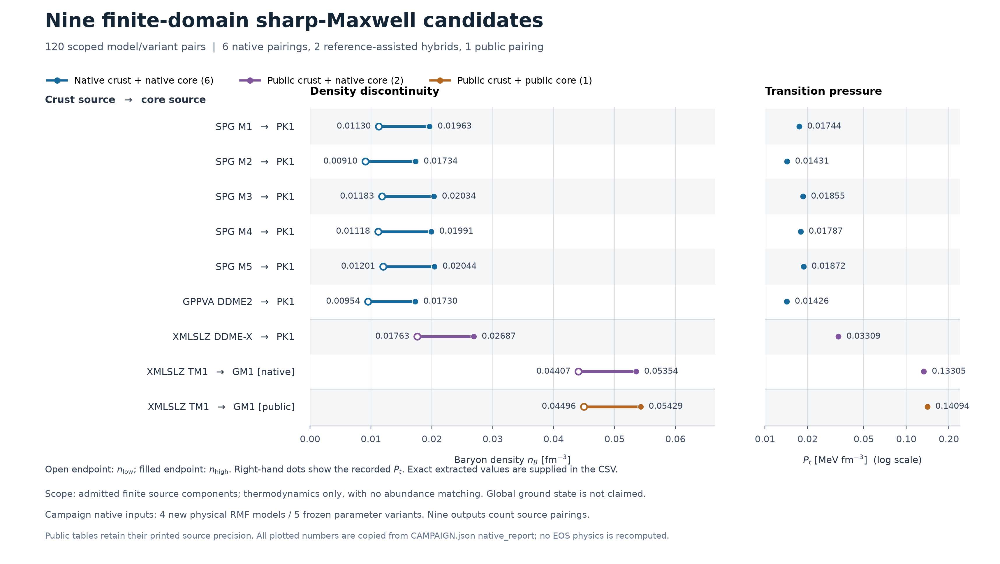

# NS_Cowling: D·E 게시 및 F 신규 모델 Maxwell 결과

작성일: 2026-11-17 (Asia/Seoul). F 기준 커밋: `00bb5e1adcdbb8dfa0a0b2d5d7dd6f9037a4ddc3`.

## 완료한 일

D와 E를 각각 요청한 branch에 push하고 원격 ref가 정확한 커밋과 같은지 확인했다. 이어 F에서는 CompOSE의 새 RMF 계열 NL3·PK1·TM1·DDME-X를 실제 균일 물질 계산으로 재생성하고, 새 공개 crust 5종을 포함한 120개 조합을 실행했다. 4,197회의 primary Maxwell component 계산에서 9개 finite-domain EOS 표가 독립 admission, 실제 저장·재읽기, serialized native consistency 및 압력 envelope 검사를 통과했다.

출처를 구별한 성공 표는 9개이고, 모델 이름만으로 묶으면 8쌍이다. TM1 crust–GM1 core는 공개 GM1과 native GM1의 두 출처를 별개 결과로 보존했다. F의 구현·계산·독립 검토를 완료했으며, 로컬 커밋을 검토한 뒤 게시를 승인하는 단계다. F의 새로운 전이는 아직 별 전체 EOS·TOV·Cowling 검증 결과를 갖지 않는다.

## 게시된 D와 E

| 단계 | branch | 커밋 | 상태 |
|---|---|---|---|
| D | research/stellar-consumers-20261117 | 300e5a0532dd137cb09738568fca0f35cfcc9282 | push 및 원격 SHA 확인 |
| E | research/stellar-extension-20261117 | 00bb5e1adcdbb8dfa0a0b2d5d7dd6f9037a4ddc3 | push 및 원격 SHA 확인 |

E tree는 `3af04e6c6de1e9fabf58540d281fb6a17ae721a2`이다. 게시 영수증은 이 저장소의 E/F data 폴더에 보존했다. PR 생성이나 main merge는 수행하지 않았다.

E는 기존 B의 선택된 hybrid crust + native SLy4 barotrope를 실제 native 계산으로 연장했다. 기존 저밀도 계약과 773개 원본 행은 보존했고, 에너지 이동이나 EOS 외삽은 하지 않았다. 64/128/256개 tail interval 및 더 엄격한 TOV 적분으로 최대질량 부근을 확인했다.

| E 관측량 | 계산 결과 |
|---|---:|
| 최대질량 중심밀도 bracket | [1.2060, 1.2061] fm⁻³ |
| bracket 내부 재현용 대표 중심밀도 | 1.2060328050005111 fm⁻³ |
| 대표 최대질량 | 2.0503812906965106 nominal M_sun |
| 대표 반지름 | 10.006409438136822 km |
| 대표 중심압력 | 855.9246351636019 MeV fm⁻³ |
| native equilibrium χ=1 밀도 | 1.2650056715193052 fm⁻³ |
| 최대질량 근방 Cowling f | 2899.4886731199385 Hz |
| 같은 background의 Cowling p1 | 7504.249127615556 Hz |

여기서 χ=dP/dε=c_s²/c²이며 ε에는 rest energy를 포함한다. Cowling 두 모드는 별도로 고정한 n_c=1.2060130400651856 fm⁻³의 tight background에서 계산했고, 그 background의 M=2.050381290491854 M_sun, R=10.006456596177095 km다. 이를 위 TOV 대표 입력과 같은 수치라고 바꾸어 표시하지 않는다. l=2, metric signature (−,+,+,+), equilibrium perfect-fluid Γ1=Γeq, 무한대 관측자 frequency의 결과다. 전체 22개 모드가 고정 residual gate를 통과했다.

E 회귀 검증은 1,404 passed / 9 skipped / 0 failed, actual exit 0이다. native의 fixed-Yp 진단에서도 lepton은 재평형하므로 이를 완전한 frozen-species sound speed로 해석하지 않는다. radial stability spectrum이나 full GR mode spectrum은 계산하지 않았다. 자세한 내용은 [E 결과](../stellar_extension_20261117/RESULTS_KO.md), [E 최대질량 refinement](../../data/stellar_extension_20261117/tov/MAXIMUM_REFINEMENT.json)를 따른다.

## F의 입력과 실제 재생성

CompOSE에서 XMLSLZ_NL3, XMLSLZ_PK1, XMLSLZ_TM1, XMLSLZ_DDME-X, XMLSLZ_PKDD의 원문 table·datasheet·provenance를 확보했다. 그중 앞의 네 물리 모델은 기존 native TF/RMF field·coupling kernel을 사용한 parameter-injected 균일 물질 driver로 재생성했다. PKDD는 새 공개 crust 후보로 사용했고 이번 범위에서 native core로 생성하지 않았다.

| 재생성 입력 | 의미 |
|---|---|
| NL3_PROVIDER_PRECISION | provider 표의 명시 정밀도를 사용한 NL3 |
| PK1_CANONICAL | Long et al. 원전의 PK1 vector |
| TM1_CANONICAL | 원전으로 구별한 canonical TM1 vector |
| DDMEX_ORIGINAL_TABLE_RHO0 | coupling reference density 0.151832 fm⁻³ |
| DDMEX_PROVIDER_ROUNDED_N0 | coupling reference density 0.152 fm⁻³의 고정 대조군 |

DDME-X의 두 입력은 하나의 물리 모델에 대한 사전 고정 변형이다. 총 네 모델·다섯 입력을 각각 n=0.015–1 fm⁻³의 385점과 769점에서 계산하여 CompOSE 표 10개를 생성했다. 공개 uniform table이 시작하는 밀도 아래의 상태도 동일 field equations를 실제로 풀어 얻었으며 provider table의 외삽은 하지 않았다.

원전의 scalar/rho convention을 명시적으로 변환했다. φ=−σ, M*=M−gσφ, scalar cubic 계수 a3=−g2 ħc, quartic 계수 a4=g3를 사용한다. ρ vertex의 τ convention은 code의 τ3/2에 맞추어 gρ=2Γρ로 변환했다. DD coupling의 density derivative와 rearrangement Σ_R를 chemical potential 및 P의 nΣ_R 항에 포함한다. 질량 입력은 m_i c²를 MeV로, 길이는 fm로, ħc=197.3269804 MeV fm로 사용한다. 수식·개별 parameter·생성법은 [RMF 생성 보고서](RMF_GENERATION_KO.md)에 기록했다.

생산점 전체에서 β·charge·Euler 및 field residual을 확인했고, source-independent DD2 control과 density finite difference도 실행했다. Scalar root는 유한 256-bin scan에서 검출된 positive-curvature root 가운데 선택한다. 이를 모든 가능한 근의 완전한 탐색 또는 global minimum의 증명이라고 부르지 않는다.

### 문헌 표기 충돌과 수치 identity

PK1/TM1의 후속 논문 parameter table label에는 충돌이 있다. 원전 vector를 구별한 뒤 current CompOSE raw table과 n=.1,.2,.4,.8 fm⁻³의 실제 공통 uniform 행에서 비교했다. 현재 raw PK1은 canonical PK1, raw TM1은 canonical TM1에 맞았고, 서로 교환하면 pressure 차이가 약 13–15%였다. 각자의 최대 scaled P·ε·μ 잔차는 약 10⁻⁶–5×10⁻⁶였다. Table header의 질량 normalization과 미시적 physical mass를 구별했으며 물리 에너지를 옮기지 않았다.

DDME-X에서 n0=.151832 입력의 최대 scaled P 잔차는 3.9561×10⁻⁶, .152 입력은 1.6575×10⁻³였다. 둘은 비교 전에 고정된 입력이며 fitting 결과가 아니다. 현재 provider thermodynamics와의 표본점 일치는 .151832 입력이 더 좋다.

다만 원전 supplemental 핵물질 물성의 완전한 재현은 unresolved다. .151832 입력의 직접 계산은 J=32.2430, L=49.6520 MeV이고 원표는 각각 32.865829, 47.806151 MeV이다. 원인이 입증되지 않았으므로 질량 convention 등으로 단정하지 않는다. Provider 표본점 일치와 원전 NMP identity는 별개의 근거 상태다. [SOURCE_IDENTITY_ASSESSMENT.json](../../data/new_model_maxwell_20261117/uniform_validation/SOURCE_IDENTITY_ASSESSMENT.json)에 이를 구분했다.

## F sharp Maxwell 캠페인

기존 native crust 13종과 새 native core 5개 입력을 조합한 65개 셀, 새 공개 crust 5종×기존 공개 GM1의 5개 셀, 새 공개 crust 5종×새 공개 core 4종의 20개 셀, 새 공개 crust×native core의 명시적 hybrid 30개 셀을 실행했다. 기존 195개 캠페인은 다시 실행하지 않았다.

Partner와 무관하게 native admissibility 진단을 먼저 수행하고, geometry 또는 invalid interval을 건너지 않는 maximal connected component를 고정했다. 공개 표 Nadd=5/7과 Q1–Q7 원문을 sidecar에 보존했다. Native transport는 명시적인 thermo-only projection이며, native readback의 Q1–Q7 parsed double이 원문 값과 bitwise equal임을 확인했다. 원문 Q3와 μ_E 차이를 덮어쓰거나 Q5를 임의로 0으로 만들지 않았다.

| 범주 | 요청 셀 | 성공 표 | 실제 primary kernel 호출 |
|---|---:|---:|---:|
| 기존 native crust × 새 native core | 65 | 6 | 305 |
| 새 공개 crust × 기존 공개 GM1 | 5 | 1 | 28 |
| 새 공개 crust × 새 공개 core | 20 | 0 | 3696 |
| 공개 crust + native core hybrid | 30 | 2 | 168 |
| 합계 | 120 | 9 | 4197 |

### 성공 표 9개

n은 fm⁻³, P와 Δε는 MeV fm⁻³ 단위다. 아래 자리수는 가독성을 위한 표시이며 정확한 값과 source component/파일 SHA는 [SUCCESS_INDEX.json](../../data/new_model_maxwell_20261117/campaign/SUCCESS_INDEX.json)에 있다.

| crust | core 출처 | P_t | n_low | n_high | Δε |
|---|---|---:|---:|---:|---:|
| SPG_M1 | PK1 native | 0.017444212 | 0.011298547 | 0.019632547 | 7.8614014 |
| SPG_M2 | PK1 native | 0.014307398 | 0.009104211 | 0.017338746 | 7.7661812 |
| SPG_M3 | PK1 native | 0.018550740 | 0.011833637 | 0.020336099 | 8.0207812 |
| SPG_M4 | PK1 native | 0.017870691 | 0.011175815 | 0.019909297 | 8.2384184 |
| SPG_M5 | PK1 native | 0.018724184 | 0.012008325 | 0.020442245 | 7.9561936 |
| GPPVA_DDME2 | PK1 native | 0.014256542 | 0.009540222 | 0.017297196 | 7.3157595 |
| XMLSLZ_TM1 | GM1 public | 0.140940527 | 0.044962774 | 0.054291826 | 8.8199951 |
| XMLSLZ_TM1 | GM1 native | 0.133045884 | 0.044073464 | 0.053544221 | 8.9522884 |
| XMLSLZ_DDME-X | PK1 native | 0.033085014 | 0.017626325 | 0.026870363 | 8.7259972 |

Cold local-neutrality Maxwell 계약에서 μ_E=(ε+P)/n를 사용하여 두 상의 P와 μ를 같게 하고 n_high>n_low, Δε=μ_t Δn을 검사했다. 상이한 mass header는 physical ε·μ를 보존하는 Q 재인코딩으로 처리했다. 물리 에너지 이동은 모두 0이다.

각 성공의 두 연결 성분 전체 공통 μ 구간에서 ΔP=P_core−P_crust는 전이 아래 음수, 위 양수이고 고립된 root가 하나다. Native union-cell cubic 분석과 독립 SciPy polynomial 계산이 일치했다. 두 방식의 root 차이 최댓값은 3.21734×10⁻¹¹ MeV다. 이 검사는 서로 다른 geometry나 제외된 구간을 포함하는 전역 phase competition의 증명이 아니다.

새 native core를 포함한 성공 7개는 모두 PK1 core였다. 같은 crust component를 유지하고 core 385/769점 계산을 비교했을 때 7개 모두 성공했다. 최대 상대 변화는 P_t 3.47299×10⁻⁹, n_high 2.12687×10⁻⁷, Δε 4.48483×10⁻⁷이다. 이는 core grid 변화에 대한 민감도이고 crust mesh 수렴이나 엄밀한 error bound가 아니다.

### 실패를 분리한 결과

4,188개 거절은 공통 μ support 부재 3,852개, 교차 없음 328개, density jump 방향 불일치 2개, 여러 번 교차 2개, 보존 가능한 source knot 부족 3개, 최종 C2 열역학 검증 실패 1개로 분류했다. Native가 UNKNOWN으로 보고한 4건의 원문 오류는 보존하고 별도 진단 파일에 실제 원인을 적었다.

NL3wrL55×PK1, TM1e×PK1, 공개 NL3×native GM1은 source knot가 부족했다. 공개 DDME-X×native GM1은 원본 component의 C2 상대 잔차 4.4023902×10⁻⁶가 strict 2×10⁻⁶ gate를 넘었다. 이 네 건을 성공으로 세지 않았고 숫자 보정이나 tolerance 완화는 하지 않았다.

공개 새 core의 허용 component 수는 NL3 44, PK1 41, TM1 6, DDME-X 41이었다. 공개 표의 finite precision과 선택한 thermodynamic Hermite 표현의 shape·causality 검사 때문에 지원 구간이 많이 분리됐다. 모델 전체에 대한 비인과성이나 sharp matching 불가능의 결론으로 확대하지 않는다. 자세한 수치·오류·지원 범위는 [Maxwell 보고서](MAXWELL_RESULTS_KO.md)에 있다.

## 검증과 traceability

| 검증 | 실제 결과와 범위 |
|---|---|
| 신규 RMF targeted tests | 6 passed, actual exit 0 |
| 신규 source parser/origin tests | 5 passed, actual exit 0 |
| 전체 frontend/pipeline | 1415 passed, 9 skipped, 4 subtests passed; actual exit 0 |
| 전체 회귀 중 source identity | 408개 code/test file hash, 실행 전후 동일 |
| 독립 uniform subset | 다섯 입력×다섯 상태; 별도 192-node momentum quadrature·4096-bin root scan |
| 독립 uniform 에너지·압력 비교 | max scaled ε 8.06×10⁻¹⁵, P 1.06×10⁻¹³ |
| 독립 matching raw readback | 9 primary + 7 coarse 출력의 실제 bytes·물리량·잠열 재검산 |
| 독립 interface identity | 최대 상대 잔차 8.93×10⁻¹⁶ |
| 독립 polynomial envelope | 9/9 통과 |
| 과학적 scope | finite connected components, conditional hybrid EOS candidates |

신규 11개 테스트는 전체 1415개에 포함되므로 더해서 세지 않는다. 9개 skip은 기존 raw BBB/APR/tensor/axes/m7/SPG fixture 부재이며 F 수치 검사의 실패를 skip 처리한 것이 아니다.

두 개의 생산/현재 source identity 차이를 명시적으로 보존했다. Uniform driver는 생산 후 root-scan 범위를 명확히 한 주석만 바뀌었고, 생산 당시 정확한 source와 비주석 line 일치 증거가 있다. Maxwell runner는 전체 suite 이후 convergence 보고 집계에서 거의 0인 residual의 무의미한 상대오차 표기를 절대 차이로 수정했다. prepare/execute/run_candidate 등 생산 함수 AST는 동일하며, 바뀐 집계 AST를 기존 7개 수치에 실행해 저장 결과와 일치함을 확인했다. 수치 생산을 다시 했다고 주장하지 않는다. 새 plotting script는 실제 exit 0과 렌더링 확인을 별도로 기록했다.

독립 검토의 최종 판정과 finding 상태는 [INDEPENDENT_REVIEW_KO.md](INDEPENDENT_REVIEW_KO.md) 및 [INDEPENDENT_REVIEW.json](../../data/new_model_maxwell_20261117/INDEPENDENT_REVIEW.json)을 따른다. 본 단계에서 반복적인 추가 감사 대신 관찰된 보고 문제를 한 번 수정하고 계산 산출물을 닫았다.

## 남은 한계와 다음 단계

검증된 아홉 출력은 모두 유한 밀도 영역이다. SPG 기반 표는 약 2.3–2.5×10⁻⁴ fm⁻³부터, native DDME2+PK1은 .0040000002 fm⁻³부터, 공개 TM1+GM1은 .000379971 fm⁻³부터, 공개 DDME-X+PK1은 .01 fm⁻³부터 시작한다. 각 표의 상단은 1 fm⁻³다. 이 경계를 넘어선 저밀도 연결이나 고밀도 completion은 아직 새로 구성하지 않았다.

SPG native는 기존 public-composition-inferred surface candidate의 한계를 상속한다. Native TF 결과의 finite mesh stationarity와 미시적 global minimum을 구분한다. 새 matching 출력은 thermo-only이며 원문 composition은 source로 보존했지만 abundance 보존을 출력의 검증으로 주장하지 않는다.

다음 G에서는 다음의 좁은 순서를 권한다.

1. 성공한 native DDME2–PK1 및 공개 TM1–GM1을 우선 대상으로 crust 재생성·mesh 민감도를 확인한다. 특히 다른 functional을 이은 hybrid라는 조건과 정확한 energy reference를 유지한다.
2. 교차가 있었으나 source knot가 부족했던 세 후보는 같은 물리 branch의 실제 추가 계산으로만 support를 보충한다. 공개 DDME-X–native GM1의 C2 실패는 원문 더 높은 정밀도 확보 또는 같은 모델 재생성으로 처리한다.
3. 이 과정을 통과한 표에 검증된 저밀도 경계와 sharp interface contract를 붙여 TOV/Cowling 소비자까지 연결한다. 해당 단계 전에는 현재 F 표로 별 관측량을 제시하지 않는다.

이는 F 완료 후의 제안이며 G 계산을 이미 실행했다는 뜻이 아니다. F push는 로컬 커밋의 branch·SHA·산출물을 확인한 후 사용자의 단계별 승인에 따라 수행한다.

## 기준 자료

- [CompOSE XMLSLZ(NL3)](https://compose.obspm.fr/eos/284), [PK1](https://compose.obspm.fr/eos/285), [TM1](https://compose.obspm.fr/eos/287), [DDME-X](https://compose.obspm.fr/eos/281), [PKDD](https://compose.obspm.fr/eos/286).
- [Long et al., nucl-th/0311031](https://arxiv.org/abs/nucl-th/0311031): canonical PK1 및 비교 parameter vector.
- [NL3 원전, nucl-th/9607039](https://arxiv.org/abs/nucl-th/9607039).
- [DDME-X 원전, arXiv:1910.13007](https://arxiv.org/abs/1910.13007) 및 source archive의 supplementary material.
- [Xia et al., arXiv:2208.12893](https://arxiv.org/abs/2208.12893), [Niu et al., arXiv:2506.11492v2](https://arxiv.org/abs/2506.11492v2): provider 관련 TF 모델과 후속 자료.
- [Douchin–Haensel, astro-ph/0111092](https://arxiv.org/abs/astro-ph/0111092): E의 SLy4 비교 문헌. 현재 hybrid와 동일한 EOS로 취급하지 않는다.

원문 문헌의 PDF·전문 추출본은 원격 근거 보관 경로에 남기고, 게시 묶음에는 URL·SHA·인용 및 고정 parameter 입력을 보존한다. CompOSE 원본 수치 표, 생성 코드·고정 입력·출력·오류·실행 영수증은 F 산출물에 포함한다. 문헌 전문의 외부 의존은 [EXTERNAL_EVIDENCE.json](../../data/new_model_maxwell_20261117/EXTERNAL_EVIDENCE.json)에 기록한다.
