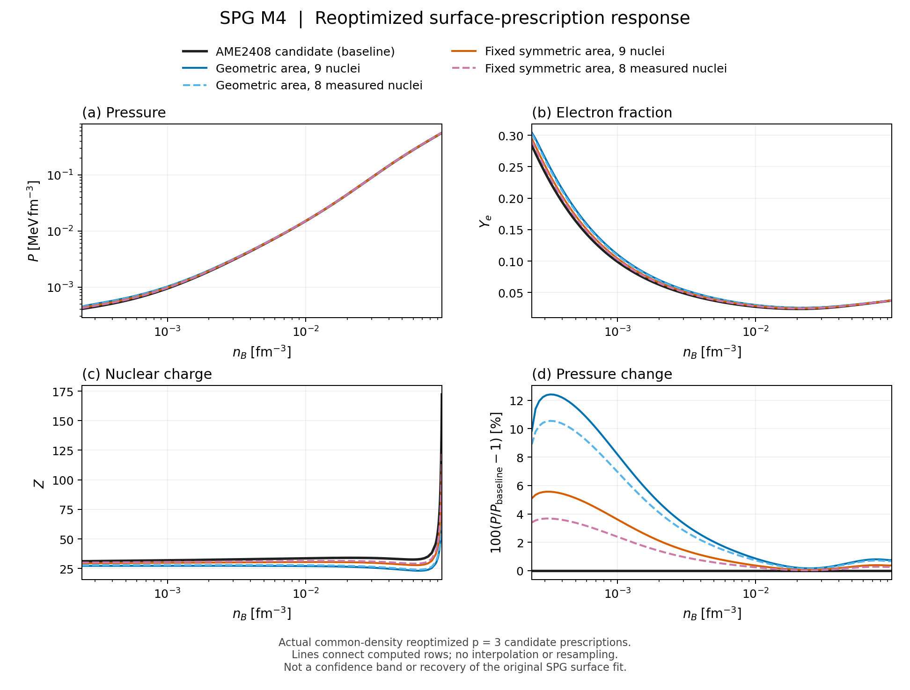

# 독립 EOS 생성 후속 연구, 2026-11-16

기준 커밋: `573a31485bc9af30915e01fe74f259e4fa5ac54f`. 별도 detached worktree에서 작업했으며, 원본 dirty checkout은 변경하지 않았다. 기준 HEAD의 PR CI #620은 성공했다. 최종 출판 SHA와 이후 CI는 PR #15에서 확인한다.

이번 루프의 목표는 원래의 core 5종과 crust 13종을 조성을 포함해 독립적으로 재생성하는 것이다. **전체 원전 모델과 완전한 crust 재생성 목표는 PARTIALLY_COMPLETE**다. 실행 가능한 18개 명시적 생성 경로, 수치적으로 검증된 후보 해, 원저자 보정의 동등성, 모든 밀도에서의 완전한 crust를 같은 상태로 세지 않는다.

CompOSE와의 차이는 비교 진단이다. 구현된 함수·계수·보존량·변분 조건·열역학 항등식·원전 유효구간을 각각 심사한다. 원래 모델의 acausality는 밀도별 사용 범위를 제한하며 모델 전체의 구현 실패로 바꾸지 않는다. 수치 실패는 원 입력과 모든 시도를 보존하고 해당 밀도/geometry의 미해결 상태로 남긴다. 새로운 core–crust 결합이나 stellar/mode 계산은 하지 않았다.

## 이번에 추가한 실제 계산

**SPG 표면 재최적화.** M1–M5 각각의 기준 AME2408 후보와 네 기존 대안에서 129점과 257점 continuation을 별도로 실행했다. 257점 기준 6,425개 selected cell 모두 정지 후보이고, 조성 포함 native write/readback을 통과했다. 공통 support의 같은 129개 밀도에서도 25처방을 각각 다시 풀었다. 기준 대비 최대 차이는 P 12.4140%, ε 0.034034%, Ye 11.7390%, A 61.2821%, Z 57.9644%다. ε에는 정지에너지가 포함된다. 이 수치는 고정 p=3 후보 처방들의 차이이며 통계적 신뢰대역이 아니다.

SPG 후보의 상단은 같은 bulk functional에서 국소 중성인 두 분지의 P/μ를 맞춘 common-tangent의 clustered endpoint다. [원문 §II.2](https://arxiv.org/html/2402.15548v1#S2.SS2.p1.5)가 설명하는 같은 밀도의 energy-density 교차는 receipt의 `fixed_density_energy_crossing`에 별도 진단으로 보존했다. 두 전이 처방의 원전 동등성을 주장하지 않는다.

129/257 독립 continuation의 공통 밀도 압력 차이는 최대 3.67e−12 상대값, 129→257 보간 진단은 최대 0.1340%다. 125개 실제 재최적화 first-law stencil의 μ 상대 잔차는 최대 3.12e−11이다. 26,143개 optimizer 시도에 포함된 2,400개 비정지 대안과 107개 초기 실패를 남겼다. 원 SPG fit 동등성이나 구형 외 geometry의 전역 최소는 주장하지 않는다. [세부 보고서](SPG_REOPTIMIZATION.md).

**Screened electron 수리.** DD2 0.0625fm⁻³ rod의 두 실제 실패는 거의 사라진 양성자 밀도에서 기존 Neumann Newton의 susceptibility가 0으로 내려가는 문제였다. 각 potential에서 scalar neutrality를 먼저 만족시키고 gauge를 고정한 비특이 block을 푼다. 이어서 포착한 TW/DDME2 slab 여섯 실패는 dense matrix 곱의 상쇄 오차였다. 같은 유한체적 연산자를 face flux 차이로 평가하고 내부 potential update 정밀도를 보강했다. 기존 물리 잔차·KKT 기준은 유지했다.

실제 8개 전체 셀을 다시 최소화해 모두 정지 후보를 얻었다. 최종 코드의 독립 70자리 검산에서 dense slab Poisson 잔차는 최대 2.733e−13, 상대 전하 오차는 6.205e−16이다. 최종 public 결과는 float64이고 내부 extended precision의 효과는 실행한 Linux 환경에 한정해 검증했다. [유도·실패·수리](ELECTRON_REPAIR.md).

**GPPVA 여덟 모델의 geometry 정련.** 기존 27개 window의 76개 고유 밀도를 N192/N384에서 조사한 152개 mesh-density node를 모두 마쳤다. 여섯 seed family와 각 초기값을 조사했고 최종 선택이 유보된 node는 없다. 최종 보존된 주 캠페인은 1,763개 시도이며, 선택 성공은 모든 초기값이 성공했다는 뜻이 아니다. 전자장 수리 뒤 완료한 dense-vector 112개 node는 원래 source identity를 보존하고 1,241개 unique profile을 최종 연산자로 재평가해 재사용했으며, 나머지 40개는 동등한 band solver로 계산했다. [연산자 유도·검산·전환](VECTOR_BAND_PROTOTYPE.md).

NL3wrL55는 .085fm⁻³에서 N384도 tube 후보가 uniform보다 2.40754e−5MeV/핵자 낮았다. 이에 .0875와 .090fm⁻³를 두 mesh에서 실제로 추가 계산했고 둘 다 uniform을 선택했다. 추가 4개와 합쳐 **156개 고유 mesh-density node**다. 최종 native 테이블 18개의 158행에는 .085의 두 anchor 행이 반복되어 있으므로 158개의 독립 계산으로 세지 않는다. 관측한 tube→uniform 표본 bracket은 [.085,.0875]fm⁻³이며, clustered branch 소실이나 작은 에너지 차이만으로 연속 전이점의 root를 주장하지 않는다.

새 표본에서 DDME2의 기존 rod→uniform window 안에 slab 후보도 확인했다. 원래 요청한 두 phase 이름과 실제로 선택된 profile 변화를 별도 기록한다. DD2 droplet–rod [.060,.0625], rod–slab [.0675,.070]와 DDME2 rod–slab [.070,.0725]의 유한 표본 부호 변화도 보존했다. 측정한 mesh 변화와 roundoff 규모보다 큰 ΔE는 유용한 진단이지만, KKT/radius 잔차는 에너지 오차의 상한이 아니다. 특히 NL3 .085의 KKT는 .001728MeV로, 이를 ΔE의 인증 오차처럼 쓰지 않는다. 완전한 geometry 또는 전역 최소, continuum transition을 증명한 것은 아니다. [모든 시도·정련·추가 상단과 재현](GEOMETRY.md).

**내부 crust 접점과 부분 테이블.** unchanged DD2/TW/FSU2R/FSU2H 네 TF branch와 outer에 기준을 고정한 analytic BSk22 lower crust 사이에서 실제 N384의 P/μ 접점을 구했다. 네 부분 crust는 nB=.03fm⁻³까지 685/688/690/690행이다. SPG에는 중성자/양성자 정지에너지를 beta 최소화 전에 넣는 별도 후보를 구현했으며 다섯 경우 각각 .01fm⁻³까지 741행을 생성했다. 총 9개 부분 crust, 6,458행을 native readback했고 TF profile companion도 읽었다.

아홉 새 접점에서 양의 density jump, P/μ 일치, 실제 양쪽 행의 Gibbs 순서 및 양의 압축률을 확인했다. 이는 선택한 두 branch 사이의 국소 정합이며 전역 convex envelope나 mesh 수렴된 물리적 전이가 아니다. 공통 outer–BSk 접점은 기존 결과를 재사용했다. SPG rest-energy 변경은 새 functional이며 원 SPG를 완성했다고 세지 않는다. 기존 13개 unchanged branch 중 나머지 9개는 확장된 유한 표본에서도 같은 방식의 교차를 찾지 못했지만, 이를 전역 no-go로 선언하지 않았다.

BSk22는 전체 ETFSI solver가 아니라 published analytic representation이다. 별도 확장 API는 .01fm⁻³까지이고 기존 .002 guard는 유지한다. analytic 조성의 chemical potential과 thermodynamic μ 사이 약 −.0215…+.0255MeV 잔차도 남아 있다. [식·각 모델·검증](crust_assembly/REPORT_KO.md). 접점의 상대 μ 오차에 대한 압력 감도도 기존 아홉 endpoint에서 유도·계산했다. 작은 density jump에서는 작은 μ 차이도 접점 압력에 크게 증폭될 수 있다. 이 계산은 실제 오차 대역이나 교정값이 아니다. [원전 구분과 조건수 유도](SOURCE_COMPLETION_ADDENDUM_KO.md).

## 원전 조사로 확인한 것과 남은 것

[Scurto2024](https://arxiv.org/html/2402.15548v1) Eqs.21–25와31, 공개 SPG bulk arrays, [CUTER v1](https://zenodo.org/records/10781539) 및 [v2.3.2](https://zenodo.org/records/15166920), Pearson/BSk analytic 식과 현행 Ioffe 안내를 조사했다.

CUTER의 2,408핵종이 현재 후보의 (A,Z) 목록과 정확히 같고 B/A 차이는 최대 3.55e−15MeV다. 그러나 CUTER는 curvature 포함 네 매개변수와 일정 0.04MeV/핵자 잔차를 쓰므로 SPG의 두 계수·2% mass prescription과 같다고 할 수 없다. 공개 SPG 배열의 전체 열에도 M1–M5 surface 계수는 없었다. 이 한정된 검색 결과는 원전 동등성의 미해결 항목이며 후보 계산 자체의 금지 사유가 아니다.

고정 조성에서 P=n²∂e/∂n이므로 bulk saturation은 ∂e/∂n=0이다. ∂ε/∂n=0과 다르고, 유한핵 전체 에너지 최소화는 surface/Coulomb/curvature의 밀도 미분도 포함한다. CUTER의 밀도식은 bulk 에너지/입자 정지 조건의 이차 근사와 일치한다. 네 bulk 예제와 아홉 유한핵 미분을 계산했다. 또 SPG M1 제공자 PDF의 BSk22 링크가 현재 DD2 페이지를 가리키는 출처 identity 결함을 기록했다. 이 링크 오류를 EOS 수치 오류의 증거로 쓰지 않았다. [전체 출처 계약과 획득 hash](CALIBRATION_SOURCE_CONTRACT_KO.md).

## 생성 API와 적대적 검토에서 고친 결함

공개 `compose-eos generators`와 `compose-eos generate MODEL OUTPUT`를 추가했다. fresh output을 요구하며 자식 실행 종료코드뿐 아니라 요청 밀도 행, model/variant identity, native 파일과 readback receipt를 확인한다. core, candidate inner crust, finite TF cells의 범위를 catalog에 명시한다. 실제 CLI에서 GM1 3행, SPG M1 17행, APR 요청 3점과 두 phase endpoint를 포함한 5행을 생성했다. 이어서 FSU2H의 .095/.0975/.1fm⁻³를 N16/N24에서 실제로 풀어 최종 3행과 full profile을 출력했다. 여섯 mesh-density node의 39개 시도, 세 초기 실패와 실제 재시도를 보존했고 native/profile hash와 readback을 독립 검증했다. 이 coarse CLI 실행은 N192/N384 수렴의 증거가 아니다. [명령과 출력 계약](PUBLIC_GENERATION_CLI.md).

일반 TF 생성기의 실패 geometry 누락과 미해결 밀도 사이의 table bridging을 각각 실제 RED 테스트로 재현했다. 모든 물리적 seed family에 적어도 하나의 지원되는 정지 후보가 있어야 하며, 더 낮은 feasible/unknown 비정지 상태가 있으면 선택을 유보한다. 제약을 어긴 trial의 낮은 에너지는 물리 경쟁자로 취급하지 않는다. 단일 restart 실패는 같은 family의 성공한 재시도로 해소할 수 있다. 선택기는 KKT/radius 판단을 solver의 numerical_status 계약에 의존하고, 밀도·전하·field 잔차는 별도로 확인한다. 전역 최소의 증명은 아니다.

출력은 HOLD density에서 분리한다. phase-change bracket을 가로지르는 보간은 승인하지 않는다. shell-like 또는 여러 radial 구조를 가진 해도 모든 에너지 비교에 남기되 단순 droplet/tube/bubble이라고 부르지 않는다. near-uniform 종별 변조는 물리적 새 phase의 증거로 승격하지 않으며, free nucleon/discrete cluster 분해가 확정되지 않은 native mask를 유지한다. 공간 TF의 실제 total n/p/e 조성은 companion profiles에 보존한다.

SPG 보조 후보의 mutable configuration/cache와 반환 dict 오염을 재현해 immutable 설정·private cache·deep copy로 고쳤다. t=1 marginal boundary에서는 tangent Hessian만으로 놓친 saddle 반례를 보존하고 inward critical direction도 검사한다. 최종 코드로 기존 325개 inner row를 다시 풀어 모든 비교 물리값의 bit identity를 확인했다. 별도 독립 검토는 원 SPG ensemble의 25개 drip 경계에서도 inward curvature가 양수임을 확인했다.

## 유지되는 core 결과와 전체 목표

core 다섯 경로의 기존 807행, native output hash와 모든 과학 코드 의존성이 현 코드와 일치함을 확인해 재사용했다. 이번에 다섯 full core campaign을 다시 실행했다고 주장하지 않는다. APR은 published functional과 명시적 bulk Gibbs, GM1/Skyrme는 published parameter functional이다. BBB는 published SNM/PNM energy reconstruction이며 원 BHF kernel을 다시 푼 것이 아니다.

기존 수치적 첫 causal crossing은 APR 약 .868953, KDE0v1 약1.410966, SLy4 약1.265006fm⁻³이고, 각각의 density support와 별도로 기록한다. BBB의 .8fm⁻³ 이후에는 원문 extrapolation의 범위도 구분한다. [원전·support·기존 비교](../research_completion_20261116/CORE_GENERATION.md), [identity 재사용 증거](../../data/research_finish_20261116/integration/EVIDENCE_REUSE.json).

남은 핵심은 original SPG calibration/low-Yp 근거, 13개 original crust의 공통 lower-piece 정합과 상단까지의 완결, 원전 BSk22 ETFSI 또는 명시한 analytic approximation의 조성 정합, TF phase ordering의 추가 density/mesh 수렴이다. production Fortran port는 이 과학 재생성 범위와 별도 engineering 작업이다. full original-model completion, spectrum completeness, global minimum은 인정하지 않는다.

## 최종 통합 기록

최종 production 코드에서 frontend/pipeline **971 passed, 9 skipped**, generator **142 passed**를 확인했다. generator에는 기존 Matplotlib Axes3D import warning 하나가 있다. 테스트 전후와 최종 계산 후에도 검사 대상 코드 SHA가 같았다. native Fortran build log, 바이너리 SHA, 실행 환경 및 전체 명령·로그는 `integration/{REGRESSION.json,ENVIRONMENT.json,native_build.log}`에 보존했다. 기존 core 807행의 source/output identity와 generator checksum 439개도 확인했다. 독립 검토의 정확한 범위와 최종 판단은 아래 review와 execution receipt를 따른다. 원본 dirty checkout 및 이전 회차 evidence는 유지했다.

원자료·실패·source snapshot은 `data/research_finish_20261116/`에 있다. [10단계 이론/코딩 작업 기록](../../data/research_finish_20261116/RESEARCH_LOOP.json), [모델별 범위](../../data/research_finish_20261116/MODEL_COVERAGE.json), [독립 검토](INDEPENDENT_REVIEW.md), [다음 작업](HANDOFF_KO.md)을 함께 읽는다.

최종 재개 검증에서도 frontend/pipeline 971 passed, 9 skipped 및 generator 142 passed를 확인했다 (`integration/resume_verification/`). 두 geometry export 검증 결과는 보존된 최종 검증 결과와 byte-identical이다. 최종 독립 검토는 PASS_SCOPED이며 156개 고유 node와 모든 1,807개 시도를 포함한다. 누락됐던 geometry 및 execution 종합 receipt를 작성하고 원자료를 유지했다.
