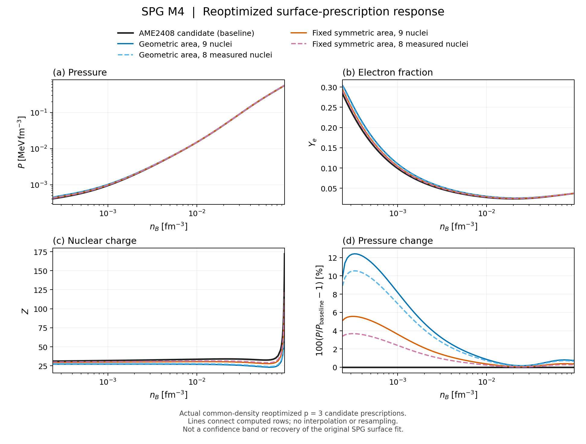

# SPG surface prescriptions: actual reoptimized inner-crust EOS

Base: `573a31485bc9af30915e01fe74f259e4fa5ac54f`. Scope: `PASS_SCOPED_REOPTIMIZED_P3_CANDIDATE_ENSEMBLE`; original SPG surface calibration remains unresolved.

이번 계산은 기존 고정 셀에서 표면 항만 바꾼 민감도와 다르다. M1–M5 각각에서 baseline AME2408 및 기존 네 대안의 표면 계수를 명시적으로 넣고, 조밀상 밀도·양성자 분율·체적 분율·기체 양성자 분율과 구형 반지름을 다시 정지화했다. 25개 경우마다 neutron-drip 경계와 같은 bulk functional의 균일상 common tangent를 다시 계산했다. 각 경우의 129점·257점 독립 continuation 및 공통 밀도 129점 계산을 별도로 실행했다.

## Functional and conventions

`SurfaceParameters`는 모델명, sigma0, b, 고정 p=3, prescription label 및 입력 파일 SHA를 갖는 frozen dataclass다. default는 입력의 exact bytes로 cache하므로 파일이 바뀌거나 모델·처방이 달라졌을 때 이전 계수가 남지 않는다. 모든 energy·gradient·minimizer·drip·endpoint 호출에 이 값을 명시적으로 전달한다.

구형 CLD의 baryon/charge 제약은 nB=u ni+(1−u)ng 및 ne=u ni yi+(1−u)ng yg이다. 에너지는 두 baryon phase의 부피 평균, 균일 전자 에너지, 3u sigma/R 및 2π e²u Phi(u) R²(ni yi−ng yg)²의 합이다. 반지름 정지 조건은 R³=3 sigma/[4π e² Phi(u)(ni yi−ng yg)²]이며 beta·기체 조성과 함께 재평형한다. 조성은 free neutron/proton, electron, cluster baryon fraction, A=4πniR³/3, Z=yiA까지 저장하고 native CompOSE round-trip을 검증했다.

공통 baryon 정지질량 938.9 MeV, sharp interface, uniform electrons, spherical geometry, curvature/shell/pairing 항 없음이라는 기존 후보 functional을 유지한다. 이것은 별도 연구에서 species별 정지질량을 복원한 처방과 구분된다. neutron-drip 값도 이 convention의 값이다. 저밀도 outer-crust 완성이나 다른 core와의 결합을 이 표본에 포함하지 않는다.

기준 AME2408과 네 대안은 기존 입력을 재사용했다. 대안은 geometric area/fixed symmetric area와 9개 핵종/추정 48Ni를 뺀 8개 핵종의 조합이며 기존 2% mass weighting과 p=3을 유지한다. 관련 저자 CUTER 코드에서 2408 cohort가 독립적으로 확인되었다는 사실은 원 SPG 계수·fit protocol의 동등성을 확정하지 않는다. 이 다섯 처방의 범위는 통계적 신뢰구간이나 원전 calibration 불확실도 대역이 아니다.

## Actual response at common density

각 모델에서 공통 support는 다섯 처방의 drip 밀도 중 최대부터 clustered endpoint 중 최소까지다. 아래 수치는 이 구간의 동일한 129개 밀도에서 각각 다시 푼 값의 baseline 대비 최대 상대 차이이며, interpolation으로 만든 차이가 아니다. epsilon에는 rest energy가 포함되므로 작은 상대 차이를 interaction energy의 작은 차이로 해석하면 안 된다.

| Model | max ΔP/P | max Δepsilon/epsilon | max ΔYe/Ye | max ΔA/A | max ΔZ/Z |
|---|---:|---:|---:|---:|---:|
| SPG_M1 | 9.81094% | 0.02712% | 8.84997% | 56.41312% | 47.29128% |
| SPG_M2 | 11.72713% | 0.03264% | 11.25528% | 60.25120% | 56.79328% |
| SPG_M3 | 10.16361% | 0.02804% | 9.21656% | 57.54040% | 49.06661% |
| SPG_M4 | 12.41399% | 0.03403% | 11.73896% | 61.28215% | 57.96440% |
| SPG_M5 | 10.76578% | 0.02960% | 10.08766% | 59.86328% | 52.96659% |

표면 계수 선택은 열역학 압력보다 핵 조성·크기에 더 큰 영향을 줄 수 있다. 이 결과는 조성까지 재평형했을 때의 유한 처방 비교이며, 구형 CLD의 전역 최소 또는 pasta geometry 비교를 뜻하지 않는다.

| Model | drip range (fm⁻³) | clustered endpoint range (fm⁻³) |
|---|---:|---:|
| SPG_M1 | [0.0001940206412, 0.0002209213229] | [0.07448996086, 0.07645359952] |
| SPG_M2 | [0.0002050014888, 0.0002438128317] | [0.08741374154, 0.08922163297] |
| SPG_M3 | [0.0001938621063, 0.0002218005162] | [0.07892887684, 0.08102513485] |
| SPG_M4 | [0.0002021086001, 0.0002407964388] | [0.09680891996, 0.09868990228] |
| SPG_M5 | [0.0002029589416, 0.0002363062474] | [0.07159598588, 0.07323801067] |

기체 양성자 onset은 각 257점 표본에서 마지막 zero-gas/첫 positive-gas 사이 bracket으로 기록했다. 이것은 continuum onset의 정밀 root가 아니다. 모든 endpoint의 시도 bracket, 실패한 초기 bracket과 최종 residual을 case receipt에 보존했다.

M4의 동일 밀도 재최적화 결과는 아래 그림에 정리했다. 모든 선은 실제 129개 계산 행을 연결하며 별도 fit·resampling은 없다. 다른 처방의 통계적 신뢰구간이나 원저자 fit 복원을 뜻하지 않는다.



[Vector PDF](../../data/research_finish_20261116/figures/SPG_M4_surface_response.pdf) · [input/plot SHA receipt](../../data/research_finish_20261116/figures/SPG_M4_surface_response.receipt.json). 재생 명령:

```sh
python3 scripts/plot_spg_reoptimized_surfaces.py data/research_finish_20261116/spg/common_grid129 data/research_finish_20261116/figures/SPG_M4_surface_response --model SPG_M4
```

## Numerical and implementation evidence

- 25×257 = 6,425개 selected cell이 모두 stationary candidate였고, 이 중 156개는 양성자 기체를 양수로 재최적화했다. 최대 projected gradient는 1.329e-08이다.
- 129점·257점 grid는 별도 continuation 실행이다. 동일 밀도에서 압력 차이 최대는 3.669e-12 상대값이다. 129점 PCHIP를 257점에서 검사한 최대 압력 차이는 0.13402%이다. 후자는 표 보간 해상도 진단이며 optimizer 정확도와 구분된다.
- 다섯 밀도 위치×25처방의 125개 stencil에서 ±h 상태까지 다시 풀어 dε/dnB를 검사했다. 모든 stencil이 stationary였고 μB 대비 최대 상대 오차는 3.122e-11이다. h=10⁻⁵nB, 허용 상대값 10⁻⁷을 명시했다. 상단 stencil은 positive-gas branch를 포함한다.
- 50개 native table(129/257)의 모든 thermo·composition 배열·presence mask·phase를 write/readback했다. C1–C5를 구현·보존량 hard check로 두고 C6/C10/C11은 밀도별 물리 진단으로 보존한다. 이번 25개의 257점 표본에서는 이들 검사도 모두 통과했고 최대 sampled c_s²/c²는 0.0137552이다. 불안정/acausal functional 구간이 나타나도 모델 전체를 폐기하는 gate는 사용하지 않는다.
- 수치 HOLD가 있는 경우 runner는 모든 시도를 보존하고 연속한 stationary 구간별 native table을 쓰며 HOLD를 가로지르지 않는다. 이번 전체 grid에는 selected HOLD가 없었지만 2400개의 nonstationary 대안 시도와 107개의 초기 optimizer 실패를 포함한 총 26143개 시도는 보존했다. 초기 optimizer 성공 여부와 최종 polish/stationarity 판정을 혼동하지 않는다.
- 과거 baseline 513점 표와 새 baseline 257점의 동일한 모든 밀도를 대조했고 결과는 LEGACY_BASELINE_REGRESSION.json에 있다. explicit parameter 전달이 baseline 처방을 바꾸지 않았음을 별도로 확인했다.
- 기능 테스트는 23 passed. frozen 객체·cross-model 거절·내용 기반 cache·에너지/미분·실제 조성 재평형·drip provenance 및 물리 지원 진단을 보존하면서 C3 오류는 거절하는 동작을 검사했다. 최초 missing API 실패 로그와 최종 green 로그를 함께 보존했다.

독립 심사는 별도 `independent_review/SPG_ENERGY_ORACLE.json`에 있다. 독립 Phi/sigma/virial-radius 재구성으로 25처방의 50개 내부 상태를 검산했으며 기존 bulk/lepton 함수는 입력으로 사용했다. 이 독립 검사는 원 SPG calibration이나 global minimum의 증명이 아니다.

## Reproduction and artifacts

아래 명령은 repository root에서 실행한다. output은 새 경로여야 한다. Fortran executable은 먼저 build한다.

```sh
bash fortran_eos/build.sh build/compose_eos_fortran
export OPENBLAS_NUM_THREADS=1 OMP_NUM_THREADS=1
export PYTHONPATH=python_frontend
export COMPOSE_EOS_FORTRAN_ROOT=.
export COMPOSE_EOS_FORTRAN_EXE=build/compose_eos_fortran/compose_eos_fortran
python3 scripts/reoptimize_spg_surfaces.py build/replay_spg129 --points 129 --workers 4
python3 scripts/reoptimize_spg_surfaces.py build/replay_spg257 --points 257 --workers 4
python3 scripts/compare_spg_reoptimized_surfaces.py build/replay_spg129 build/replay_spg257 build/replay_spg_common --points 129 --workers 4
python3 -m pytest -q python_frontend/tests/test_spg_surface_prescriptions.py python_frontend/tests/test_spg_crust_generator.py python_frontend/tests/test_candidate_gdfm_cld.py
```

단일 처방은 `--models SPG_M1 --variants AME2408_candidate`로 지정한다. 네 대안 label은 input JSON의 정확한 이름을 사용한다. `--endpoint-only`는 endpoint 탐색만 한다.

- `data/research_finish_20261116/spg/RECEIPT.json`: source/input/binary identity와 전체 수치 요약.
- `grid129/`, `grid257/`: 각 모델·처방의 모든 시도 gzip, endpoint 및 support receipt, native eos.*.
- `common_grid129/COMPARISON.json`: 실제 동일 밀도 sensitivity, endpoint/onset 이동, 독립 continuation 비교, first-law 진단.
- `common_grid129/*/*/*.gz`: common-grid 모든 초기값과 first-law stencil의 ±h 모든 시도.
- `SHA256SUMS.txt`: 위 committed 데이터와 로그 identity.

남은 연구 의무는 원저자 M1–M5의 두 표면 계수/fit 처방 동등성, 저-Yp 외삽의 원전 근거, 구형 외 geometry와 전역 최소 심사 및 lower crust와의 convention 정합이다. 이 산출물은 그 의무를 숨기지 않으면서 명시된 각 후보 functional의 조성 포함 EOS 재생성과 readback을 완료한다.
