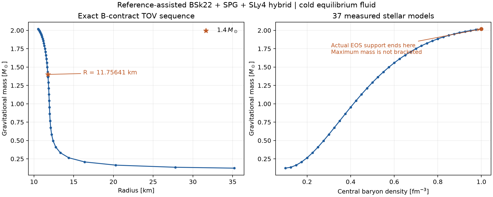
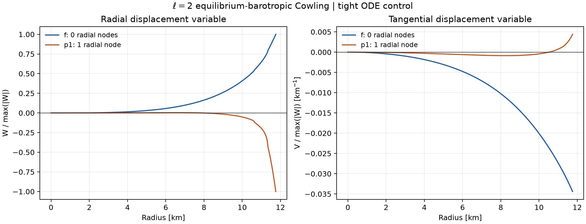

# NS_Cowling D 결과 — APR 경계와 TOV/Cowling 소비자

C commit `539e6bd8de73f8654d121c0bc30023fb868dc05b`를
`research/tf-pair-expansion-20261117`에 push했고 원격 ref의 동일 SHA를 확인했다.
그 commit에서 별도 `research/stellar-consumers-20261117` branch로 D를 수행했다.
이 문서는 D의 검토 대상이며 D 게시에는 사용자의 별도 승인이 필요하다.

D의 선택 범위는 완료했다. APR 연속 Gibbs 경계 소비자와 보류된 25개 matching cell,
B primary에 묶인 37개 TOV 모형, \(1.4\,M_\odot\) 부근의 평형 barotropic Cowling
\(f,p_1\) 모드를 실제 계산했다. 수치 수렴·native 교차검증·입력 identity를 연결했다.
최대질량, frozen-species 조성 부력, 완전한 APR 별은 이번 결과가 아니다.

## 1. 입력·출력과 근거 상태

| 대상 | identity 또는 결과 | 근거 상태 |
|---|---|---|
| 기준 commit | C `539e6bd8de73f8654d121c0bc30023fb868dc05b` | 원격 게시 및 readback 확인 |
| whole-star EOS | `data/core_support_20261117/primary_v1/REPRESENTATION.json` | B의 연속 contract 그대로 사용 |
| EOS SHA-256 | `591ac27aa99448512e291684c98f8273efc729d17c63be88e331c20e83bd2653` | base C와 byte identity |
| 실제 density 지원 | \(0\le n_B\le1.0\,\mathrm{fm}^{-3}\) | extrapolation 없이 소비 |
| 모델 | BSk22 lower + SPG + SLy4, 명시한 surface/bridge | reference-assisted hybrid |
| 별 배경 | 정적·구대칭·비회전·비자성 완전유체 | 선택한 모델 가정 |
| 섭동 | \(\delta g_{\mu\nu}=0,\ \Gamma_1=\Gamma_{\rm eq}\), \(\ell=2\) | equilibrium-barotropic Cowling |
| 조성·탄성 | frozen species, 전단탄성, 초유체 상대운동 미포함 | 추가 입력/모델 필요 |
| 근사·수치 식 | \((-+++)\), \(G,c\) 변환 명시, 무한대 시간 주파수 | FORMULATION_KO.md의 직접 유도 및 CAS |

근거는 관측 적합도, microscopic model fidelity, 수치 적분의 정확도, 게시 상태를 구분한다.
새 결과가 GM1 provider residual이나 DD2 TF global minimum의 미해결 상태를 바꾸지 않는다.

## 2. APR의 연속 \(6\rightarrow8\rightarrow7\) 경계

APR source는 native 생성 131행, \(n_B=0.085\)–\(0.5\,\mathrm{fm}^{-3}\)다.
Phase별 cubic Hermite \(\epsilon(n_B)\)에서
\[
\mu_B=\epsilon',\qquad P=n_B\epsilon'-\epsilon,\qquad
c_s^2/c^2=n_B\epsilon''/\epsilon'
\]
를 함께 얻는다. 같은 endpoint의 \(n_B,P,\epsilon,\mu_B\)는 연속이며
one-sided \(\epsilon''\)와 음속은 별도로 보존한다.
Sharp Maxwell plateau나 density jump로 치환하지 않는다.
이는 [APR provider의 Gibbs 처방](https://compose.obspm.fr/download/1D/NS/Classical/APR/eos.pdf)에 묶인다.

| 경계 | \(n_B\) [fm\(^{-3}\)] | \(P\) [MeV fm\(^{-3}\)] | 낮은 쪽 \(c_s^2/c^2\) | 높은 쪽 \(c_s^2/c^2\) |
|---|---:|---:|---:|---:|
| 6 → 8 | 0.204394954893 | 5.83908413833 | 0.08562810672 | 0.001934084553 |
| 8 → 7 | 0.237384248939 | 5.90285482869 | 0.001952275953 | 0.07263397965 |

43개 공통 density에서 직접 functional solve와 비교한 pressure 오차는
66-knot 진단표의 \(5.14969\times10^{-5}\)에서 원래 131-knot 표의
\(1.38702\times10^{-7}\)로 줄었다. 분모는 \(\max(|P_{\rm direct}|,1)\)이다.
one-sided derivative의 가장 미세한 차분 비교에서 상대 차이는 최대 \(1.56704\times10^{-5}\)다.
Polynomial의 positive compressibility와 causality는 interval endpoint 논증으로 검사했다.
이것은 유한 interpolant의 binary64 검사이며 global microscopic minimum의 증명은 아니다.

SPG M1–M5 × cubic_F/cubic_P/quintic_F/quintic_P/CSS를 실제 native matching했다.
Homogeneous low branch를 먼저 계산하고 원 source의 mixed/high branch suffix를 보존했다.

- **25/25 고유 cell:** constructed + native CompOSE readback 검증.
- Retained core \(n_B,P,\epsilon,\mu_B,F\): source와 최대 절대 차이 **0.0**.
- Source phase·crust/core composition·presence mask 보존, bridge composition은 unavailable.
- CSS **low-branch 5개**의 독립 admission만 인정했다. 전체 assembled APR EOS나 별의 admission으로 세지 않았다.
- 초기25회 + inverse roundoff/차분 anchor 수정 후25회로 matching 호출은50회다. coverage는 고유25개 증가다.
- 기존 source bytes와 C의 역사 기록은 바꾸지 않았다.

### 390-cell census 갱신

| 항목 | C | D 이후 |
|---|---:|---:|
| 요청된 고유 cell | 390 | 390 |
| finite-component kernel 지원·실행 | 165 | 190 |
| constructed/readback | 105 | 130 |
| 기존 기준의 전체 cell method admission | 25 | 25 |
| 미실행·보류 | 225 | 200 |

보류200개는 continuous TF production source 부족에 묶인다.
C에서 기록한 finite-component Maxwell 결과와 sparse TF profile을 완전한 TF EOS로 승격하지 않았다.
새 `MATCHING_390_MAP.json`은 C 원본과 D의 25개 exact cell-ID delta로 재구성했다.

## 3. TOV: 실제 지원 안의 별 수열

기준 계산은 B의 원래 연속식을 enthalpy \(h=\ln(\mu_B/\mu_{\rm vac})\)로 직접 평가한다.
새 Python reference는 sample-table spline으로 EOS를 대체하지 않는다.
중심 series, analytic vacuum \(h=0\), Schwarzschild 시간 정규화를 사용했다.
독립된 기존 Fortran 경로에서도 같은 입력을 표본화해 비교했다.

\(n_c=0.1\)–\(1.0\,\mathrm{fm}^{-3}\), 간격0.025의 **37개** 모형을 계산했다.

| 관측량 | \(1.4\,M_\odot\) 모형 | 실제 지원의 상단 \(n_c=1.0\) |
|---|---:|---:|
| 중심밀도 [fm\(^{-3}\)] | 0.537733977636 | 1.0 |
| 중심압력 [MeV fm\(^{-3}\)] | 84.6508280826 | 506.421334440 |
| 질량 [nominal \(M_\odot\)] | 1.399999994656 | 2.018352873130 |
| 반경 [km] | 11.7564107841 | 10.5369441164 |
| compactness \(GM/(Rc^2)\) | 0.175842362380 | 0.282847698078 |

\(1.4\,M_\odot\) 모형의 중심밀도는 이전 matching-only 상한 \(0.5\)를 넘는다.
B의 실제 core 연장이 이번 별 계산에 사용됐다는 직접 증거다.

모든 표본 간 mass slope가 양수이고 마지막 slope도
\(0.3880443\,M_\odot/(\mathrm{fm}^{-3})\)다.
**\(2.01835\,M_\odot\)는 최대질량이 아니다.**
상단에 도달했을 때 mass turning point가 bracket되지 않았으므로 최대질량을 알기 위해서는
같은 native source를 더 높은 밀도로 실제 생성해야 한다.
양의 slope만으로 전 branch의 radial/비방사 모드 안정성을 확정하지 않았다.

### 배경 수렴

Canonical 모형의 tighter ODE에서 \(\Delta M=4.57\times10^{-8}M_\odot\),
\(\Delta R=-6.31\times10^{-5}\,\mathrm m\)였다.
고밀도 endpoint에서는 \(\Delta M=6.89\times10^{-7}M_\odot\),
\(\Delta R=-0.000400\,\mathrm m\)여서 endpoint mass의 tested envelope를 약 \(10^{-6}M_\odot\)로 읽는다.
중심 시작 반경0.3/1/10 m도 비교했다.
Canonical surface \(h_s=10^{-4},10^{-6},10^{-8}\) 절단의 반경 손실은
4.33245 m, 0.0433446 m, 0.000433448 m이며 reference는 \(h_s=0\)다.

같은 \(P_c\), \(h_s=10^{-4}\)에 해당하는 \(P_{\rm cut}\)에서 native 경로를 비교했다.

| Exact EOS 표본 수 | Native−exact \(\Delta R\) [m] | Native−exact \(\Delta M\) [\(M_\odot\)] |
|---|---:|---:|
| 514 | −2.15462493 | \(-1.96525\times10^{-7}\) |
| 2,053 | −0.23397734 | \(9.46988\times10^{-9}\) |

Native 실제 보간은 **PCHIP of \(\epsilon-P\) against \(\ln P\)**다.
P,epsilon knot를 유지하고 n,mu는 first law 적분으로 재구성하는 별도 표현이다.
0.234 m의 잔여 차이는 표현과 ODE의 합성 민감도이며 exact-contract 오차에 전부 귀속하지 않는다.
PAV 또는 q-linear 물리량 수정은 사용하지 않았다.

## 4. \(f,p_1\) 모드와 수렴

정칙 중심은 \(W\sim Ar^{\ell+1}\), \(V\sim-Ar^\ell/\ell\)다.
표면은 \(\Delta P=0\), 내부는 두 방향 적분의 normalized matching determinant를 사용했다.
양쪽 \(W,V\)와 그 node를 저장했고, 고정된 기본 bracket을 성공으로 가정하지 않았다.
실제 250 Hz scan에서 \(f\)는2250–2500 Hz, \(p_1\)은6500–6750 Hz에 잡혔다.

Cowling의 별도 numerical mass closure는 \(n_c=0.537733986607\,\mathrm{fm}^{-3}\),
\(M=1.40000006478\,M_\odot\), \(R=11.7564106743\,\mathrm{km}\)다.
위 TOV canonical fitting과의 차이는 각각 \(9.0\times10^{-9}\,\mathrm{fm}^{-3}\),
\(7.0\times10^{-8}M_\odot\)이며 서로 다른 수치 설정의 결과를 exact byte 동일한 실행으로 취급하지 않는다.

| \(\ell=2\) 모드 | tighter ODE 주파수 [Hz] | \(W,V\) node 수 | matching residual 절댓값 |
|---|---:|---:|---:|
| \(f\) | 2401.381839494 | 0, 0 | \(2.39\times10^{-8}\) |
| \(p_1\) | 6721.957071699 | 1, 1 | \(2.21\times10^{-9}\) |

12개 설정에서24개 mode solution을 계산했다.
ODE tolerance, \(h_s=10^{-6}\)–\(10^{-9}\), match \(h/h_c=0.07,0.15,0.30\),
중심0.1/1/10 m, enthalpy step cap 및 배경 오차를 바꿨다.

Loose ODE \(10^{-6}\) 설정의 \(f\) matching residual \(3.87\times10^{-6}\)은
고정 acceptance \(2\times10^{-6}\)을 넘어서 **rejected diagnostic**으로 보존했다.
판정 한계를 늘려 통과시키지 않았다. 나머지23개는 residual gate를 만족했다.
같은 loose 설정의 \(p_1\) 주파수 shift는 −0.02450 Hz였다.

Loose-mode 진단을 제외한11개 설정에서 관측한 주파수의 전체 range는
\(f\) **0.0009762 Hz**, \(p_1\) **0.0027938 Hz**다.
이 값은 수행한 설정에 대한 numerical sensitivity이며 모든 미지의 오차에 대한 엄밀한 상계가 아니다.

### 독립 native Cowling 비교

기존 Fortran cell solver의 실제 컴파일 source와 executable hash를 묶었다.
TOV와 같은 PCHIP EOS provider를 사용하지만 독립 native 적분·matching 경로다.
같은 \(P_c,P_{\rm cut}\), 절단 표면에서의 시간 정규화로 비교했다.

| Exact EOS 표본 수 | Native−exact \(f\) [Hz] | Native−exact \(p_1\) [Hz] |
|---|---:|---:|
| 514 | +0.001013735 | +0.084873189 |
| 2,053 | +0.000205347 | +0.007416953 |

Native의 \(W,V\) node는 \(f:0,0\), \(p_1:1,1\)이며 residual은 \(3.1\times10^{-10}\) 이하다.
이 비교는 서로 다른 EOS 표현의 세분화 효과까지 포함한다.

선택한 closure는 \(\Gamma_1=\Gamma_{\rm eq}\)이므로 composition buoyancy \(N^2=0\)다.
실제 frozen-species response나 equilibrium–frozen 주파수 차이를 계산한 결과는 아니다.
필요한 전체 crust의 off-equilibrium susceptibility가 없기 때문에 그 sensitivity는
`INPUT_NOT_AVAILABLE / NOT_COMPUTED`로 남긴다.
[평형과 frozen regime의 구별](https://arxiv.org/html/2410.08008v2)은 단순한
EOS 표본 간격 문제와 분리했다.

## 5. 구현·검증과 수정된 오류

새 production/reference 모듈은
`apr_phase_consumer.py`, `stellar_background.py`, `stellar_cowling.py`다.
각 실행기·회귀·raw profile·source hash·입출력 및 actual exit receipt를 함께 보존했다.
기존 EOS 생성·matching 물리는 native Fortran을 재사용했다.

전체 실행 명령은 다음과 같다.

~~~bash
OMP_NUM_THREADS=1 OPENBLAS_NUM_THREADS=1 MKL_NUM_THREADS=1 \
PYTHONPATH=python_frontend:/tmp/ns_cowling_audit_20261117_pydeps \
COMPOSE_EOS_FORTRAN_ROOT="$PWD" \
COMPOSE_EOS_FORTRAN_EXE="$PWD/build/compose_eos_fortran/compose_eos_fortran" \
/home/cosmosapjw/ns_cowling_wt/.venv-gen/bin/python -m pytest -q -rs \
python_frontend/tests pipeline/tests
~~~

**1,397 passed / 9 skipped / 0 failed**, pytest117.40 s, subprocess exit0이다.
실행 전후 source/test hash가 같다.
19개의 신규 targeted regression은 이 전체 수에 포함되므로 더해서 세지 않는다.
9 skip은 raw BBB/APR/tensor/axes/SPG fixture가 staged되지 않은 기존 조건이다.

해석적 대조에는 incompressible Schwarzschild TOV 및 weak-gravity Cowling
\(f^2\propto\ell GM/R^3\) 한계, scaled/original RHS 동일성이 포함된다.
Incompressible control을 physical causal EOS로 채택하지 않았다.
CAS는 enthalpy/TOV 변수변환, 중심 계수, Cowling scaling, APR derivative,
평형 \(N^2=0\)의 algebraic residual을 정확히0으로 확인했다.

실패 이력을 성공으로 덮지 않았다.
TOV runner의 CSV schema와 Python package shadowing은 실행 구성 오류였고 수정 후 재실행했다.
초기 knot derivative 테스트는 서로 다른 one-sided derivative를 혼동한 테스트 계약 오류로 수정했다.
Symbolic 치환 순서 문제와 loose Cowling rejection은 원 기록에 남아 있다.

한 번의 fresh independent review에서 native Cowling의 보간을 Hermite로 잘못 적은 provenance 오류를 발견했다.
실제 컴파일 대상 `oscillation_source/solutions/src/eos/ns_table_eos.f90`의
`TABLE_INTERPOLATION_ID`를 확인하여 PCHIP로 수정했다.
수치 출력·binary는 변하지 않았고 문서·receipt의 의미를 바로잡았다.
최종 독립 검토는 검토 범위에서 열린 blocking finding 없음으로 종료했다.
독립 검토의 상세 판정은 `INDEPENDENT_REVIEW_KO.md`와 대응 JSON을 따른다.

## 6. 완료 경계와 다음 순서

원 A–D 계획은 D에서 끝나므로 미리 정해진 E가 있는 것처럼 표시하지 않는다.
이번 D 게시를 승인한 뒤의 **새 후속 E 제안**은
**SLy4의 실제 고밀도 지원 연장과 최대질량·causal 종단 결정**이다.

같은 source parameter와 energy reference로 \(n_B>1.0\,\mathrm{fm}^{-3}\) 중 필요한 tail만 생성하고,
별도 representation에서 기존 lower EOS를 보존한 채 mass turning point 또는 먼저 나타나는
physical domain limit를 찾는다. 그 결과에 맞춰 고질량 별의 모드 범위를 확장한다.
D 결과를 재감사하는 것으로 대체하지 않고 새로 필요한 고밀도 계산만 수행한다.
이번 D에서는 그 후속 단계를 실행하지 않았다.

다른 미해결 항목은 frozen-species 응답, TF continuous source와 global geometry 선택,
APR full-star surface/upper-support 연결, GM1 provider residual이다.
CSS Seidov local flag를 TOV branch나 전체 mode 안정성의 판정으로 사용하지 않았다.

## 핵심 파일

- `data/stellar_consumers_20261117/CURRENT_OUTCOME.json`: 단계별 결과와 근거 범위.
- `C_PUBLICATION_RECEIPT.json`: C push/readback 실제 결과.
- `MATCHING_390_MAP.json`: C+25개 APR delta의 exact cell-ID census.
- `apr/`: boundary/readback,25개 실제 CompOSE 출력, native 호출 및 regression.
- `tov/`:37개 수열, canonical profile, center/surface/ODE 및 native 비교.
- `cowling/`: 실제 scan,12설정24모드, eigenfunction, native 비교 및 provenance correction.
- `FRONTEND_PIPELINE.json/log`: 전체 회귀 actual exit 및 source/test hash.
- `FORMULATION_KO.md`, `SOURCE_LEDGER.json`, `SYMBOLIC_CHECK.json`: 물리식과 출처·검산.
- `NEXT_STEP_PROPOSED_E.json`: D 게시 승인 뒤 제안하는 새 작업.
- `STAGE_MANIFEST.json`: 최종 payload byte hashes; manifest 자체는 자기참조에서 제외.
