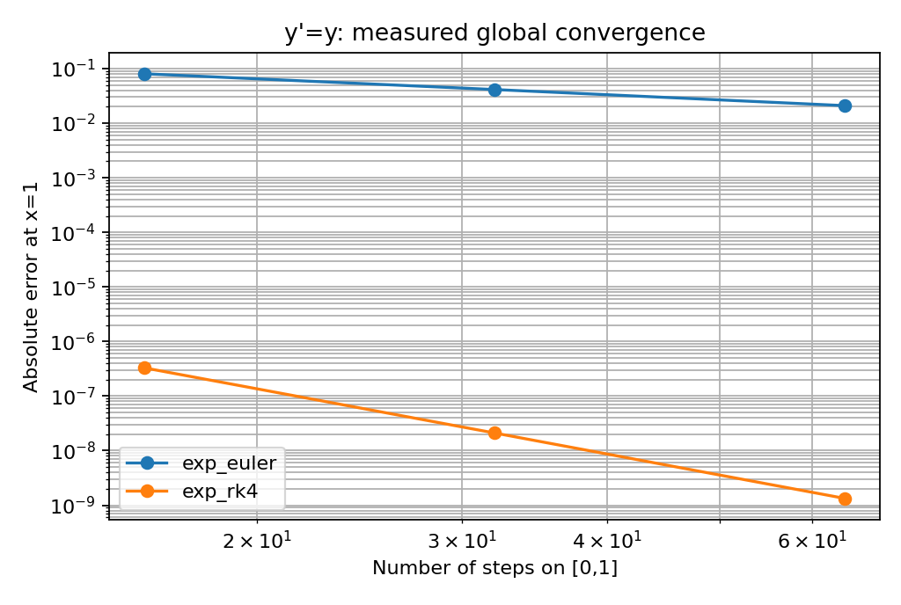
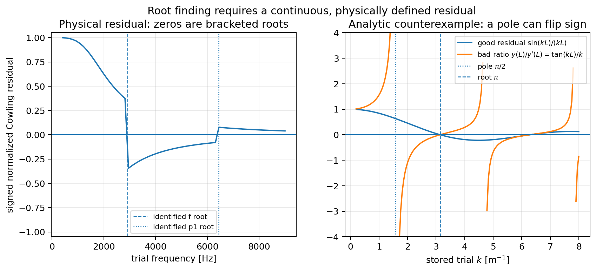
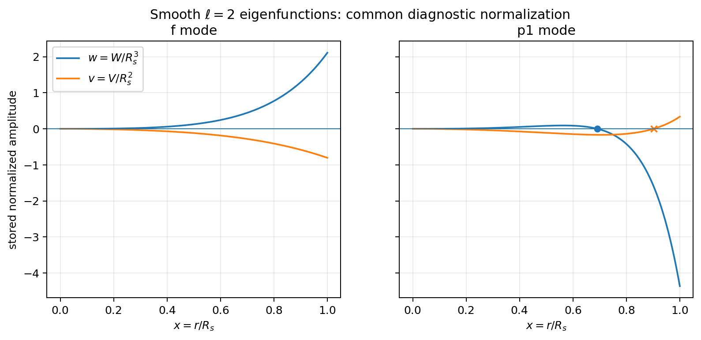
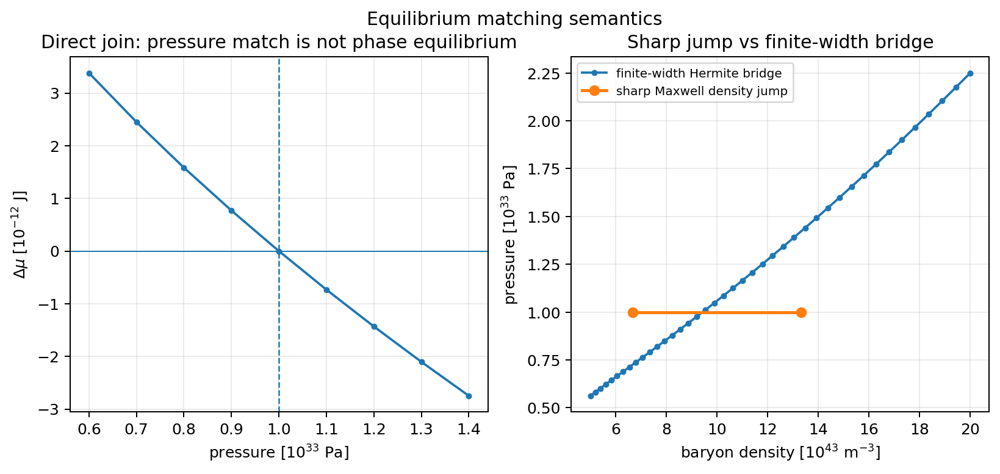

\clearpage

# 평형 별에서 진동하는 별로


TOV 코드를 이미 작성했다면, 우리는 중심압력과 상태방정식을 주어 하나의 별을 얻는 데까지 와 있다. 그렇다면 그 별을 조금 흔들었을 때의 운동도 이미 알고 있는 셈일까? 그렇지는 않다. 평형 계산의 출력은 진동 문제의 입력이지만, 질량과 반경 두 수에는 내부의 중력장과 압축응답이 모두 담겨 있지 않다. 이제 필요한 것은 별 하나를 다시 그리는 일이 아니라, 그 별에서 어떤 운동이 허용되는지 묻는 일이다.

우리는 비회전 구대칭 별의 상대론적 Cowling 식을 계산에 연결하고, 매끄러운 물질의 $f$와 $p_1$ 모드를 구한 뒤 저밀도 상태방정식의 변화가 주파수에 남기는 차이를 살펴본다. 여기서 생략하는 것은 계량섭동 $\delta g_{\mu\nu}$다. 압력과 밀도의 섭동은 남아 있다. 중력을 포함한 평형 배경 위에서 유체는 움직인다.

## 무엇이 주어지고 무엇을 찾아야 하는가

**읽기 전에 한 번 답해 보자.** 자신의 TOV 출력에서 질량과 반경을 제외한 열 두 개를 고르고, 진동 계산이 왜 그 열을 읽어야 하는지 적는다. 이름이 떠오르지 않으면 소스를 열어도 좋다. 지금 필요한 것은 암기가 아니라 이미 만든 별의 의미다.

평형 계산에서는 중심압력과 EOS로 출발했다. 진동 계산에서는 그 배경에 시험 각주파수 $\omega$를 더 주고, 중심에서 정칙한 변위가 표면에서도 허용되는지를 확인한다. 이 조건은 대부분의 $\omega$에서 성립하지 않는다. 적분기가 틀렸기 때문이 아니다. 두 경계조건을 동시에 만족하는 해를 아직 고르지 않았기 때문이다.

이를 한 식으로 쓰면

$$
\omega\ \longmapsto\ (W(r;\omega),V(r;\omega))
\ \longmapsto\ \mathcal R(\omega)
$$

이다. $\mathcal R$은 표면조건의 위반을 부호까지 포함해 측정한다. 이를 영으로 만드는 값을 찾으면 고유조건을 만족하는 후보를 얻는다. 그런데 그 후보가 $f$인지 $p_1$인지는 어떻게 알 수 있을까? 이 질문에는 주파수 순번이 아니라 고유함수의 공간적 구조가 답해야 한다.

## 출발점을 선택한다

물리 문제를 정하는 일과 적분기의 내부를 작성하는 일은 구별하자. TOV 경험이 있는 독자는 `calculation/`의 완성된 물리 예제로 두 모드를 먼저 계산할 수 있다. `methods/`의 적분·근 찾기·열역학 표 표현과 제공된 양방향 matching 함수를 호출하는 경로다. 함수의 내부를 다시 작성할 필요는 없다. 대신 어떤 입력과 경계조건을 그 함수에 맡겼는지는 설명할 수 있어야 한다.

```python
from tools.stellar_methods import solve_pair
pair = solve_pair("../first_pair", level="fine")
print(pair["delta_f_hz"], pair["delta_p1_hz"])
```

이 호출로 같은 질량의 두 별과 모드 대응을 얻는다. 여기까지는 한 pair의 계산이다. 정밀도를 달리해도 같은 결론이 남는지는 제6장에서 따로 묻고, 제10장의 `run_study`로 검사한다. 이를 위해 제3·7·9장에서 EOS의 표현을, 제4·5장에서 양쪽 경계의 해를 연결하는 방법을 배운다. 필요한 이유를 먼저 알고 함수를 사용하자는 순서다.

직접 구현하는 물리 함수는 `learner/src/modes/`에 남아 있다. 중심 정칙성, Cowling 우변, 표면조건을 자신의 코드로 작성한 뒤 자신의 TOV와 함께 제공 방법에 연결할 수 있다. `make_calculation.py --physics learner/src`는 네 물리 파일을 명시적으로 선택하여 새 디렉터리에 옮긴다. 미완성 함수를 완성 예제로 대신하지 않는다.

자신의 TOV를 가져오는 경우에도 새 적분기부터 만들지는 말자. 먼저 총에너지의 정의, 반경과 질량의 단위, lapse 상수, 표면압력과 EOS 미분을 맞춘다. 열 이름이 같은 것은 그 다음 문제다. 제3장에서 이 대응을 확인하고, 해석적 EOS와 단방향 적분으로 원리를 익힌 뒤 실제표의 작은 차이를 구간 적분과 양방향 방법으로 계산한다.

## 첫 별: 해석적인 EOS와 유한 압력 표면

가장 단순한 입력은

$$
P=P_a\left(\frac{n}{n_a}\right)^\Gamma,
\qquad \epsilon=Cn+\frac{P}{\Gamma-1}
$$

이다. $n$은 baryon 수밀도이며 $C$는 baryon당 기준 에너지다. 두 번째 식은 압력과 독립적인 경험식을 덧붙인 것이 아니라 차가운 열역학의 적분 결과다. $C$의 선택은 압력곡선에는 보이지 않지만 중력질량과 음속에 들어간다.

강의의 해석 예제는 $\Gamma=2$, $n_a=10^{44}\,\mathrm{m^{-3}}$, $P_a=10^{32}\,\mathrm{Pa}$, $C=1.5\times10^{-10}\,\mathrm{J}$를 사용한다. $P_c=10^{34}\,\mathrm{Pa}$, $r_0=1\,\mathrm m$, $P_{\rm cut}=10^{22}\,\mathrm{Pa}$에서 계산한 예제의 주파수는 약 $2894.464\,\mathrm{Hz}$와 $6440.653\,\mathrm{Hz}$다. 이는 이 입력의 수치 예제이지 관측된 별의 주파수가 아니다. 이 예제의 수렴과 모드 식별은 제6장에서 다룬다.

`tools/example_star.py`는 두 독립 코드의 대조에 사용한 다른 폴리트로프를 계산한다. 그 입력에서는 $P_a=2.7854778312812705\times10^{32}\,\mathrm{Pa}$와 $P_c=6.4\times10^{33}\,\mathrm{Pa}$를 사용한다. 두 예제의 주파수를 서로의 정답으로 비교해서는 안 된다. 동반 계산 대조표에 입력과 수렴 결과를 따로 실었다.

## 모드를 물리적으로 읽는 첫 방법

$f$ 모드에 대해서는 전역 동역학 시간

$$
 t_{\rm dyn}=\sqrt{\frac{R^3}{GM}}
$$

을 먼저 생각할 수 있다. 이는 중력 복원력이 만드는 시간 척도다. $p_1$에서는 압축응답과 음향 전파가 더 직접적인 역할을 한다. 그러나 낮은 차수의 압력모드를 고차 WKB 식 하나로 정확히 예측할 수 있다고 가정하지 않는다. 이 강의에서는 음향시간을 진단량으로 계산한 후 실제 고유주파수와 비교한다.

고유함수 그림은 어떻게 읽어야 할까? 선형 문제에서 전체 진폭은 임의이므로 한 모드의 $W$가 더 높게 그려졌다는 이유만으로 더 쉽게 여기되거나 에너지가 더 크다고 말할 수는 없다. 우리는 먼저 같은 정규화를 적용한다. 그 뒤에 공간적 형태와 내부 영점, 모델을 조금 바꾸었을 때의 대응을 비교한다.

## 계산이 말할 수 있는 것

우리는 차갑고 비회전인 구대칭 완전유체, 평형 barotropic 압축응답, 양의 유한 표면압력을 사용하는 문제부터 시작한다. 탄성 지각, 자기장, 초유체의 상대운동과 중력파 감쇠시간은 이 문제에 포함되지 않는다. 저밀도층의 EOS를 바꾸었다고 해서 탄성 지각의 진동을 계산한 것은 아니다.

이 제한 안에서 우리가 물을 수 있는 것은 구체적이다. 바꾼 함수는 무엇인가, 두 별의 질량은 정말 같은가, 주파수 차이는 수치 분해능보다 큰가? 마지막 격자에서 큰 차이가 보인다는 것만으로는 답이 되지 않는다. 제10장에서는 이 질문들에 차례로 답한 뒤 물리적 결론을 적는다.

## 첫 실행에서 확인할 것

기본 실행은 `calculation/`의 물리식과 `methods/`, `support/`의 제공 함수를 소스부터 빌드한다. 물리식은 `calculation/src/physics/`에, 저밀도 모형은 `calculation/src/models/`에 있다. 계산법의 호출과 물리 가정의 선택이 서로 다른 위치에 드러나도록 한 것이다.

`learner/`는 직접 구현 과제를 위한 별도 공간이다. `solutions/`는 그 과제의 풀이이며 기본 계산이 자동으로 찾아가는 경로가 아니다. 제공된 예제를 실행한 결과와 자신이 작성한 물리 함수를 시험한 결과를 구별한다. 어느 경우에도 저장된 주파수를 성공값으로 되돌려 주지 않는다.

먼저 도구가 준비되었는지 확인한 다음 `solve_pair`로 두 별을 계산한다. `run_study`는 같은 물리 문제를 여러 정밀도에서 반복하고, 경계·단계법·질량 잔차·모드 대응까지 검사한다. 실행이 끝나지 않았으면 `pending`으로 남는다. 완료한 단일별 계산은 같은 소스와 입력일 때만 다시 사용한다.

프로그램이 끝까지 실행되었다면 우선 실행 경로가 연결된 것이다. 방정식이 맞는지와 해가 수렴하는지는 아직 남아 있다. 반대로 compiler가 없어서 시작하지 못했다면 Cowling 근사를 의심할 이유도 없다. 이후에는 한 점의 수식, 해석해, 해상도 변화가 각각 어떤 오류를 겨냥하는지 구별하며 계산을 진행한다.


\Needspace{12\baselineskip}

# 단위와 수치법


이제 물리량을 숫자로 옮겨 보자. 이미 TOV를 계산했다면 익숙한 과정일 것이다. 그렇지만 단위를 맞추는 일과 같은 물리량을 고르는 일은 같지 않다. 이 차이가 뒤의 근 찾기와 적분에도 그대로 따라간다.

## 숫자가 같아도 같은 물리량은 아니다

EOS의 한 열에 \(0.16\)이 적혀 있다고 하자. 익숙한 숫자처럼 보여도 수밀도인지 입자당 에너지인지, 이미 정규화한 무차원 양인지 모르면 계산에 넣을 수 없다. 먼저 열이 무엇을 뜻하는지 정한다. 그 다음에 단위, 정지에너지의 포함 여부와 유효 구간을 확인한다. 단위변환은 이 정의를 대신해 주지 않는다.

별의 구조와 진동 커널은 SI로 계산한다. 핵물질 함수에서 MeV와 fm을 쓰는 것은 허용하지만 경계에서 한 번 변환한다. 서로 다른 함수가 각자 \(c\)나 \(10^{15}\)를 넣었다 빼는 방식은 피한다. 제공된 `ns_physical_constants`와 `ns_units`는 이 경계를 한 장소에 둔다.

상수값을 직접 베껴 입력하는 일은 실습의 목표가 아니다. 독자가 설명해야 하는 것은 다음 환산의 지수이다.
\[
1\;\mathrm{MeV\,fm^{-3}}
=\frac{10^6(1.602176634\times10^{-19})}{(10^{-15})^3}
\;\mathrm{J\,m^{-3}}
=1.602176634\times10^{32}\;\mathrm{J\,m^{-3}}.
\]

분모의 fm은 세 번 변환된다. MeV만 J로 바꾸면 숫자가 \(10^{45}\)배 어긋난다. 그런데 그런 순변환에 맞춰 역변환도 잘못 만들면, 왕복 검사는 통과할 수 있지 않을까? 실제로 그럴 수 있다. 그러므로 원래 입력으로 돌아왔는지와 정의에서 유도한 값에 도착했는지를 따로 확인한다.

## 두 종류의 질량밀도

\[
\rho_0=m_b n_B,\qquad \rho_E=\epsilon/c^2
\]

에서 첫째는 선택한 baryon 기준질량으로 정의한 정지질량밀도이고, 둘째는 총에너지에 대응하는 질량밀도다. 내부에너지와 결합에너지가 있으면 두 양은 달라진다. TOV가 요구하는 밀도는 방정식의 에너지 정의가 정한다. 두 열을 모두 `rho`라고 부르는 관습이 그 차이를 없애 주지는 않는다.

제공 함수는 두 변환에 서로 다른 이름을 사용한다. `number_to_rest_mass_density`에는 \(m_b\)를 명시적인 인수로 전달하며, `energy_to_mass_density`는 \(\epsilon/c^2\)를 계산한다. \(m_b\)를 어떤 핵질량과 동일시할지는 뒤의 물질 모델에서 정할 일이다. 상수 제공 파일이 그 가정을 대신 선택하지 않는다.

## 각주파수와 주파수

시간 의존성을 \(e^{i\omega t}\)로 쓰면 \(\omega\)는 각주파수이다. 시간당 cycle 수는
\[
f=\frac{\omega}{2\pi}
\]
이다. 두 양의 차원은 모두 역시간이므로 \(2\pi\)의 누락은 차원 검사만으로 찾지 못한다. 또한 \(k=\omega/c\)는 Cowling 식에 사용되는 역길이 변수이지, 음속을 넣어 정의한 유체의 국소 파수와 같다고 가정할 수 없다. 입력 변수의 이름과 정의가 필요한 이유이다.

이 실습에서는 한 cycle per second가 \(2\pi\;\mathrm{s^{-1}}\)와 대응하는지 독립 기준으로 확인한다. 별의 모드 주파수나 평균밀도 관계를 아직 정답으로 사용하지 않는다.

## 작은 값과 큰 값을 계산하는 방법

벡터의 Euclidean norm을 \(\sqrt{x_1^2+x_2^2+\cdots}\)로 직접 계산하면 성분이 \(10^{300}\)인 경우 제곱에서 overflow할 수 있다. 그러나 \((3\times10^{300},4\times10^{300})\)의 norm \(5\times10^{300}\) 자체는 real64 범위 안이다.

\(s=\max_i|x_i|>0\)를 먼저 구하면
\[
\|x\|_2=s\sqrt{\sum_i(x_i/s)^2}
\]
로 계산할 수 있다. 동일한 식을 작게 스케일된 벡터에도 적용하면 중간 제곱이 전부 0으로 사라지는 문제를 줄일 수 있다. 0벡터는 별도로 norm 0을 반환한다. 최종 norm 자체가 표현 범위를 넘으면 성공값을 발명하지 않고 실패를 반환한다.

이 계산은 제공 함수 `safe_norm2`에 맡길 수 있다. 그 대신 다음 질문은 남는다. 영벡터의 norm을 정의할 수 있다는 것이 그 norm으로 나누어도 된다는 뜻일까? 아니다. 뒤에서 사용할 고유값 잔차에는 비영인 정규화 분모가 필요하다.

## 검사의 역할과 한계

단위변환과 norm이 정확한 사례를 통과했다고 해서 상태방정식이나 Cowling 방정식이 검증되는 것은 아니다. 이번 실습은 후속 계산의 입력 의미와 수치 연산을 정리하는 단계이다. 정의상 exact한 상수도 이진 부동소수점으로 저장하면 반올림되며, 측정된 \(G\)의 불확실성은 수치시험의 허용오차와 별도이다. 이 구분은 공통 수식표의 BIPM·CODATA·IAU 출처와 연결된다.

단위 과제는 `curriculum/cues/A01.md`, 수식표는 `notes/equations/conventions.md`, 검사의 범위는 `curriculum/cues/A01.md`에 있다. 먼저 한 환산을 정의에서 설명해 보고 수식표와 대조한다. 이후의 실제 계산에서는 표와 제공 모듈을 열어 두어도 좋다. 상수를 외우는 능력과 물리량을 구별하는 능력을 혼동하지 말자.

## 근 찾기와 초기값 문제를 수치 계산으로 옮기기

뒤에서 우리는 EOS의 역함수, 목표 질량에 맞는 중심압력, 진동 주파수를 각각 찾아야 한다. 겉모습은 다르지만 필요한 기본 연산은 근 찾기와 초기값 적분이다. 먼저 무차원 해석 예제로 그 원리를 분리한다. 일반 커널에 돌아오면 독립변수와 각 상태 성분의 단위를 호출자가 정하며, 절대 허용오차도 해당 성분의 단위를 갖는다. 별 구조와 Cowling의 SI 정의는 그대로다.

### 근을 포함한 구간을 보존한다

연속인 실함수 $F$에서 $F(a)$와 $F(b)$의 부호가 반대이면 그 사이에 적어도 하나의 근이 있다. 이분법은 이 사실을 반복해서 사용한다. 중점을 평가하고 반대 부호가 남는 절반을 보존하면, 정확한 실수 연산에서 $k$회 뒤의 폭은 $(b-a)2^{-k}$다. 여기서 버려서는 안 되는 전제는 연속성이다. 불연속이나 계산하지 못한 구간을 가로지른 부호 변화에는 같은 보장을 붙일 수 없다.

컴퓨터에서는 $F(a)F(b)<0$을 곱셈으로 검사할 필요가 없다. 두 값의 부호를 비교하면 큰 값의 곱이 넘치거나 작은 값의 곱이 0으로 반올림되는 문제를 피한다. 마찬가지로 매우 큰 양수와 음수를 끝점으로 삼을 때 $(a+b)/2$ 또는 $a+(b-a)/2$가 항상 안전한 것도 아니다. 구현은 같은 부호와 반대 부호의 끝점을 구분해 중점을 계산한다.

기본 좌표 조건은 반구간 폭이 $x_{\rm atol}+x_{\rm rtol}\max(|a|,|b|)$ 이하인지 보는 것이다. 별도로 $|F(x)|\le f_{\rm atol}$을 사용할 수 있으나, 작은 함수값과 작은 좌표 오차는 다른 명제다. 함수 전체에 작은 상수를 곱하면 근은 같지만 잔차 크기는 달라진다. 따라서 결과에는 `exact`, `coordinate`, `residual` 중 어떤 조건으로 종료했는지 남긴다. `exact`는 계산된 부동소수점 잔차가 0이라는 뜻이며, 무한정밀도 실수의 근을 증명했다는 뜻은 아니다.

입력 구간, 허용오차, callback의 유한성을 먼저 확인한다. 양 끝이 같은 부호이면 `no_bracket`, 유한 반복 예산을 소진하면 `max_iterations`, 양 끝 사이에 더 이상 표현 가능한 중점이 없으면 `stagnation`으로 반환한다. 실패 결과에는 마지막 구간과 평가 횟수를 남기지만 성공한 근의 출력으로 재사용하지 않는다. 바깥 근 찾기의 callback에서 또 다른 근 찾기를 호출할 수 있도록 구현은 재진입을 허용하고 각 호출의 상태를 분리한다.

### 미분방정식은 국소 예측을 반복하여 적분한다

초기값 문제 $y'=f(x,y)$, $y(x_0)=y_0$에서 Euler 방법은

$$y_{n+1}=y_n+h f(x_n,y_n)$$

를 사용한다. 충분히 매끄러운 해의 Taylor 전개와 비교하면 한 단계의 국소 절단오차는 $O(h^2)$이다. 고정된 유한 구간에서 안정적으로 적용할 때 전체 오차가 보통 $O(h)$인 것은 단계 수가 $O(h^{-1})$로 증가하기 때문이다. 이러한 차수 관계는 해와 알고리즘의 적용 조건에 대한 진술이지, 임의로 큰 단계 크기의 안정성을 보장하지 않는다.

고전적 RK4는

$$
\begin{aligned}
k_1&=f(x,y),& k_2&=f(x+h/2,y+hk_1/2),\\
k_3&=f(x+h/2,y+hk_2/2),& k_4&=f(x+h,y+hk_3),\\
y_{n+1}&=y+h(k_1+2k_2+2k_3+k_4)/6
\end{aligned}
$$

로 정의한다. 미분을 여러 번 구하는 대신 네 위치에서의 기울기를 조합한 것이다. 충분히 매끄럽고 안정적인 문제에서는 국소 오차가 $O(h^5)$, 전체 오차가 $O(h^4)$다. 이제 $y'=y$뿐 아니라 $y'=x^3$도 시험해 보자. 두 번째 예제가 필요한 이유는 무엇일까? 자율방정식만으로는 중간 단계의 $x$ 좌표를 잘못 넣은 오류를 놓칠 수 있기 때문이다.

$y'=y$, $y(0)=1$의 정확한 해는 $e^x$이고, $q'=v$, $v'=-q$, $(q,v)(0)=(1,0)$의 해는 $(\cos x,-\sin x)$이다. 전자는 값의 오차를, 후자는 진폭과 위상의 오차를 함께 확인하는 데 사용한다. RK4는 조화진동자의 에너지나 위상을 유한 단계에서 정확히 보존하는 방법이 아니므로, 보존을 오차 0으로 요구하지 않고 해상도 변화에 따른 감소를 조사한다.



그림은 동반 패키지의 Fortran 커널을 실제 실행해 얻은 결과다. 계산 조건과 값은 동반 수치실험의 저장 결과와 `fixed_steps.csv`에 기록되어 있다. 다른 수학 문제나 별의 주파수 정확도를 이 그림에서 보증하지 않는다.

### 단계 크기는 오차 추정으로 선택한다

Dormand-Prince 5(4) 쌍은 공통 단계 평가로 5차 상태 $y^{(5)}$와 4차 embedded 상태의 차이를 추정한다.[N1] 제공된 `ns_dopri_stages`는 표의 계수와 단계 평가를 담당한다. 독자가 확인할 핵심은 성분별 오차의 정규화, 단계 수락·거절과 다음 단계 크기이다.

$$
e_i=y_i^{(5)}-y_i^{(4)},\quad
s_i=a_i+r\max(|y_i^{\rm old}|,|y_i^{(5)}|),\quad
E=\max_i\frac{|e_i|}{s_i}.
$$

$a_i>0$는 성분별 절대 허용오차이며 $r\ge0$는 무차원 상대 허용오차다. 크기가 $1$인 성분과 $10^{-20}$인 성분을 하나의 절대 오차로 다루면 작은 성분의 부정확함을 감출 수 있다. 본 구현은 maximum norm을 사용한다. 원전 DOPRI5 프로그램의 RMS norm·안정화 controller 등 전체 기능과 동일한 프로그램이라고 주장하지 않는다.

새 상태와 좌표는 $E\le1$일 때만 수락한다. 거절한 상태를 다음 초기값으로 사용하면, 오차를 검사하고도 그 검사 결과를 무시한 셈이 된다. 제공 커널은 두 큰 상태의 차이 대신 embedded 가중치와 기울기로 $e_i$를 구한다. 이 방식은 불필요한 상쇄를 줄이지만 roundoff와 오차 추정의 한계까지 없애지는 않는다.

embedded 차이의 선도 크기가 $h^5$로 감소한다는 점에서 기본 비례 제어는

$$f_h=\operatorname{clip}(0.9E^{-1/5},0.2,5)$$

로 정한다. $E=0$에서는 최대 배율을 사용하고, 이전 시도가 거절되었다면 바로 다음 배율을 1 이하로 제한한다. 실제 계산에서는 로그와 제한 범위를 사용해 극단적인 $E$의 거듭제곱 평가를 피한다. 최소·최대 단계, 총 시도 횟수, 비유한 callback과 좌표 정체를 각각 별도로 처리한다.

### ‘최종 좌표를 기록했다’와 ‘그곳까지 적분했다’는 다르다

마지막 단계는 남은 길이로 제한한다. 알려진 중간 좌표 목록을 제공하면 그 위치에서도 정확히 멈춘다. 이 기능은 지정된 좌표의 정지 일정일 뿐이다. 압력으로 정의되는 별의 표면을 찾거나 불연속 계면의 전달조건을 적용하는 기능은 뒤의 절에서 별도로 다룬다.

극단적으로 큰 $x$와 작은 최종 좌표를 섞으면, 계산한 $h=x_{\rm end}-x$를 더해도 $x+h\ne x_{\rm end}$일 수 있다. 이때 출력 좌표만 목표값으로 바꾸어 성공으로 표시하지 않는다. 현재 구현은 `stagnation`을 반환하므로 더 적절한 단계와 좌표 규모를 선택해야 한다. 실제 부동소수점 진행이 없는 문제를 작은 잔차로 은폐하지 않는다.

결과 profile에는 초기 상태와 수락한 상태만 들어간다. 거절 내역은 선택적인 진단 trace로 별도 저장한다. Trace를 기록하지 않았다면 rollback 검사를 수행했다는 출력도 만들지 않는다. Callback 실패나 시도 횟수 소진 때에는 마지막 수락 상태까지의 prefix를 진단용으로 보존하지만, 목표 구간의 성공한 해는 반환하지 않는다.

### 구현과 학습의 구분

직접 구현을 선택할 때 비교할 커널은 `solutions/src/numerics/`, 누적 학습자의 커널은 `learner/src/numerics/`에 둔다. 공개 시험은 선택한 작업공간을 검사한다. 아직 구현하지 않은 학습자 커널은 `not_implemented`를 반환하며 해설로 우회하지 않는다. 공용 record와 DOPRI 단계표를 사용하는 것은 허용된 제공 기반의 재사용이지 solver 대체가 아니다.

**판단해 보자.** 틀린 우변을 매우 작은 허용오차로 적분한 계산과, 옳은 우변을 너무 거친 단계로 적분한 계산을 구별할 검사 하나씩을 고른다. 두 경우에 모두 “허용오차를 줄인다”라고 답했다면, 한 점의 우변 검사와 해상도 검사가 묻는 질문부터 다시 비교하자.

적분기가 한 단계를 수락했다. 그렇다면 무엇이 확인된 것일까? 해당 단계의 오차 추정이 지정한 기준 안에 들어왔다는 뜻이다. 잘못된 초기조건이나 우변, 다른 물리 모델이 바로잡혔다는 뜻은 아니다. 그래서 우리는 독립 해석해, 여러 단계 크기, callback 실패와 결함 주입을 함께 사용한다. 국소 오차 제어와 전체 해의 검산은 서로 맡은 일이 다르다.

**[N1]** E. Hairer and G. Wanner, DOPRI5 / CDOPRI, Université de Genève. Dormand-Prince (1980) 계수의 1차 자료 대조에 사용했다. 공식 소스의 마지막 수정 표시는 2005-08-08이다. <https://www.unige.ch/~hairer/prog/nonstiff/dopri5.f>. 제공 표와 단계는 본 패키지에서 새로 작성했으며 원전의 dense output, FSAL cache, stiffness detection, 안정화 제어를 복제하지 않았다.


### 제공 적분기를 호출할 때 정해야 할 것

기본 계산에서는 `use ns_numerical_methods`로 `adaptive_integrate`와 `bisect`를 가져온다. 독자는 우변, 적분 구간, 초기값, 성분별 절대 허용오차와 상대 허용오차를 정한다. Runge–Kutta 계수, 거절 단계의 복구, 구간 끝에서의 정지는 제공 함수가 처리한다. 내부 구현을 재작성하지 않아도 이 선택이 어떤 오차를 제어하는지 설명해야 한다.

Euler와 RK4의 한 단계는 손으로 따라가 보자. 그러면 제공 적분기가 무엇을 반복하는지 알 수 있다. 반면 고급 controller를 처음부터 작성하는 것은 선택 연습이다. EOS·TOV·Cowling으로 넘어가기 위해 그 구현을 기다릴 필요는 없다. 제공 함수를 쓰더라도 해상도를 바꿔 보고 다른 단계법과 비교해야 한다는 책임은 남는다.


\Needspace{12\baselineskip}

# 열역학 EOS와 TOV 배경


압력곡선 $P=Kn^\Gamma$을 그렸으니 이제 EOS가 완성된 것일까? TOV를 생각하면 빠진 것이 보인다. 중력에는 총에너지밀도가 필요하고, 물질을 한 개 더 넣는 문제에는 화학퍼텐셜이 필요하다. 압력값 하나가 이 둘을 대신하지는 않는다. 우리는 세 양이 같은 열역학에서 나오도록 연결해야 한다.

## 압력을 알면 에너지는 유일하게 정해지는가?

차갑고 단일 보존량으로 기술되는 계에서 $\epsilon/n$은 baryon당 에너지이다. 부피를 바꾸며 일을 하는 관계를 $n$으로 쓰면

\[
\frac{d(\epsilon/n)}{dn}=\frac{P(n)}{n^2}.
\]

따라서 압력함수를 적분해 에너지를 얻지만 적분상수가 남는다. 폴리트로프에서는

\[
\frac{\epsilon}{n}=C+\frac{K}{\Gamma-1}n^{\Gamma-1}.
\]

$C$는 압력식을 적분하고도 남은 에너지 기준이다. baryon 정지에너지를 포함하는 기준을 정할 수 있지만, 압력곡선만으로 그 선택이 나오지는 않는다. 여기서는 $C$를 양의 입력 parameter로 둔다. 뒤에서 두 밀도 구간을 연결할 때 이 상수가 화학퍼텐셜의 일치에 들어간다. 적분상수라고 해서 물리적으로 없어도 되는 것은 아니다.

계산 전에 예측해 보자. 같은 압력곡선에서 $C$만 바꾸면 어떤 양이 그대로일까? 압력은 변하지 않지만 $\epsilon$은 $n\Delta C$, $\mu$는 $\Delta C$만큼 변한다. $dP/d\epsilon$도 달라진다. 우리가 바꾼 것은 실제 crust의 상이 아니라 에너지 완결의 선택이다. 이 간단한 차이가 그래프 접합과 열역학적 접합이 다름을 보여 준다.

## 한 함수에서 다섯 물리량을 얻기

수식표의 $P(n),\epsilon(n),\mu(n),\chi(n)$는 서로 다른 fit의 모음이 아니라 한 모델에서 얻은 양들이다. $n(P)$와 $n(\mu)$도 해석적으로 구할 수 있다. 이미 이분법을 배웠다는 이유로 모든 역함수에 반복 계산을 쓸 필요는 없다. 식이 알려 주는 것을 먼저 사용하자.

코드에는 SI 수밀도와 압력이 입력된다. $n_a=10^{44}\,\mathrm{m}^{-3}$, $P_a=10^{32}\,\mathrm{J\,m^{-3}}$, $\Gamma=2$, $C=1.5\times10^{-10}\,\mathrm{J}$를 예로 잡으면 기준점에서

\[
\epsilon_a=1.51\times10^{34}\,\mathrm{J\,m^{-3}},\quad
\mu_a=1.52\times10^{-10}\,\mathrm{J},\quad
\chi_a=\frac1{76}.
\]

이 값은 정의로 만든 해석적 시험이다. 특정 핵물질의 fit이나 중성자별의 관측값이 아니다. 출력의 단위와 $\epsilon$의 rest-energy convention을 먼저 확인하고 숫자를 비교한다.

## 해석식 대신 표가 주어지면 무엇이 달라지는가?

해석식 대신 표를 받아도 원칙은 바뀌지 않는다. 주어진 $(\mu_i,P_i,n_i)$에서 하나의 $P(\mu)$를 정하고, $n=dP/d\mu$와 $\epsilon=\mu n-P$를 그 함수에서 얻는다. $P,\epsilon,\chi$를 각각 다른 보간기로 만들면 곡선은 매끄러워 보일 수 있다. 그러나 같은 열역학에서 나온 값과 미분인지는 별도 문제다.

각 구간의 양 끝값과 기울기를 보존하는 cubic Hermite 함수는 이 조건을 구현하는 한 선택이다. 하지만 $P$와 $P'$가 연속이어도 $P''$까지 연속인 것은 아니다. 따라서 압축응답 $\chi=P'/(\mu P'')$에는 구간 경계가 남을 수 있다. 이를 새로운 물질적 상전이와 구별한다. 제7장에서 한 구간의 계수를 유도하고, 제9장에서 원래 구간을 유지한 채 별을 적분한다.

구간 함수와 역함수의 구현은 제공한다. 우리는 입력의 단위와 에너지 기준을 확인하고 한 점의 열역학 관계, 구간 전체의 허용조건을 따로 살펴본다. 코드를 직접 쓰지 않았다는 사실은 그 함수가 어떤 물질을 표현하는지 묻지 않아도 된다는 뜻이 아니다.

## 왜 기준점 표현을 사용하는가?

수밀도는 SI에서 큰 수이다. 큰 지수에 대해 $n^\Gamma$를 먼저 계산하고 아주 작은 $K$를 곱하면, 최종 압력이 표현 가능해도 중간의 거듭제곱이 overflow할 수 있다. $P_a(n/n_a)^\Gamma$는 같은 물리식을 안정적인 비율로 계산한다. 필요한 경우 로그를 사용하지만 최종 물리값 자체가 실수 범위를 벗어나면 실패로 남긴다. 작은 압력이나 음의 압력을 0으로 지우는 것은 이 문제의 해결이 아니다.

## 독립적으로 확인하기

$\mu=(\epsilon+P)/n$으로 계산한 값을 같은 우변으로 다시 평가하는 것만으로는 충분하지 않다. 에너지를 조금 다른 밀도에서 직접 평가하여

\[
\mu_{\rm FD}(n;h)=\frac{\epsilon(n+hn)-\epsilon(n-hn)}{2hn}
\]

와 비교하자. $h$를 줄일 때 중앙차분의 근사오차가 줄다가 충분히 작은 $h$에서는 차분의 cancellation이 중요해질 수 있다. 세 단계의 $h$에서 거동을 기록하면 결과 하나를 맞추는 것보다 더 많은 것을 배운다.

두 번째 경로는 압력만으로 적분한

\[
\int_{n_1}^{n_2}\frac{P(n)}{n^2}dn
\]

를 $\epsilon(n_2)/n_2-\epsilon(n_1)/n_1$과 비교하는 것이다. 동반 예제는 Fortran EOS가 반환한 압력을 Simpson 구적으로 적분한다. Python에서 별도의 EOS solver를 만드는 것이 아니라 결과의 열역학 관계를 독립적으로 검사한다. $dP/d\mu=n$과 $\chi=(dP/dn)/(d\epsilon/dn)$도 같은 방식으로 검토할 수 있다.

## 허용되는 함수와 허용되는 계산 구간

폴리트로프의 고밀도 극한은 $\chi\to\Gamma-1$이다. 따라서 큰 $\Gamma$가 항상 더 좋은 모델은 아니다. $\Gamma>2$의 함수도 일부 유한 구간에서는 causal하지만, 그 구간을 넘어선 extrapolation까지 물리적으로 허용되지는 않는다. 이 실습의 생성자는 선언한 전체 구간의 상한까지 검사하고, 실패하면 구간을 자동으로 줄이지 않는다.

또한 $\mu-C$를 구별하지 못하는 낮은 밀도에서 역함수가 나쁘게 조건화될 수 있다. 이때 수학적 EOS의 문제인지 유한 정밀도의 문제인지 구분해야 한다. 본 구현은 양의 하한을 가진 유한 구간에 한정한다. 실제 표면의 $n\to0$ 극한, 표면 cutoff와 계면 처리는 다음 장의 별 구조·진동 문제에서 따로 다룬다.

이제 압력곡선을 에너지와 압축응답으로 연결했다. 다음 절에서는 이를 TOV에 넣어 별을 만든다. 넘어가기 전에, 에너지 상수를 바꾸었을 때 압력이 같아도 별이 달라질 수 있는 이유를 자신의 말로 설명해 보자. 그 설명이 있어야 접합 문제에서 무엇을 고정해야 하는지도 분명해진다.

## 상태방정식에서 평형 별로

EOS가 준비되었다. 그런데 같은 물질로 만든 별이라도 중심 상태가 다르면 질량과 반경은 달라진다. 우리는 하나의 중심 상태를 선택하고, 차갑고 비회전인 구대칭 완전유체를 정해 둔 양의 압력 cutoff까지 적분한다. 이미 TOV를 작성했다면 익숙한 식이다. 이번에는 **그 코드의 중심·표면·시간 기준이 진동 계산에 무엇을 전달하는지**에 주목하자.

### 가정

- metric signature는 \((-,+,+,+)\)이고
  \[
  ds^2=-e^{2\nu(r)}c^2dt^2+e^{2\lambda(r)}dr^2+r^2d\Omega^2
  \]
  를 쓴다.
- \(m(r)\)은 kg 단위의 중력질량, \(\epsilon\)은 정지에너지를 포함한 J m\(^{-3}\), \(P\)는 Pa이다.
- EOS는 한 압력에서 \(\epsilon,n,\mu,\chi=dP/d\epsilon\)를 같은 열역학 convention으로 반환한다.
- 첫 예제용 별은 매끄러운 단일 barotrope이며, sharp material interface는 이 장의 적분구간 안에 숨겨 넣지 않는다.
- EOS가 \(P=0\)까지 정의되지 않으면 surface를 외삽하지 않고 양의 \(P_{\rm cut}\)에서 문제를 끝낸다.

### 평형식의 유도와 SI 형태

정적 구대칭 metric에서 질량함수는
\[
e^{-2\lambda}=1-\frac{2Gm}{rc^2}
\]
로 정의한다. Einstein 방정식의 시간-시간 성분은 구 내부의 총 에너지가 질량함수를 어떻게 증가시키는지 주어
\[
\boxed{\frac{dm}{dr}=\frac{4\pi r^2\epsilon}{c^2}}
\]
가 된다. 따라서 \(dm/dr\)의 차원은 kg m\(^{-1}\)이다. 여기서 \(\epsilon/c^2\)가 들어가야 하며, 정지질량밀도와 총에너지 대응 질량밀도를 혼동하면 안 된다.

정적 유체의 운동량 보존 \(\nabla_\mu T^{\mu r}=0\)은
\[
\frac{dP}{dr}=-(\epsilon+P)\frac{d\nu}{dr}
\]
를 준다. 남은 Einstein 방정식으로 lapse gradient를 없애면
\[
\boxed{\frac{d\nu}{dr}=\frac{G\left(m+4\pi r^3P/c^2\right)}{c^2r^2\left(1-2Gm/(rc^2)\right)}}
\]
이고, 따라서
\[
\boxed{\frac{dP}{dr}=-(\epsilon+P)
\frac{G\left(m+4\pi r^3P/c^2\right)}{c^2r^2\left(1-2Gm/(rc^2)\right)}}.
\]
이 세 식이 이 패키지의 SI TOV system이다. \(d\nu/dr\)의 차원은 m\(^{-1}\), \(dP/dr\)의 차원은 Pa m\(^{-1}\)이다.

### 중심 정칙해

보통 RHS에는 \(r^{-2}\)가 있으므로 \(r=0\)에 그대로 대입하지 않는다. 정칙 중심에서는 \(m=O(r^3)\), \(P-P_c=O(r^2)\)이다. \(\epsilon_c=\epsilon(P_c)\)라 두고 leading order를 대입하면
\[
\boxed{m(r)=\frac{4\pi\epsilon_c}{3c^2}r^3+O(r^5)},
\]
\[
\boxed{P(r)=P_c-\alpha r^2+O(r^4)},\qquad
\alpha=\frac{2\pi G}{3c^4}(\epsilon_c+P_c)(\epsilon_c+3P_c).
\]
따라서 실제 적분은 작은 양의 \(r_0\)에서 이 값을 초기조건으로 사용한다. \(r_0\)를 줄이는 것은 center-series 근사의 민감도를 보는 시험이지, 표면 cutoff를 낮추는 것과 같은 수치 refinement가 아니다.

### 중심 급수로 첫 적분 구간을 줄인다

중심 오차를 줄이려면 시작점을 무조건 원점에 가깝게 잡아야 할까? 꼭 그렇지는 않다. 정칙해의 다음 계수를 알면 $1/r$ 항을 포함한 식을 아주 작은 반경부터 반복해 적분하는 부담을 줄일 수 있다. 중심을 포함한 하나의 매끄러운 EOS 구간에서
\[
m=m_3r^3+m_5r^5+O(r^7),\qquad
P=P_c+P_2r^2+P_4r^4+O(r^6)
\]
로 둔다. $\epsilon_c=\epsilon(P_c)$, $\chi_c=(dP/d\epsilon)_c$이며 $\epsilon_2=P_2/\chi_c$다. TOV 우변의 같은 차수끼리 비교하면
\[
\begin{aligned}
m_3&=\frac{4\pi\epsilon_c}{3c^2},&
g_1&=\frac{4\pi G}{c^4}\left(\frac{\epsilon_c}{3}+P_c\right),\\
P_2&=-\frac{(\epsilon_c+P_c)g_1}{2},&
m_5&=\frac{4\pi\epsilon_2}{5c^2},\\
g_3&=\frac{G}{c^2}\left[m_5+\frac{4\pi P_2}{c^2}
+\left(m_3+\frac{4\pi P_c}{c^2}\right)\frac{2Gm_3}{c^2}\right],\\
P_4&=-\frac{(\epsilon_c+P_c)g_3+(1+\chi_c^{-1})P_2g_1}{4}
\end{aligned}
\]
를 얻는다. 여기서 $\nu'=g_1r+g_3r^3+O(r^5)$다. 새로운 물질항을 추가한 것이 아니다. 같은 TOV 식의 국소해를 한 항 더 알고 시작하는 것이다.

계수의 평가는 제공 함수 `tov_center_second`에 맡긴다. 대신 시작점이 같은 EOS 구간 안에 있고 상대 보정이 작은지 확인해야 한다. 도함수가 불연속인 knot를 하나의 Taylor 급수로 건너갈 수는 없다. 이 조건은 급수를 사용하는 국소 기준이지 생략항의 엄밀한 상한은 아니다. 제5장의 중심 변위에도 같은 판단을 적용한다.


### 압력 좌표와 유효 표면

매끄러운 별에서 압력이 단조 감소하므로
\[
q=\ln\frac{P_s}{P},\qquad P_s=P(r_0)
\]
를 독립변수로 쓸 수 있다. 연쇄법칙으로
\[
\frac{dr}{dq}=-\frac{P}{dP/dr},\qquad
\frac{dm}{dq}=\frac{dm}{dr}\frac{dr}{dq},\qquad
\frac{d\nu}{dq}=\frac{P}{\epsilon+P}.
\]
이는 TOV의 물리식을 바꾸는 것이 아니라 이미 정의한 radial equations를 다른 좌표로 적분하는 adapter다. 선언한 \(P_{\rm cut}>0\)이면
\[
q_s=\ln P_s-\ln P_{\rm cut}
\]
가 끝 좌표이고, 그 위치의 areal radius를 \(R_s\)라 부른다. 마지막으로 저장된 양압 점을 임의로 surface로 선택하거나, domain 아래로 EOS를 extrapolate하지 않는다.

### 시간 정규화와 열역학적 불변량

\(\nu\)를 적분하고 나면 상수가 남는다. 질량과 반경만 보았다면 지나치기 쉽지만, 진동 주파수를 비교하려면 시간 기준을 정해야 한다. 이 유한 cutoff 문제에서는
\[
\nu(R_s)=\frac12\ln\left(1-\frac{2GM_s}{R_sc^2}\right)
\]
로 고정한다. 이는 같은 좌표시간에서 결과를 비교하기 위한 정규화다. 양의 압력에서 자른 유체가 진공 Schwarzschild 해와 물리적으로 완전 접합되었다는 뜻은 아니다.

차갑고 단일 보존량으로 기술되는 barotrope에서는 \(dP=n\,d\mu\)와 \(\epsilon+P=\mu n\)이므로
\[
\frac{d\ln\mu}{dr}=\frac{1}{\epsilon+P}\frac{dP}{dr}=-\frac{d\nu}{dr},
\qquad
\boxed{\mu e^\nu=\mathrm{constant}}.
\]
이 관계는 EOS와 lapse를 함께 점검하는 독립 잔차다. 이것 하나가 \(dm/dr\)이나 모든 profile 열의 정확성까지 증명하는 것은 아니다.

### 같은 질량의 두 별

**두 선택을 비교하자.** EOS를 바꾼 뒤 중심압력을 그대로 두는 실험과 최종 질량을 다시 맞추는 실험은 무엇이 다른가? 아직 주파수를 계산하지 말고, 두 실험에서 바깥 근 찾기가 필요한 쪽과 그 잔차를 먼저 설명한다.

EOS가 달라지면 같은 \(P_c\)가 같은 질량을 주지 않는다. 따라서 비교 연구에서는 각 EOS에 대해 지정한 안정한 branch 구간에서 \(P_c\)를 scan하고, 그 안에서
\[
F(P_c)=\frac{M(P_c)-M_*}{M_*}
\]
의 root를 찾는다. 마지막에는 반드시 별을 다시 적분해 \(|M-M_*|\)가 선언한 질량 허용오차를 만족하는지 확인한다. 좁은 \(P_c\) bracket만으로 same-mass가 보장되는 것은 아니다.

### 유도 확인

1. \(dm/dr\)에 \(\epsilon/c^2\)가 들어가는 이유를 단위와 질량함수 정의에서 설명할 수 있는가?
2. \(P'=-(\epsilon+P)\nu'\)와 lapse 식을 결합해 TOV 압력식을 다시 얻을 수 있는가?
3. \(m=O(r^3)\), \(P-P_c=O(r^2)\)를 가정해 중심 leading coefficients를 직접 얻을 수 있는가?
4. \(q=\ln(P_s/P)\)의 연쇄법칙에서 \(dr/dq>0\)가 되는 이유를 설명할 수 있는가?

### 코드 맵

- 직접 구현 경로: `learner/src/structure/ns_tov.f90`의 SI point RHS, center series, log-pressure adapter, 적분 연결.
- 직접 구현 경로: `learner/src/structure/ns_target_mass.f90`의 same-mass residual과 bracketed solve.
- 제공 기반: EOS record, 상태/오류 record, adaptive integrator, profile I/O와 plotting helper.
- compact reference: `notes/equations/tov.md`는 이 장의 수식·단위·failure contract를 빠르게 대조하는 카드다.

### 독립 검산

- 균일 총에너지밀도 Schwarzschild interior solution의 \(M,R\)를 형식적 정적 기준으로 사용한다. 이것은 인과적 EOS나 진동 입력이 아니다.
- 약한 중력 \(\Gamma=2\) polytrope에서는 Lane-Emden scale을 비교한다.
- \(r_0\), ODE tolerance, \(P_{\rm cut}\)을 **서로 다른 실험**으로 변화시킨다.
- \(\mu e^\nu\)의 공간적 일정성을 확인하되 이것을 다른 식의 검증으로 대체하지 않는다.

### 해석 질문

- 왜 \(r_0\)를 줄이는 것과 \(P_{\rm cut}\)을 낮추는 것은 같은 convergence test가 아닌가?
- \(\nu\)의 additive constant가 \(M,R\)에는 보이지 않지만 진동 주파수에는 중요한 이유는 무엇인가?
- same-mass root가 여러 branch를 가로지르면 왜 물리 비교가 모호해지는가?
- \(\mu e^\nu\)가 잘 보존되는데도 질량 profile이 틀릴 수 있는 반례를 어떻게 만들 수 있는가?

### 범위 한계

이 장은 cold, nonrotating, spherical perfect-fluid equilibrium과 finite positive-pressure cutoff를 다룬다. 정확한 진공 표면, 방사형 안정성의 전역 증명, rotation, magnetic field, elastic crust, sharp-interface restart는 여기서 구현하지 않는다. 다음 진동 장에서는 이 고정 배경을 입력으로 사용하되, 배경이 존재한다는 사실과 고유주파수가 검증됐다는 사실을 구분한다.


## 자신이 만든 TOV를 연결하는 방법

자신의 TOV가 있다면, 그 코드를 버리고 다른 적분기로 다시 시작할 이유는 없다. 먼저 출력이 진동 문제에 필요한 물리량을 제공하는지 보자. 배열 길이가 같고 질량·반경이 비슷해도 내부 음속과 lapse가 다르면 같은 진동 문제는 아니다. 연결의 첫 작업은 열 이름을 바꾸는 것이 아니라 정의를 맞추는 일이다.

### 배경의 열과 단위

동반 코드의 기본 배경에는 $r,m,P,\epsilon,n,\mu,\chi,\nu,\lambda,\nu'$가 필요하다. $r$은 m, $m$은 kg, $P$와 $\epsilon$은 각각 Pa와 $\mathrm{J\,m^{-3}}$, $n$은 $\mathrm{m^{-3}}$, $\mu$는 J이며 $\nu,\lambda,\chi$는 무차원이다. $\nu'$의 단위는 $\mathrm{m^{-1}}$이다. 평형 프로파일을 쓴다면 이 수식과 단위표를 출력 파일 옆에 둔다.

총에너지 대신 정지질량밀도 $\rho_0$를 저장했다면 $\epsilon=\rho_0c^2$라고 놓기 전에 EOS의 내부에너지를 확인해야 한다. $P=K\rho_0^\Gamma$와 $\epsilon=\rho_0c^2+P/(\Gamma-1)$을 쓰는 예에서는 압력 항이 명시적으로 필요하다. 이를 빠뜨리면 같은 압력분포를 입력해도 질량함수와 압축응답이 달라진다.

질량함수를 길이로 저장하는 코드도 있다. $m_g=Gm/c^2$라면 물리 질량은 $m=m_gc^2/G$다. $m_g$가 cm이고 SI 질량을 구하려면 길이를 먼저 m로 바꾸거나 CGS의 $G,c$와 g를 끝까지 일관되게 사용해야 한다. 숫자의 자리만 보고 어느 질량인지 판단하지 않는다.

### lapse 적분상수

$\nu'$를 적분하여 얻은 $\nu_{\rm raw}$에는 상수가 남는다. 이 상수는 $M,R$에 보이지 않는다. 그러나 Cowling 식의 $\omega^2e^{-2\nu}$에는 들어간다. 따라서 표면에서

$$
C_\nu=\frac12\ln\left(1-\frac{2GM_s}{R_sc^2}\right)-\nu_{\rm raw}(R_s),
\qquad\nu=\nu_{\rm raw}+C_\nu
$$

로 정한 시간 기준을 모든 radial 점에 적용한다. 이 강의의 $P_{\rm cut}>0$ 문제에서는 이것이 유효 표면의 시간 convention이다. 양압 유체가 진공과 정확히 접합되었다는 진술은 아니다.

질량과 반경이 일치하는 두 코드에서 모드 주파수만 일정한 비율로 다르면, 먼저 $\omega$와 $f$의 $2\pi$ 및 lapse 상수를 확인한다. 모든 불일치가 이 이유에서 생기지는 않지만, 두 오류는 ODE 허용오차를 줄여도 사라지지 않는다.

### 미분을 얻는 방법

$\nu'$는 저장된 $\nu$를 다시 유한차분하지 않고 TOV 식의 우변으로 평가할 수 있다. $\chi=dP/d\epsilon$ 역시 EOS가 제공하는 같은 열역학적 함수에서 구하는 것이 원칙이다. 서로 다른 spline으로 $P,\epsilon,\chi$를 각각 만들면 값이 매끄러워 보여도 제1법칙과 도함수의 관계가 깨질 수 있다.

자신의 표가 $d\epsilon/dP$를 저장한다면 먼저 양의 유한값인지 확인한 뒤 역수를 취한다. $c_s^2$를 직접 저장한다면 $\chi=c_s^2/c^2$로 바꾼다. 세 표현은 모두 사용 가능하지만 파일의 한 열을 무조건 `chi`로 이름만 바꾸면 안 된다.

배경 파일의 열과 조건은 `tools/background_io.py`로 함께 기록한다. 누락된 단위를 추측하거나 표 밖을 외삽하지 않는다. 첫 연결은 매끄러운 EOS에서 확인하고 물질적 계면은 제7장에서 따로 다룬다.

### 연결 순서

먼저 매끄러운 단일 EOS에서 일곱 정도의 내부 점을 고른다. 각 점에서 $e^{-2\lambda}=1-2Gm/(rc^2)$, TOV의 $\nu'$, $P'=-(\epsilon+P)\nu'$를 확인한다. 다음으로 $\mu e^\nu$의 공간적 변화를 그린다. 이 불변량은 EOS와 lapse의 일관성을 확인하지만 질량식 전체의 정확성을 대신하지 않는다.

배경의 의미를 맞춘 뒤에는 한 시험 주파수에서 Cowling 우변을 대조한다. 처음부터 spectrum만 비교하면 EOS, 배경과 근 찾기의 차이가 숫자 하나에 함께 들어간다. 한 점의 계산이 맞을 때 같은 중심상태·cutoff·시간 기준의 두 배경으로 넘어가자. 마지막으로 근과 고유함수를 비교하고, 배경 격자가 다르면 보간에 의한 차이도 따로 기록한다.


\Needspace{12\baselineskip}

# 해석적 고유값 문제


## 적분할 수 있다는 것과 허용된 해라는 것

TOV에서는 중심의 조건을 주고 바깥쪽으로 적분했다. 그 경험만으로 진동도 끝낼 수 있을 것 같지만, 여기에는 경계가 하나 더 있다. 중심에서 허용된 변위가 표면에서도 허용되는 것은 아니다. 별의 물리는 잠시 내려놓고, 정확한 답을 아는 문제에서 이 차이부터 보자.

길이 $L>0$인 구간에 실수 함수 $y(x)$를 두고

\[
y''+k^2y=0,\qquad y(0)=y(L)=0
\]

를 생각한다. 좌표와 $y$를 길이 단위로 정하면 $[k]=L^{-1}$이고 두 항의 차원은 모두 $L^{-1}$이다. 여기서 $k^2$는 고유값이며 양의 $k$를 탐색 변수로 사용한다. 아직 상대론적 별의 진동수나 음속을 도입한 것은 아니다.

고정한 $k$마다 $y(0)=0$과 $y'(0)=A$를 주면 초기값 문제가 된다. $A=0$이면 자명한 영해가 모든 $k$에서 경계조건을 만족한다. 그 해는 우리가 찾는 진동 모드가 아니므로 $A\ne0$을 택한다. 선형성 때문에 $A$는 해의 전체 크기를 바꿀 뿐 허용되는 $k$를 바꾸지 않는다.

이제 $x=L$까지 적분했다. 그렇다면 고유값을 찾았을까? 적분기는 선택한 $k$의 초기값 문제를 풀었을 뿐이다. 두 번째 조건 $y(L)=0$은 아직 남아 있다. 우리는 $k$를 바꾸며 표면 잔차를 평가하고, 그것이 영이 되는 값을 찾아야 한다.

## 해석해가 제공하는 독립적인 기준

$k>0$에서 초기조건을 대입하면

\[
y(x)=A\frac{\sin(kx)}{k},\qquad y'(x)=A\cos(kx)
\]

를 얻는다. 비자명한 표면조건은 $\sin(kL)=0$이므로

\[
k_n=\frac{n\pi}{L},\qquad n=1,2,\ldots
\]

이다. $k=0$에서는 $\sin(kx)/k$를 그대로 나누지 않고 원래 방정식 $y''=0$을 푼다. 그 해는 $y=Ax$이고 $y(L)=AL\ne0$이므로 영 고유모드가 추가되는 것은 아니다.

이 해석해는 수치 코드의 구현식이 아니라 독립적인 비교 기준이다. 실습의 Fortran 함수에서는 RK4 또는 adaptive 적분기로 실제 두 성분 초기값 문제를 적분한다. Python 도구는 그 결과를 $n\pi/L$ 및 sine 곡선과 비교하여 오차를 계산하지만 두 번째 ODE solver를 만들지 않는다.

## 진폭이 결과를 속이지 못하게 하기

잔차 $y(L)$가 작으면 충분할까? $A$만 작게 잡아도 그 값은 줄어든다. 진폭을 줄였다고 주파수가 더 정확해진 것은 아니다. 이 구별을 잔차 자체에 반영하여

\[
\mathcal R(k)=\frac{y(L;k)}{|A|L}
\]

를 사용한다. 이 무차원 잔차는 $A$의 양의 배율에 무관하고 음의 배율에는 전체 부호만 바뀐다. 한 스캔에서 주파수마다 해의 부호를 새로 정하면 원래 없던 sign change를 만들 수 있으므로 방향 기준을 고정해야 한다.

실제 적분에서도 $u=y/A$, $v=y'/A$를 사용하여

\[
u'=v,\qquad v'=-k^2u,\qquad u(0)=0,\quad v(0)=1
\]

을 푼다. 출력에서만 $A$를 복원한다. 이 선택은 unit-amplitude 변수의 오차 제어가 임의의 출력 진폭에 좌우되지 않게 한다. 물리적 출력의 곱이 표현 범위를 벗어나면 명시적으로 실패를 반환한다.

그렇다고 아무 비율이나 만들면 되는 것은 아니다. $y(L)/y'(L)$에는 $\cos(kL)=0$인 곳에서 pole이 생긴다. $L=1$일 때 $k=1.5$와 $1.6$ 사이를 살펴보자. 비율의 부호는 바뀌지만 첫 고유값 $\pi$는 그 안에 없고, 올바른 $\mathcal R$는 양 끝에서 모두 양수다. 이분법이 속은 것이 아니다. 우리가 그 정리를 적용할 수 없는 잔차를 넘긴 것이다.

### 그림: root와 pole의 sign change를 구분하기



**그림을 먼저 읽어 보자.** 오른쪽에서 부호가 바뀌는 곳 중 어느 것이 근이고 어느 것이 pole인지, 곡선의 유한성과 이어짐을 근거로 고른다. 왼쪽은 저장된 Cowling scan의 부호 있는 정규화 잔차와 두 root다. 둘을 나란히 둔 이유는 같은 주파수를 비교하려는 것이 아니라 잔차를 해석하는 기준을 옮기기 위해서다.

**정량적 관찰.** 오른쪽의 $k=\pi/2$ 근처에서는 $y(L)/y'(L)$가 발산하며 부호를 바꾸지만 실제 첫 root는 $k=\pi$이다. 왼쪽의 수직선은 저장된 $f,p_1$ root이며 새 spectrum 계산을 한 것이 아니다.

**물리적 해석.** bracket은 단순한 부호변화가 아니라 연속이고 물리적으로 정의된 residual의 부호변화에 대해서만 의미가 있다. 실패 trial과 pole을 root처럼 이어 붙이면 가짜 고유값을 만들 수 있다.

**적용 범위와 한계.** 오른쪽은 $L=1\,\mathrm{m}$ 해석 toy이고 왼쪽은 smooth finite-cutoff Cowling example이다. 두 패널은 알고리즘 의미를 비교하기 위한 것이며 서로 같은 물리 spectrum을 나타내지 않는다.

## Scan과 bracket은 왜 분리하는가

검색할 유한 구간과 sample 수를 먼저 명시한다. 각 trial에는 $k$, 잔차, 성공 여부와 방향 기준을 저장한다. 성공한 인접 trial에서만 반대 부호를 확인하여 bisection에 넘길 bracket을 만든다.

중간 trial이 실패했다면 그 빈자리는 정보다. 양옆의 성공점을 이어 붙이면 그 사이에 수치해가 정의된다는 가정을 새로 넣게 된다. 그래서 실패나 NaN은 구간을 나누는 경계로 남긴다. 모든 샘플을 처리했다는 것과 모든 샘플의 계산이 성공했다는 것도 구별한다.

격자점이 root에 아주 가까울 때에는 단순히 부호만 검사하면 중복 후보가 생길 수 있다. 이미 sign bracket에 포함된 끝점 후보는 다시 세지 않는다. 정확히 작은 sample의 양옆에서 신뢰할 수 있는 반대 부호가 확인되면 그 둘을 bracket으로 사용한다. 양옆이 같은 부호이거나 검색구간 경계에서 한쪽 이웃이 없으면 그 점은 후보로 남긴다. 작은 잔차라는 이유만으로 검증된 고유값으로 승격하지 않는다.

이 방식은 모든 종류의 root를 찾는 절차가 아니다. 예를 들어 $L=1$, $k\in[1,8]$를 단 두 점으로 검사하면 두 끝의 잔차가 모두 양수여서 $\pi$와 $2\pi$를 함께 놓친다. 더 촘촘한 scan은 이 두 root를 구분하지만, 유한 scan 자체가 전 스펙트럼의 완전성을 증명하지는 않는다. 검색범위 밖에 있는 root도 발견했다고 말할 수 없다.

## 양쪽 경계에서 같은 해를 찾아도 되는가?

길이 $L$인 앞의 문제를 중간점 $x_m$에서 나누어 보자. 왼쪽 경계를 만족하는 해와 오른쪽 경계를 만족하는 해를 각각

$$
z_L(x)=\begin{pmatrix}\sin(kx)/k\\ \cos(kx)\end{pmatrix},\qquad
z_R(x)=\begin{pmatrix}\sin(k(L-x))/k\\ -\cos(k(L-x))\end{pmatrix}
$$

로 둘 수 있다. 두 벡터의 성분은 $(y,y')$이며 오른쪽 해에는 $y'(L)=-1$을 주었다. 같은 비자명한 해의 전체 배율만 다르려면 $x_m$에서 두 벡터가 평행해야 한다.

$$
\det(z_L(x_m),z_R(x_m))=-\frac{\sin(kL)}{k}=0.
$$

허용되는 $k$는 앞의 단방향 계산과 같다. $k\to0$에서 우변은 $-L$이므로 영 고유모드를 새로 만들지도 않는다. 이 예제의 determinant가 $x_m$에 의존하지 않는다는 점을 직접 확인하자.

**이제 설명을 잠깐 덮자.** 두 벡터가 같은 배율일 필요 없이 평행하면 되는 이유를 말로 설명한다. 이어서 연결점을 바꾸는 검사가 “다른 물리 문제를 푸는 것”이 아닌 이유를 적는다. 답이 막히면 고유함수의 전체 진폭이 임의라는 사실로 돌아가면 된다.

별에서도 같은 방법을 쓸 수 있다. 중심조건을 만족하는 해와 표면조건을 만족하는 해를 따로 계산하고 중간에서 연결한다. 한쪽 해를 먼 경계까지 운반하는 수치적 민감도를 줄이는 방법이다. 그러나 방향을 둘로 나누었다는 사실이 정확도를 보장하지는 않는다. 같은 배경인지, 연결점과 해상도를 바꿔도 같은 근인지 확인해야 한다. 더 일반적인 multiple shooting은 [A2]에서 읽을 수 있다. 여기서는 필요한 두 방향의 함수를 제공한다.

## Root를 다시 적분한다

선택한 bracket 안에서 앞 장에서 구현한 bisection을 재사용한다. 매 반복은 새로운 $k$에서 초기값 문제를 다시 풀고 잔차를 평가한다. 외부 스캔이 전달한 끝점 부호도 실제 IVP에서 재평가한다. 조작되거나 잘못 정규화된 이전 기록이 근 찾기 결과를 결정하지 않게 하는 것이다.

좌표 허용오차로 bracket이 충분히 좁아졌더라도 ODE 오차는 별도로 남는다. 최종 $k$에서 다시 적분하여 경계 잔차를 확인하고 고유함수를 저장한다. 근 찾기의 반복 한계와 적분의 실패는 원래의 이유를 보존하며 모두 `no_bracket`이라고 뭉뚱그리지 않는다.

고유함수를 저장하는 이유는 수치값 두 개만 비교하기 위해서가 아니다. 이 예제의 첫 번째 해와 두 번째 해는 내부 영점 구조가 다르다. 각각을 독립 해석함수와 대조하면 잘못된 부호나 잘못 찾은 해를 추가로 드러낼 수 있다. 이 간단한 node 규칙을 향후 불연속 EOS나 상대론적 변수 $W,V$에 검토 없이 옮기지는 않는다.

## 오차를 구분하는 계산 실험

기본 실험은 $L=1\,\mathrm{m}$, $k\in[0.2,8]\,\mathrm{m}^{-1}$에서 수행한다. 실험의 결과는 동반 shooting evidence와 대응 CSV에 저장되어 있다. 알려진 해석값은 $\pi$와 $2\pi$이다.

먼저 RK4의 step 수를 32, 64, 128로 바꾸며 근의 절대오차를 비교한다. 매끄러운 문제에서 기대하는 4차 거동에 접근하는지 본다. 이어서 근 찾기의 허용오차만 줄여 보자. 적분에 남은 위상오차도 함께 없어질까? 이 둘은 다른 오차다. Adaptive 허용오차를 세 단계로 바꾸는 실험, scan의 해상도와 범위를 바꾸는 실험도 따로 수행해 원인을 구별한다.

$L$을 바꾸면 $k_n L=n\pi$가 유지되어야 한다. 이것은 같은 fixture 수치 하나를 hard-code한 프로그램이 통과하기 어려운 검사이며 차원의 의미도 확인해 준다. 반면 실제 코드가 공유하는 오류까지 완전히 배제하는 증명은 아니다.

정당한 결과에는 root 두 개의 회복뿐 아니라 `검색구간에 bracket 없음`, `반복 한계`, `적분 실패`, `near-zero 후보만 존재`도 포함된다. 서로 다른 실패를 보존하고 허용오차와 실행 조건을 보고하는 것이 계산의 일부이다.

## 다음 장으로 가져갈 것

이 장에서 완성한 것은 성공·실패를 보존하는 scan, bracket과 근 찾기의 결합, 진폭을 구분한 잔차, 고유함수의 재적분이다. TOV 고정 배경과 같은 코드에 존재하더라도 이 결과는 중성자별의 $f$나 $p_1$을 계산한 것이 아니다. 다음 장에서는 시험 parameter가 $\omega$가 되고, 중심 정칙해와 표면 잔차가 Cowling 방정식의 물리적 정의로 바뀐다. 그때에도 초기값 적분과 경계조건, root의 존재와 모드의 식별을 분리하는 원칙은 그대로 남는다.


\Needspace{12\baselineskip}

# 상대론적 Cowling의 유도와 계산


TOV는 정지한 유체에서 힘이 어떻게 균형을 이루는지 알려 준다. 이제 그 유체 요소를 조금 옮겨 보자. 이동한 위치의 배경압력도 다르고, 요소 자체가 압축되어 생기는 압력 변화도 있다. 둘을 구별하는 데서 진동식이 시작된다. 여기서 계량을 고정하는 Cowling 근사와 물질의 압축응답을 정하는 선택은 별개다. 하나를 정했다고 다른 하나까지 정해지지는 않는다.

## 가정과 표기

배경은

$$
ds^2=-e^{2\nu(r)}c^2dt^2+e^{2\lambda(r)}dr^2+r^2d\Omega^2,
\qquad e^{-2\lambda}=1-\frac{2Gm}{rc^2}
$$

인 정적 구대칭 완전유체다. $m$은 kg 단위의 질량이며 $\epsilon$은 정지에너지를 포함한 에너지밀도다. 시간 의존성은 $e^{i\omega t}$이고 $\omega>0$를 탐색한다. 앞으로 $k=\omega/c$, $L=\ell(\ell+1)$, $h=\epsilon+P$로 쓴다. 이 $h$는 enthalpy density이며 적분의 단계 크기와 다른 기호다.

기본 압축응답은

$$
\chi=\frac{dP}{d\epsilon},\qquad 0<\chi\leq1
$$

로 정한다. 평형과 섭동에 같은 barotrope를 사용하는 선택이다. 따라서 이 절에서는 $\delta P=\chi\delta\epsilon$과 $\Delta P=\chi\Delta\epsilon$을 모두 사용할 수 있다. 조성이 진동 동안 고정되는 경우에는 이 두 관계와 배경 미분의 관계를 다시 확인해야 한다. 이 차이는 뒤에서 따로 다룬다.

## Eulerian 변화와 Lagrangian 변화

“압력이 변했다”는 말부터 두 가지로 나누자. 같은 좌표에서 전후를 비교하면 Eulerian 섭동 $\delta$, 같은 유체 요소를 따라가며 비교하면 Lagrangian 섭동 $\Delta$다. 배경의 스칼라 $P(r)$에 대해

$$
\Delta P=\delta P+\xi^r P'
$$

이다. 두 번째 항은 요소가 다른 배경압력을 가진 위치로 옮겨 갔기 때문에 생긴다. 요소 자체가 움직이는 표면에서는 어느 변화를 보아야 할까? 바깥 압력과 맞추어야 하는 것은 그 요소의 압력이다. 따라서 조건은 $\delta P=0$가 아니라 $\Delta P=0$다.

이제 부호를 예상해 보자. $P'<0$인 곳에서 요소가 바깥으로 움직이면 $\xi^rP'<0$다. 같은 요소의 압력 변화가 영이 되려면 Eulerian 압력섭동은 양수여야 한다. 배경이 감소한 만큼을 보상해야 하기 때문이다. 이 한 사례로 두 섭동을 같은 양처럼 취급하는 오류를 드러낼 수 있다.

## 변위를 두 radial 함수로 분리한다

구면조화함수는 $D_aD^aY_{\ell m}=-LY_{\ell m}$을 만족한다. 여기서 $D_a$는 단위구의 공변미분이다. 변위를

$$
\xi^r=\frac{e^{-\lambda}}{r^2}W(r)Y_{\ell m},
\qquad
\xi^a=-\frac{V(r)}{r^2}D^aY_{\ell m}
$$

로 정의한다. 각좌표는 무차원이고 $\xi^r$은 길이이므로 $[W]=\mathrm{m^3}$, $[V]=\mathrm{m^2}$다. $W$와 $V$가 같은 차원의 두 변위라고 생각하면 뒤의 정규화가 잘못된다.

공간 계량의 체적요소는 $\sqrt\gamma=e^\lambda r^2\sin\theta$다. 따라서 변위의 발산은

$$
D_i\xi^i=
\left(\frac{e^{-\lambda}}{r^2}W'+\frac{L}{r^2}V\right)Y_{\ell m}.
$$

첫 항에서 $\sqrt\gamma$와 $\xi^r$의 $e^\lambda r^2$가 상쇄된다. 각방향 항은 왜 양의 부호일까? $\xi^a$ 정의에 한 번, 구면조화함수의 Laplacian에 한 번 음의 부호가 들어가기 때문이다. 둘 중 하나만 기억해 부호를 고르지 말고, 지금 두 자리를 각각 짚어 보자.

## 입자수 보존에서 압축을 얻는다

계량을 고정했을 때, 같은 유체 요소의 baryon 수 보존은

$$
\frac{\Delta n}{n}=-D_i\xi^i
$$

를 준다. 차갑고 하나의 보존 수밀도로 기술되는 barotrope의 제1법칙은 $d\epsilon=(\epsilon+P)dn/n$이다. 두 식을 결합하면

$$
\Delta\epsilon=-h D_i\xi^i,
\qquad
\Delta P=-\frac{h\chi e^{-\lambda}}{r^2}
\left(W'+Le^\lambda V\right)Y_{\ell m}.
$$

압력 변화가 변위의 발산으로 표현되었다. 압축되어 부피가 줄면 $D_i\xi^i<0$이고, $\chi$가 양수이므로 $\Delta P>0$다. 압축이 압력을 높인다는 해석과 부호가 일치한다. 이 해석에는 우리가 선택한 양의 압축응답이 사용되었다.

## 각방향 운동방정식과 첫 번째 radial 식

완전유체 운동방정식의 각방향 성분을 선형화하고 $e^{i\omega t}$를 대입하면

$$
\delta P=-h k^2e^{-2\nu}VY_{\ell m}
$$

를 얻는다. $k^2V$는 무차원이고, 우변 전체는 압력 차원이다. 배경의 평형식 $P'=-h\nu'$와 결합하면

$$
\Delta P=-\frac{he^{-\lambda}}{r^2}QY_{\ell m},
\qquad
Q=k^2r^2e^{\lambda-2\nu}V+\nu'W.
$$

$Q$의 두 항은 모두 면적 차원을 가진다. 앞 절에서 구한 $\Delta P$와 비교하여

$$
\boxed{\frac{dW}{dr}=\frac{Q}{\chi}-Le^\lambda V}
$$

를 얻는다. $Q/\chi$는 압축에 대한 반응이고, 둘째 항은 각방향 변위의 발산에 대응한다. $\chi$가 작은 영역에서 같은 $Q$가 큰 $W'$를 만들 수 있으므로, 외층의 낮은 음속은 적분에도 부담을 준다. 그러나 작은 $\chi$를 임의의 양의 바닥값으로 바꾸면 다른 EOS를 푸는 셈이다.

## radial 운동방정식과 두 번째 식

radial 성분은 채택한 convention에서

$$
\delta P'+(\delta\epsilon+\delta P)\nu'
-hk^2e^{2\lambda-2\nu}\xi^r=0
$$

이다. 여기와 다음 두 식에서는 공통 $Y_{\ell m}$을 생략한다. 평형과 섭동에 같은 $\chi$를 쓰면

$$
\delta\epsilon=\frac{\delta P}{\chi},
\qquad
\frac{h'}h=-\left(1+\frac1\chi\right)\nu'.
$$

이 관계를 $\delta P=-hk^2e^{-2\nu}V$의 미분에 대입한다. $h'$에서 생기는 항과 $(\delta\epsilon+\delta P)\nu'$의 일부가 상쇄되어

$$
-hk^2e^{-2\nu}
\left(V'-2\nu'V+\frac{e^\lambda}{r^2}W\right)=0
$$

가 남는다. 따라서 $\omega>0$에서

$$
\boxed{\frac{dV}{dr}=2\nu'V-\frac{e^\lambda}{r^2}W}
$$

를 얻는다. 이 간단한 꼴은 두 식의 모양을 맞추기 위해 고른 것이 아니다. 열역학적 미분과 배경 평형의 항이 상쇄된 결과다. 따라서 다른 압축응답을 쓰려면 무엇이 상쇄되었는지 먼저 돌아보아야 한다. 계수 하나를 바꾸고 나머지 유도가 그대로라고 가정할 수는 없다.

**핵심 한 줄을 다시 만들어 보자.** 위 유도에서 평형과 섭동에 같은 barotrope를 썼다는 가정이 사용된 줄을 찾는다. 그 줄을 가리고, 필요한 두 관계를 말로 설명한 뒤 복구한다. 두 최종 미분방정식을 통째로 외우는 것보다 이 상쇄의 조건을 아는 것이 먼저다.

두 식의 모든 항을 다시 확인하자. $dW/dr$은 $\mathrm{m^2}$, $dV/dr$은 $\mathrm m$다. 차원 검사는 $c^{-2}$나 반경 인자의 누락을 드러내지만 $L$ 앞의 부호가 옳은지까지 결정하지는 않는다. 제시한 유도, 점별 우변 대조와 변환 검사를 함께 사용한다.

## 중심 정칙성을 직접 선택한다

중심에서 $\lambda=O(r^2)$, $\nu'=O(r)$다. $W\sim r^s$, $V\sim r^{s-1}$을 대입하면 가장 낮은 차수의 식은

$$
W'=-LV,\qquad V'=-\frac{W}{r^2}
$$

가 된다. 두 식을 결합하면 $s(s-1)=L$이므로 $s=\ell+1$ 또는 $s=-\ell$이다. 발산하지 않는 첫째 가지를 택하면

$$
W=A_0r^{\ell+1}+\cdots,
\qquad
V=-\frac{A_0}{\ell}r^\ell+\cdots
$$

를 얻는다. $\ell=2$에서는 $W=A_0r^3$, $V=-A_0r^2/2$다. 실제 코드는 작은 양의 $r_0$에서 이 leading state를 시작한다. 생략한 높은 차수는 $r_0$ 변화로 따로 조사한다.

$A_0=0$을 택하면 모든 주파수에서 영해가 나온다. 그 해는 찾으려는 모드가 아니다. $A_0$는 비영으로 정하고, 주파수마다 시작 부호를 바꾸지 않는다. 양의 전체 진폭 배율은 물리적인 고유조건을 바꾸지 않는다.

## 정칙 변위의 다음 항

정칙 가지를 선택한 뒤에도 유한 $r_0$에서 leading 항만 시작하면 작은 초기 오차가 남는다. $\lambda=\lambda_2r^2+O(r^4)$, $\nu=\nu_c+g_1r^2/2+O(r^4)$로 두고
\[
W=A r^{\ell+1}(1+w_2r^2+O(r^4)),\qquad
V=-\frac{A}{\ell}r^\ell(1+v_2r^2+O(r^4))
\]
를 두 일차 방정식에 대입하자. $K_c=(\omega/c)^2e^{-2\nu_c}$와 $\lambda_2=4\pi G\epsilon_c/(3c^4)$를 쓰면 계수 방정식은
\[
\begin{aligned}
(\ell+3)w_2&=(g_1-K_c/\ell)/\chi_c+(\ell+1)(v_2+\lambda_2),\\
(\ell+2)v_2&=2g_1+\ell(\lambda_2+w_2)
\end{aligned}
\]
가 된다. 따라서
\[
w_2=\frac{(\ell+2)(g_1-K_c/\ell)/\chi_c
+2(\ell+1)^2\lambda_2+2(\ell+1)g_1}{2(2\ell+3)},\qquad
v_2=\frac{2g_1+\ell\lambda_2+\ell w_2}{\ell+2}.
\]
두 계수의 차원은 $\mathrm{m^{-2}}$다. $\nu_c$는 제3장의 $\mu e^\nu$ 관계에서 얻으므로 주파수의 좌표시간 기준과도 일치한다.

기본 호출은 1 m에서 leading 항으로 시작한다. 다음 항을 사용하는 경우에도 제공된 $\ell=2$의 `cowling_center_second`를 호출하면 된다. 학생이 계수 계산이나 적응 적분기를 모두 구현할 필요는 없다. 다만 자신의 물리 우변을 바꾸었다면 이 급수가 여전히 그 식의 국소해인지 물어야 한다. 급수 차수를 높이는 일과 ODE 허용오차를 줄이는 일은 서로 다른 실험이다.


## 표면 잔차를 안정적인 형태로 만든다

유효 표면 $R_s$에서 $\Delta P=0$을 요구하면 $Q(R_s)=0$이다. 이를 $W$나 $V$ 하나로 나누면 해당 성분이 0인 곳에 인공적인 pole이 생길 수 있다. 대신

$$
z=\left(\frac{W}{R_s^3},\frac{V}{R_s^2}\right),
\qquad b=\left(R_s\nu_s',\left(\frac{\omega R_s}{c}\right)^2
 e^{\lambda_s-2\nu_s}\right)
$$

를 정의하여

$$
\mathcal R(\omega)=\frac{b\cdot z}{\|b\|_2\|z\|_2}
$$

를 사용한다. $b$와 $z$가 모두 비영이면 $|\mathcal R|\leq1$이다. 이 정규화는 양의 진폭 배율에 불변이며, 전체 변위의 부호를 뒤집으면 잔차의 부호만 뒤집힌다. 영점은 같다.

작은 잔차가 곧 작은 주파수 오차는 아니다. 근처에서 $\mathcal R\simeq\mathcal R'(\omega_*)(\omega-\omega_*)$라면, 같은 잔차 오차라도 $|\mathcal R'|$가 작을수록 주파수에 큰 영향을 준다. 따라서 최종 주파수의 bracket 폭과 재적분한 표면 잔차를 별도로 저장한다. 이 선형화는 단순근 근처의 국소 설명이며 중근이나 불연속 잔차에 적용하지 않는다.

## 두 경계에서 시작한 해를 잇는다

잔차를 정규화했다고 전파의 민감도까지 사라진 것은 아니다. 중심의 작은 수치오차가 먼 표면에 도달하는 동안 원하지 않는 해의 성분으로 자랄 수 있다. 그렇다면 표면조건을 마지막에 맞추는 대신 처음부터 만족시키면 어떨까? 실제표의 기본 계산에서는 다음 벡터에서 안쪽으로 출발한다.

$$
z_s=\frac{(b_2,-b_1)}{\|b\|_2},\qquad b\cdot z_s=0.
$$

이는 앞 절의 $b\cdot z=0$과 같은 경계조건이다. 표면에서 안쪽으로 적분할 초기 방향을 정했을 뿐 물리를 바꾸지 않았다. 중심에서는 앞서 얻은 정칙해를 바깥쪽으로 적분한다. 두 해를 같은 내부 반경에서 공통 표면 길이 $R_s$로 무차원화하여 $z_{\rm in},z_{\rm out}$이라 쓰자. 연결 조건은

$$
D(\omega)=\frac{\det(z_{\rm in},z_{\rm out})}
{\|z_{\rm in}\|_2\|z_{\rm out}\|_2}=0
$$

이다. 두 비영 벡터의 determinant가 영이면 두 해는 평행하다. 전체 배율만 맞추면 같은 선형해로 연결할 수 있다. 양의 norm으로 나누므로 개별 성분이 영이 될 때 인공적인 pole을 만들지도 않는다. 단, 주파수마다 벡터의 방향을 임의로 뒤집어 부호변화를 만들어서는 안 된다.

왜 정확한 근은 연결점의 선택과 무관한가? 같은 매끄러운 구간에서 두 열벡터가 $z'=A(r,\omega)z$를 만족하면 직접 미분하여

$$
\frac{d}{dr}\det(z_1,z_2)=\operatorname{tr}A\,\det(z_1,z_2)
$$

를 얻는다. 따라서 한 점에서 determinant가 0인 정확한 해는 그 구간의 다른 점에서도 0이다. 정규화된 $D$의 값 자체가 일정하다는 뜻은 아니다. $\chi$만 바뀌는 구간 경계에서는 $W,V$를 연속으로 연결하므로 같은 영점 조건을 유지한다. 물질적 밀도 jump에서는 제7장의 전달조건을 먼저 적용해야 한다.

실제 수치해에서는 정확한 평행성과 배경 일치를 따로 확인해야 한다. 중심·표면에서 운반한 $r,m$, 연결 잔차 $D$, 표면의 $b\cdot z_s$, 주파수 bracket 폭을 각각 남긴다. $D$만 작다면 같은 배경의 같은 해를 얻었다고 말할 수 있을까? 그 답을 위해 연결점도 바꿔 본다. 제6·10장의 수렴 실험에서 이 구별을 사용한다.

## 두 일차 식에서 자기수반 식을 얻는다

고유조건의 잔차를 다시 계산하는 것과 해 전체를 다른 식으로 검사하는 것은 다르다. 우리는 차가운 연속 barotrope에서 두 일차 식을 하나의 scalar 식으로 옮긴다. 평형 관계에서
\[
\frac{n'}{n}=-\frac{\nu'}{\chi},\qquad
y=e^{-2\nu}V,\qquad
p_{\rm SL}=nr^2e^{2\nu-\lambda}
\]
를 쓰면 두 번째 Cowling 식은 $p_{\rm SL}y'=-nW$가 된다. 이를 미분하고 첫 번째 식을 대입한다. $n'W$ 항과 $n\nu'W/\chi$ 항이 소거되어
\[
-(p_{\rm SL}y')'+q_{\rm SL}y=k^2w_{\rm SL}y,
\qquad k=\omega/c,
\]
\[
q_{\rm SL}=\ell(\ell+1)n e^{\lambda+2\nu},\qquad
w_{\rm SL}=\frac{nr^2e^\lambda}{\chi}
\]
를 얻는다. $p_{\rm SL}$과 $w_{\rm SL}$은 양수이며 $\ell\ge1$에서 $q_{\rm SL}>0$다. 물리적 수밀도를 쓰면 차원은 각각 $\mathrm{m^{-1}},\mathrm{m^{-1}},\mathrm{m^{-3}}$이고, 식의 세 항은 모두 같은 차원이다. 수밀도 전체에 상수를 곱해 정규화해도 고유값은 변하지 않는다.

연속 EOS의 knot에서 $\chi$만 달라지는 경우에는 $y$와 flux $p_{\rm SL}y'=-nW$가 연속이다. 그래서 각 구간에서 적분한 결과를 연결할 수 있다. 물질적 밀도 jump는 다르다. 같은 연속조건을 가져다 쓰지 말고 제7장의 전달조건과 내부 경계항을 다시 유도해야 한다. 여기의 적분 도구는 그런 입력을 거절한다.

### 양의 표면압력을 0으로 간주하지 않는다

**부분적분 전에 확인할 질문.** 바깥 경계가 정확한 진공이 아니라 양의 압력에서 정해진 표면이라면, 경계항을 처음부터 영으로 놓아도 될까? 아직 계산하지 말고 어떤 경계조건을 대입해야 하는지만 적는다. 다음 전개는 바로 그 항을 남겨 둔 채 진행한다.

표면의 $Q=0$를 $y$로 쓰면
\[
p_{\rm SL}(R)y'(R)=k^2B_Ry(R),\qquad
B_R=\frac{n(R)R^2e^{\lambda(R)}}{\nu'(R)}>0
\]
이다. 이는 고유값을 포함하는 Robin 조건이다. 방정식에 $y$를 곱해 $r_0$부터 $R$까지 적분하고 한 번 부분적분하면
\[
k^2=
\frac{\displaystyle\int_{r_0}^{R}
\left[p_{\rm SL}(y')^2+q_{\rm SL}y^2\right]dr+F_0}
{\displaystyle\int_{r_0}^{R}w_{\rm SL}y^2dr+B_Ry(R)^2},
\qquad F_0=y(r_0)p_{\rm SL}(r_0)y'(r_0).
\]
$F_0$는 정칙 원점 극한에서 사라지지만 실제 유한 시작점의 검사에서는 유지한다. 분모의 표면항도 유지해야 한다. 표면에서 $P_{\rm cut}>0$인 문제에 진공표면의 항 생략을 적용하면 다른 검산식을 계산하게 된다.

정확한 배경과 정칙 원점 조건에서 이 Rayleigh 비율은 고유함수에서 정류한다. $y\to y+\eta$의 일차 변화를 취하면 부분적분의 bulk 항은 scalar 방정식으로, 바깥 경계항은 위 Robin 조건으로 소거된다. 그러므로 적절한 함수공간에서의 작은 시험함수 오차는 정류점 부근의 비율에 이차로 들어간다. 이 명제는 근사 배경이나 유한 $r_0$에서 주파수에 의존하는 급수 경계까지 자동으로 포함하지 않는다. 유한 시작점에는 위 대각 적분 항등식을 사용하고, 시작점 민감도를 별도로 측정한다.


## 기본 계산에서 호출하는 방법

`calculation/src/adapters/ns_cell_shooting.f90`는 위 연결과 수치 적분을 제공한다. `ns_stellar_methods`의 `integrate_cells`와 `match_cells`를 호출하면 선택된 물리 함수 `tov_rhs`, `cowling_rhs_point`, 중심상태와 표면잔차가 사용된다. 두 식을 다른 언어의 별도 solver로 바꾸지 않는다.

직접 확인할 것은 물리 함수의 식·부호·단위다. 구간 좌표 변환, adaptive step, 배율 조절과 연결 반복은 제공 방법에 맡긴다. `learner`의 네 물리 함수를 완성했다면 `make_calculation.py --physics learner/src`로 연결한다. 미구현이면 그 상태로 실패한다. 완성 예제로 몰래 바꾸어 실행하면 자신의 식을 확인한 것인지 알 수 없기 때문이다.

## 배경과 적분 좌표의 연결

압력이 단조 감소하면 $q_P=\ln(P_{\rm start}/P)$를 적분좌표로 사용할 수 있다. 평형식에서

$$
\frac{dr}{dq_P}=\frac{P}{h\nu'}>0,
\qquad
\frac{d(W,V)}{dq_P}=\frac{d(W,V)}{dr}\frac{dr}{dq_P}
$$

를 얻는다. 여기의 $q_P$는 새 물리장이 아니라 좌표다. 배경 표에서 필요한 $r,\nu,\lambda,\nu',\chi$를 평가하고 radial 우변에 $dr/dq_P$를 곱한다.

배경을 보간하면 적분기가 실제로 읽는 계수 함수가 정해진다. 원래의 연속 TOV 해와는 근사적으로만 같다. 따라서 적분 허용오차를 줄이는 것과 배경 간격을 줄이는 것을 나누어 보아야 한다. 먼저 고정한 계수 함수를 얼마나 정확히 적분했는지 확인하고, 그 다음 계수 함수 자체의 근사를 조사한다. 미분이 바뀌는 보간점에서 단계를 끝내는 이유도 각 구간의 정의를 지키기 위해서다.

## 한 점에서 해 전체로

직접 구현을 선택할 때는 세 단계로 나눈다. 먼저 `ns_center_state.f90`에서 정칙 leading state를 반환한다. 다음으로 `ns_cowling.f90`의 point RHS를 구현하여 한 배경점에서 두 도함수를 계산한다. 마지막으로 `ns_surface_residual.f90`를 완성한 뒤 single-shot을 연결한다. 과제 A09에 관련 파일과 명령을 모아 두었다.

첫 시험은 하나의 수치값을 외우는 일이 아니다. 각 항을 다른 계산 경로로 평가하고, $W,V$의 양의 배율과 전체 부호 반전에서 결과가 예상대로 변하는지 확인한다. 또한 $\nu\mapsto\nu+C_\nu$, $\omega\mapsto e^{C_\nu}\omega$이면 $\omega^2e^{-2\nu}$가 같아야 한다. 시간 좌표의 정규화 오류를 찾는 검사다.

한 trial이 표면까지 도달하면 그때의 $W,V,\mathcal R$을 저장한다. 아직 그 값을 고유모드라고 부르지 않는다. 다음 장에서 주파수를 변화시키고 중심과 표면조건을 동시에 만족하는 해를 찾는다.

## 평형 조성과 고정 조성은 같은 근사가 아니다

평형 EOS가 $P(\epsilon)$의 한 곡선으로 주어져 있어도, 실제 유체 요소가 진동하면서 그 곡선을 따라가는지는 반응 시간척도에 달려 있다. 반응이 매우 빠른 이상화에서는 매 순간 조성평형에 접근할 수 있고, 반응이 매우 느리면 조성이 사실상 고정된다. 두 극한은 별개의 섭동 문제다. 이 구분과 $f,p$ 모드에 대한 계산 사례는 Montefusco, Antonelli와 Gulminelli의 연구에 제시되어 있다.[C3]

우리가 위에서 유도한 두 식은 같은 barotrope를 쓰는 경우다. 고정 조성의 미분을 도입하려면 $\Delta P$와 $\Delta\epsilon$의 관계뿐 아니라 Eulerian 변화로 옮길 때 생기는 배경 gradient 항도 다시 유도해야 한다. 평형 $\chi$를 다른 숫자로 교체하는 것만으로 조성에 의한 buoyancy가 올바르게 포함되었다고 주장할 수 없다.

여기까지 얻은 것은 유체 모드의 실수 고유주파수를 구할 식이다. 계량섭동을 풀지 않았으므로 중력파 감쇠시간은 아직 계산하지 않았다. 또한 매끄러운 구간의 두 ODE가 계면의 물리까지 정하지는 않는다. 불연속 계면을 넣을 때에는 제7장의 전달조건이 필요하다.


\Needspace{12\baselineskip}

# 모드 식별과 수렴


앞 장에서는 시험 각주파수 \(\omega\)를 주고 변위를 적분했다. 이제는 허용되는 주파수를 고른다. 이 과정에서 우리는 자주 세 질문을 한꺼번에 답하려 한다. **적분은 성공했는가, 표면 또는 연결 잔차의 근은 수렴했는가, 그 근은 어떤 모드인가?** 첫 질문에 답했다고 나머지 두 질문이 사라지지는 않는다. 이 장에서는 계산 기록을 이 세 질문에 나누어 읽는다.

## 주파수 scan과 실패한 trial

\(f=\omega/(2\pi)\)를 Hz로 표시하되, 물리 커널에는 \(\omega\)를 전달한다. 예제의 초기 scan은 400-9000 Hz를 65점으로 나눈다. 각 trial은 주파수, 부호를 가진 정규화 잔차와 실행 상태를 남긴다. 인접한 두 성공 trial의 잔차 부호가 다를 때 bisection 후보를 만든다. 실패한 trial을 삭제한 다음 남은 점들을 이어 붙이면, 계산하지 못한 구간을 가로지르는 가짜 bracket을 만들 수 있다.

표본 잔차가 작다는 이유만으로 그 주파수를 고유값이라고 부르지도 않는다. 작은 값은 인접 bracket으로 보강하거나 미검증 후보로 남긴다. 유한한 scan이 같은 부호의 두 끝점 사이에 있는 짝수 개의 근을 모두 발견하지 못한다는 것은 제4장의 해석적 예제에서 확인했다. 이 장의 N/2N scan 대응도 제한된 구간의 재현성 검사이지 스펙트럼의 완전성 증명은 아니다.

## 같은 주파수의 두 가지 수렴

유효 표면 \(R_s\)에서
\[
z=\left(W/R_s^3,V/R_s^2\right),\qquad
b=\left(R_s\nu'_s,(\omega R_s/c)^2e^{\lambda_s-2\nu_s}\right)
\]
를 정의하고 \(\mathcal R=(b\cdot z)/(\|b\|\|z\|)\)를 사용한다. 분모는 두 비영 벡터의 양의 norm이다. \(W\)나 \(V\) 하나의 영점을 pole로 만드는 비율 잔차와 다르다. 전체 변위의 부호를 뒤집으면 잔차의 부호도 뒤집히지만 근은 동일하다.

Bracket이 좁아졌는데 \(\mathcal R\)은 여전히 크다. 모순일까? 잔차 평가에 적분 잡음이 있으면 근 찾기는 그 잡음의 부호를 좁은 구간에서 추적할 수 있다. 그래서 마지막 주파수에서 다시 적분하고 잔차와 폭을 각각 확인한다. 지정한 \(\omega\) 허용오차가 부동소수점 간격보다 작아 더 진행할 수 없으면 `stagnation`을 반환한다. 잔차 기준을 낮추어 이 정체를 성공으로 바꾸지는 않는다.

초기 비정렬 adaptive 경로에서 매우 좁은 root bracket과 약 \(10^{-3}\)의 잔차가 함께 나타났다. 배경 계수는 q의 구간별 선형 함수이므로 보간점에서 도함수가 불연속이다. 적분 경로는
\[
q=\ln(P_{\rm start}/P),\qquad \frac{dr}{dq}=\frac{P}{(\epsilon+P)\nu'}
\]
에서 적분하되 **모든 배경 보간점에서 step을 끝낸다.** 식과 EOS를 변경하는 것이 아니라 이미 지정한 구간별 함수를 더 일관되게 적분하는 조치다. 비정렬 적분 경로는 `adaptive_unaligned`라는 비교용으로 남긴다. 별도 RK4 경로는 각 q cell을 정해진 개수로 나누며 같은 radial RHS와 배경을 사용한다.

두 경로의 일치는 수치 적분에 대한 대조이다. 둘이 같은 잘못된 물리식이나 경계조건을 공유할 가능성은 앞 장의 독립 식·차원·부호·lapse 검사로 보완한다. 독립적인 ODE step 방식과 완전히 독립적인 물리 solver를 같은 의미로 쓰지 않는다.

## 연결 잔차와 절대 주파수의 수렴

양방향 계산은 $D(\omega)$를 사용하지만 제4장의 근 찾기 원칙은 달라지지 않는다. 성공한 연속 구간만 bracket으로 삼고 마지막 근에서 다시 적분한다. 표면조건은 시작 벡터로 만족시키고, 중간에서는 두 방향의 배경과 변위가 일치하는지 따로 검사한다.

같은 질량의 두 별에서 관심 있는 양은 차이 $\Delta f=f_{\rm var}-f_{\rm ref}$다. 그런데 그 차이만 안정적이면 충분할까? 두 주파수에 같은 큰 오차가 더해지면 뺄셈에서 사라질 수 있다. 제공된 `run_study`는 두 절대 주파수와 paired difference를 따로 확인한다. 같은 설정을 여러 번 실행하는 것은 재현성 검사이지 refinement가 아니다.

마지막 변화량이 계산 가능한 root·roundoff 규모보다 큰데 증가하면 수렴을 주장하지 않는다. NaN이나 무한대도 실패로 처리한다. 모든 추가 조건이 확인되기 전에는 단일 pair의 결과를 전역오차가 검증된 해라고 부르지 않는다. 코드 간 일치만으로 개별 코드의 오차 원인을 모두 알 수 없다는 점은 [A4]의 논의와도 연결된다. 그 논문의 오차 측정식을 이 Cowling 문제에 검토 없이 그대로 대입하지는 않는다.

## 고유함수의 정규화와 node

\(x=r/R_s\), \(w=W/R_s^3\), \(v=V/R_s^2\)를 두고
\[
I_{\rm diag}=\int_{x_0}^{1}\bigl(w^2+6v^2\bigr)\,dx
\]
가 1이 되도록 두 성분에 같은 양의 배율을 곱한다. 이 양은 변위의 비교와 overlap을 위한 진단이다. 밀도·metric 가중치를 포함한 모드 관성, 운동에너지 또는 주파수 민감도 kernel이 아니다. 적분은 저장된 원점 아닌 \(r_0\)에서 시작한다.

기본 node 진단은 \(10^{-3}\le x\le0.999\)를 사용하며, 각 성분의 이 구간 최대 진폭의 \(10^{-7}\) 이하 값은 부호 결정에서 제외한다. \(W\)와 \(V\)를 각각 검사한다. 이 smooth barotropic 기준 가족에서 0/0 node 패턴은 \(f\), 1/1 패턴은 \(p_1\)와 대응한다. 변수 정의, 끝점 제외와 zero threshold가 이 판정의 일부이다. 이를 계면이 있는 스펙트럼의 보편 법칙으로 가져가지 않는다.

범위를 넓히거나 zero threshold를 바꾼 결과, 해상도를 바꾼 결과, 작은 중심압력 변화에서의 overlap을 함께 비교한다. \(W\)와 \(V\)의 zero 위치가 같을 필요는 없다. 양의 정규화 배율이 그 부호 패턴을 바꾸어서도 안 된다. 반올림으로 같은 r에 사실상 동일한 레코드가 중복된 경우만 압축하고, 다른 값을 가진 같은-r 항목은 진짜 jump일 수 있으므로 smooth 진단이 거절한다.

그래서 출력의 `root_status`와 `identity_status`를 분리한다. 잔차의 근을 찾았더라도 node 패턴이나 진단 구간이 부적절하면 `identity_unresolved`다. 첫 번째로 찾았다는 것은 탐색 순서에 대한 말이다. 모드 이름의 근거가 되지는 않는다.

### 그림: 동일한 정규화에서 $f$와 $p_1$ 고유함수 읽기



**그림을 읽는 순서.** 먼저 가로축 $x=r/R_s$와 두 세로 변수 $w=W/R_s^3$, $v=V/R_s^2$를 확인한다. 공통의 양의 정규화를 적용한 그림이다. 곡선 높이보다 내부에서의 부호 변화를 먼저 보고, 그 다음 원과 x 표시가 zero-threshold 규칙으로 찾은 위치와 맞는지 확인한다.

**정량적 관찰.** 이 smooth barotropic 기준 가족에서 $f$는 $W,V$ 모두 내부 node가 없고, $p_1$은 두 성분에 각각 하나의 내부 node를 갖는다. 이는 아래 표의 0/0, 1/1 identity와 대응한다.

**물리적 해석.** root frequency만으로 이름을 붙이지 않고, 같은 normalization에서 고유함수 구조까지 확인해야 mode identity가 닫힌다. 전체 진폭 크기는 선형 고유문제의 물리적 우세를 뜻하지 않는다.

**적용 범위와 한계.** 이 node 규칙은 저장된 smooth $\ell=2$ 예제에 대한 진단이다. sharp interface, 추가 $g$-mode, 다른 변수 convention에 보편적으로 적용하지 않는다.

## 기준 예제에서 확인한 값

제1장의 \(\Gamma=2\) 모델에서 조밀한 고정 배경을 사용한 결과는 다음과 같다.

|모드|주파수 [Hz]|W node|V node|정규화 잔차|
|---|---:|---:|---:|---:|
|f|2894.463583260244|0|0|약 $-2.74\times10^{-10}$|
|p1|6440.652706509219|1|1|약 $-6.51\times10^{-12}$|

많은 소수 자리는 특정 고정 입력의 회귀 검사를 재현하기 위해 기록한 것이다. continuum 또는 실제 중성자별의 정확도를 그 자리수로 주장하지 않는다. 65점과 129점 scan은 같은 두 가족을 찾았다. 조밀한 배경에서 별도 RK4 8분할과 adaptive의 차이는 두 모드 모두 \(3\times10^{-11}\) Hz 미만이었다. 이는 같은 representation의 적분 일치이며 배경 자체의 오차는 아니다.

TOV 배경의 최대 \(\Delta q\)를 0.1, 0.025, 0.00625로 줄인 결과는

|최대 Δq|f [Hz]|p1 [Hz]|
|---:|---:|---:|
|0.1|2894.535085|6439.748889|
|0.025|2894.471443|6440.569650|
|0.00625|2894.463583|6440.652707|

였다. 이전의 791행 coarse 배경에서는 약 2894.590692, 6439.231208 Hz를 얻는다. 조밀한 배경과 \(p_1\)이 약 **1.42 Hz** 다르므로, 정밀한 root finder만으로 그 차이를 없앨 수 없다. 그 coarse 자료는 삭제하지 않고 의도적인 비교 기준으로 남긴다.

## 무엇을 바꾸어 검증했는가

ODE 허용오차 \(10^{-7},10^{-9},10^{-11}\), RK4 cell 분할 2,4,8, 배경 해상도 세 수준, 중심 시작점 10,1,0.1 m, cutoff \(10^{26},10^{24},10^{22}\) Pa를 별도로 바꾸었다. 주파수의 마지막 변화뿐 아니라 node 패턴과 고유함수를 확인했다. 같은 원래 TOV 입력을 새로 적분하여 저장 배경과 대조했고, 중심압력을 0.99,1,1.01배로 바꾸었을 때 같은 모드 가족이 연속적으로 변하는지도 조사했다. 이는 두 개의 독립된 TOV solver를 비교한 것이 아니다.

실습의 고정 representation 회귀 허용폭은 ±0.001 Hz이다. 배경 마지막 변화 목표는 0.1 Hz로 별도 선언했다. 이 두 기준을 합쳐 통계적 신뢰구간으로 만들지 않는다. 마지막 refinement 차이만으로 엄밀한 전역오차 상한을 얻었다고도 말하지 않는다. 자세한 입력·검증 근거는 `fixtures/modes/smooth_l2/results.json` 및 `refinements.csv`에 있다.

Finite cutoff는 또 다른 문제다. 잘린 표면에서 시간 기준을 정규화하고 유체 표면조건을 적용했으므로, 낮은 압력으로 cutoff를 이동시키는 것은 같은 IVP의 step 오차를 줄이는 것과 다르다. 본 예제의 cutoff 변화가 작았다는 관찰을 모든 EOS에 일반화하지 않는다.

## 주파수를 되넣지 않는 적분 검사

제5장의 scalar 항등식은 같은 고유함수를 다른 연산으로 확인하는 방법이다. 그러나 $W'$를 저장된 $\omega$가 들어 있는 Cowling 우변으로 대체한 뒤 원래 식의 양변을 적분하면, 확인하려던 주파수를 검사식에 이미 넣어 버릴 수 있다. 잔차가 작아도 독립적인 검사가 아닐 수 있다.[A4]

제공 도구는 $y=e^{-2\nu}V$와 주파수를 포함하지 않는 $y'=-e^{\lambda-2\nu}W/r^2$로 각 accepted 구간의 endpoint 값을 만든다. 그 값과 기울기로 국소 Hermite 시험함수를 구성하고, 그 시험함수를 실제 미분해 적분한다. $r,m$의 국소 재구성과 EOS의 원래 $P(\mu)$를 결합하며 native knot를 가로질러 평균내지 않는다. Gauss 구적의 4점·8점 결과와 저장 profile의 refinement를 따로 비교한다.

이 계산은 새로운 Python 별 solver가 아니라 저장된 해의 적분 검사다. 저장 주파수는 마지막 차이를 계산할 때만 읽는다. 실제 음성 시험에서는 주파수 metadata만 바꿔도 적분에서 재구성한 주파수가 변하지 않았고, 고유함수의 내부 모양을 바꾸면 검사값이 달라졌다. 진폭의 공통 배율과 전체 부호도 결과를 바꾸지 않았다.

```python
from tools.variational_check import audit_run
check = audit_run("../my_study/L3_a0.0", "../reference_integral.json")
print(check["modes"]["f"]["difference_hz"])
```

전체 `run_study`는 21개 단일별 계산 뒤에 네 paired 수준의 적분 검사도 수행한다. 별을 다시 적분하지는 않는다. 적분 불일치가 미리 정한 수치 여유를 넘거나 마지막 수준에서 감소하지 않으면 `integral_consistency_unresolved`로 남긴다. 수치 여유를 그 불일치에 맞춰 늘리지 않는다.

같은 기본 별에서 상대 허용오차를 $10^{-7},10^{-9},10^{-11},10^{-13}$으로 줄였을 때 $|f_{\rm integral}-f_{\rm shooting}|$는 약 $4.83\times10^{-5},3.56\times10^{-6},2.21\times10^{-7},9.56\times10^{-9}$ Hz로 감소했다. 마지막 $p_1$ 차이는 $9.62\times10^{-10}$ Hz였다. 구적 차이가 기계정밀도로 작아도 시험함수 재구성과 배경 오차까지 없어진 것은 아니다. 이 검사는 코드 간 비교·점별 물리식·경계조건 검사와 함께 읽는다.


## 다음 물리 질문

이제 하나의 EOS에서 구조와 두 모드를 구할 수 있다. 다음 장에서는 저밀도 지수를 바꾸거나 두 EOS를 접합할 때 결과가 어떻게 달라지는지 묻는다. 그러나 그 전에 ‘같은 core’, ‘같은 질량’, ‘같은 접합·섭동·표면 처방’의 의미를 정해야 한다. 진동 주파수의 차이가 생기면 물리 변화인지, 배경 representation 변화인지, mode label이 바뀐 것인지를 각각 확인해야 한다.


## 근의 정밀도와 모드의 의미를 분리한다

Scan을 조밀하게 했는데도 주파수가 달라질 수 있다. 우리가 바꾼 것은 세 이산화 중 하나뿐이기 때문이다. Scan은 근의 위치를 찾고, root refinement는 그 주위의 주파수 구간을 줄이며, 매 주파수의 ODE 적분은 잔차를 계산한다. 어느 과정의 오차를 줄였는지 구별해야 다음에 바꿀 설정도 정해진다.

### 주파수 오차를 잔차와 연결하기

단순근 $\omega_*$ 부근에서 $\mathcal R'(\omega_*)\ne0$라면

$$
\delta\omega\simeq-\frac{\delta\mathcal R}{\mathcal R'(\omega_*)}
$$

로 잔차 오차의 영향을 이해할 수 있다. $\delta\mathcal R$에는 적분 오차와 배경 표현 오차가 포함될 수 있다. 이 식은 오차의 전달을 설명하는 국소 선형식이지, 실제 계산에서 엄밀한 상한을 즉시 제공하는 공식은 아니다. 기울기가 작거나 평가 잡음이 큰 구간에서는 특히 주의해야 한다.

그렇다면 작은 bracket은 무엇을 말하는가? 실제 평가된 함수의 부호가 좁은 구간에서 바뀌었다는 뜻이다. 그 함수가 정확한 잔차에 충분히 가까운지는 별도의 질문이다. 따라서 마지막 root에서 재적분하고 표면 잔차를 다시 평가한다. 이 강의의 비교 계산에서도 좁은 주파수 구간과 기준보다 큰 표면 잔차가 함께 나타난 사례가 있었다. 표면 기준을 느슨하게 하는 대신 root 좌표 허용오차를 더 작게 하여 원인을 분리했다.

### 수렴 실험의 순서

처음에는 배경 파일을 고정하고 적분 허용오차와 고정-step RK4 결과를 비교한다. 그 뒤 배경 간격을 줄인다. 중심 시작점과 표면 cutoff는 각각 다른 실험으로 바꾼다. 한꺼번에 바꾸면 더 나은 값은 얻을 수 있어도, 무엇이 문제였는지는 알기 어렵다. 다음 계산 하나를 고를 때에는 가장 먼저 분리할 오류원을 말로 정하자.

격자 간격 $h,h/2,h/4$에서 얻은 값이 $f_h=f_*+Ch^p+o(h^p)$를 따른다고 가정하면

$$
p_{\rm obs}=\log_2\left|\frac{f_h-f_{h/2}}{f_{h/2}-f_{h/4}}\right|
$$

를 계산할 수 있다. 분모가 반올림 수준이거나 차이의 부호와 크기가 불규칙하면 이 수치를 차수 추정으로 해석하기 어렵다. 고정-step RK4를 썼다고 전체 별 계산이 반드시 4차여야 하는 것도 아니다. 배경 보간과 표면 처리가 낮은 차수의 오차를 지배할 수 있다.

### 모드 이름은 주파수 순번이 아니다

매끄러운 barotropic 예제에서 $f$와 $p_1$의 $W,V$ 내부 영점 구조는 각각 0/0, 1/1로 대응한다. 이 문장은 변수와 진단 구간을 지정한 예제의 관찰이다. 모든 상대론적 별의 모든 변수에서 같은 규칙을 적용할 수 있다는 정리는 아니다.

작은 EOS 변화 또는 중심압력 변화로 이웃 모델을 만든 후 공통 $x=r/R$에서 고유함수를 비교하자. 임의 진폭을 제거하고, 전체 부호를 맞추어 overlap을 구한다. 주파수의 가까움과 공간적 모양의 가까움이 같은 후보를 가리키는지 확인한다. 특히 계면의 추가 모드나 avoided crossing이 가능한 경우에는 이름을 자동으로 옮기지 않는다.

진단 내적 $\int(w_1w_2+L v_1v_2)dx$는 모양의 대응을 위한 선택이다. 물리적 모드 에너지의 내적이라고 부르지 않는다. 물리 에너지를 계산하려면 해당 섭동계의 작용 또는 보존량과 일치하는 밀도·metric 가중치를 유도해야 한다.

### 수치값을 문장으로 옮기기

**자료 없이 판단해 보자.** 두 주파수가 나란히 이동해 차이만 일정한 수열과, 각 주파수는 거의 일정하지만 아주 작은 차이의 부호가 바뀌는 수열을 생각한다. 각각 어떤 표를 더 보아야 할까? 자신이 먼저 확인할 열을 하나 정한 뒤 그 이유를 적는다. 더 많은 소수 자리를 요구하는 것만으로는 답이 되지 않는다.

보고서에는 입력 EOS, 중심상태, cutoff와 시간 기준을 먼저 적는다. 그 다음 최종 주파수, 잔차, bracket 폭, 고유함수의 영점 정의와 마지막 수렴 차이를 제시한다. 많은 소수 자리를 저장하는 것과 그 자리까지 정확함을 주장하는 것은 다르다. 저장된 숫자는 동일 입력의 재현에 쓰고, 물리적인 해석의 정밀도는 실제 비교와 수렴 자료에 맞춘다.

결론을 아직 내릴 수 없다는 말도 구체적이어야 한다. 근은 있지만 이름이 불확실한가, 같은 모드인데 수렴이 부족한가, 수렴했지만 관심 차이가 분해능 아래인가? 세 경우의 다음 계산은 다르다. 어떤 입력이나 검사가 부족한지까지 적으면, 보류는 막연한 실패가 아니라 다음 실험의 출발점이 된다.


\Needspace{12\baselineskip}

# EOS 접합과 물질적 계면


두 압력곡선이 만나는 점을 찾았다. 이제 두 물질을 연결했다고 말해도 될까? 평형 상태를 잇는 일과 진동하는 유체가 그 경계를 통과하는 일은 다른 질문이다. 먼저 direct join, Maxwell 후보와 유한 폭 bridge가 각각 어떤 평형을 뜻하는지 구별하자. 그 뒤에 **느린 상변환의 물질적 계면을 지나는 Cowling 해**를 별도 조건에서 유도한다.

## 가정

- 두 cold phase는 같은 energy-zero convention과 겹치는 chemical-potential domain을 가진다.
- sharp transition에서는 평형 pressure \(P_t\)와 chemical potential이 같지만 \(n,\epsilon\)은 jump할 수 있다.
- 진동 interface contract는 finite radius \(r_t>0\), \(P_t>0\), \(\omega>0\)인 **slow/material-interface** 모델이다.
- rapid phase conversion, elastic shell, finite-width mixed phase의 동역학은 이 transfer 식과 동일시하지 않는다.
- 배경의 \(m,\nu,\lambda,\nu'\)는 같은 areal radius에서 연속인 것으로 취급하고 one-sided \(\epsilon\)만 달라질 수 있다.

## 지수만 바꾸는 첫 연습

먼저 core branch는 고정하고 low-density branch의 \(\Gamma=1+1/N\)만 바꾼다. \(P_t,n_t\)에서 두 branch를 연결할 때 core의 energy reference는 다시 fit하지 않고, low-density branch의 선형 energy coefficient를 정해 \(P,\epsilon,n,\mu\)를 한 thermodynamics로 닫는다. 이 인공적인 knot은 실제 crust-core transition의 정답이 아니다.

## 압력이 같으면 충분한가

독립적인 두 상을 임의 압력에서 붙이면 \(P\)는 같아도 \(\mu\)가 다를 수 있다. 압력의 일치는 기계적 연결을, 화학퍼텐셜의 일치는 상평형을 판단한다. 따라서 direct join에서는 남은 \(\Delta\mu\)를 기록한다. 두 곡선을 이어 그렸다는 이유로 이 차이를 숨길 수는 없다.

## Maxwell construction

공통 \(\mu\) 구간에서
\[
P_{\rm high}(\mu_t)=P_{\rm low}(\mu_t)
\]
의 bracketed root를 찾는다. root 하나가 존재한다는 것만으로 candidate를 허용하지 않고, 양쪽에서 어느 phase pressure가 큰지와 density-jump 방향까지 확인한다. 허용된 first-order candidate에서는
\[
P_{\rm in}=P_{\rm out}=P_t,\qquad \mu_{\rm in}=\mu_{\rm out}=\mu_t,
\]
이어도 \(n\)과 \(\epsilon=\mu n-P\)는 jump할 수 있다.

## Maxwell과 finite-width bridge는 다른 모델이다

Maxwell plateau를 매끄럽게 만들면 더 정확한 같은 모델이 될까? 그렇지 않다. 유한 \(\mu\) 구간의 \(P(\mu)\)를 cubic Hermite로 바꾸면 **새로운 현상론적 평형 모델**을 선택한다. 그 다항식에서
\[
n=P'(\mu),\qquad \epsilon=\mu n-P,
\]
를 얻고, \(P''>0\)와 \(0<\chi\le1\)를 구간 전체에서 검사한다. 끝점이 잘 이어진다는 대수적 조건과 물리적으로 허용된다는 조건은 따로 확인해야 한다.

### 그림: pressure match, Maxwell jump, smooth bridge는 같은 명제가 아니다



**읽는 법.** 왼쪽은 같은 pressure에서 두 branch의 chemical-potential mismatch를, 오른쪽은 sharp Maxwell density jump와 finite-width Hermite bridge를 나란히 보여준다.

**정량적 관찰.** pressure가 같아지는 것만으로 $\Delta\mu=0$이 자동으로 보장되지 않는다. Maxwell candidate는 한 pressure에서 density가 뛰지만, Hermite bridge는 유한 density 구간을 연속 곡선으로 대체한다.

**물리적 해석.** direct join, first-order equilibrium jump, phenomenological smooth bridge는 서로 다른 thermodynamic model이다. 따라서 이후의 perturbation interface 조건도 같은 문제로 뭉개면 안 된다.

**적용 범위.** 그림은 동반 접합 예제의 결과다. 실제 crust-core 미시적 전이의 교정값은 아니다. 오른쪽의 두 곡선이 서로 다르다는 사실을 모드 주파수 차이의 측정 결과로 읽지도 않는다.

## Sharp material-interface의 Cowling transfer

평형의 밀도 jump를 진동해가 만났을 때 필요한 것은 보간이 아니라 경계조건이다. 여기서는 계면이 유체 요소와 함께 움직이는 느린 상변환을 택한다. 그 조건 아래에서 양쪽 Lagrangian 압력섭동이 같아야 한다. 왜 평형 EOS의 그림만으로 전달식을 정할 수 없는지 이제 드러난다.

채택 조건은
\[
\boxed{[W]=0},\qquad \boxed{[\Delta P]=0},
\]
이다. 여기서 \([X]=X_{\rm out}-X_{\rm in}\)이고, 앞 장의 convention으로
\[
\Delta P=-\frac{(\epsilon+P_t)e^{-\lambda_t}}{r_t^2}Q,
\qquad
Q=aV+\nu'_tW,
\]
\[
a=\left(\frac{\omega r_t}{c}\right)^2e^{\lambda_t-2\nu_t}.
\]
\([W]=0\)이므로 \(W_{\rm out}=W_{\rm in}\equiv W\)다. \([\Delta P]=0\)을 one-sided enthalpy density에 적용하면
\[
(\epsilon_{\rm in}+P_t)(aV_{\rm in}+\nu'_tW)
=(\epsilon_{\rm out}+P_t)(aV_{\rm out}+\nu'_tW).
\]
따라서
\[
q=\frac{\epsilon_{\rm in}+P_t}{\epsilon_{\rm out}+P_t},
\]
\[
\boxed{V_{\rm out}=qV_{\rm in}+(q-1)\frac{\nu'_tW}{a}}.
\]
일반적으로 density jump가 있으면 \(V\)는 연속일 필요가 없다. 따라서 그림에서 두 one-sided 값을 직선으로 연결한 선을 실제 finite-width layer로 해석하거나, 그 선의 zero를 eigenfunction node로 세면 안 된다.

\(\omega=0\)에서는 \(a\)로 나눌 수 없으므로 영주파수 극한은 별도로 다룬다. 빠른 상변환도 다른 계면조건을 요구한다. 외부의 sharp-interface 계산과 비교할 때에는 이름이 같은지를 보지 말고, \([W]=[\Delta P]=0\)와 여기의 유도가 같은 물리적 가정에서 나오는지 확인해야 한다.

## exact-stop / restart가 필요한 이유

압력좌표 \(q_P=\ln(P_{\rm start}/P)\)를 쓰면 선언된 transition pressure는 하나의 정확한 event coordinate로 바뀐다. Material jump를 adaptive step 하나가 가로지르게 한 뒤 보간으로 양쪽 값을 섞어서는 안 된다. 적분 계약은 다음과 같다.

1. 다음 event coordinate에서 **exact stop** 한다.
2. 같은 \(r_t\)에서 inner **one-sided** state를 보존한다.
3. material transfer로 \((W_{\rm in},V_{\rm in})\to(W_{\rm out},V_{\rm out})\)를 적용한다.
4. outer **one-sided** state를 별도 record로 남긴다.
5. 그 outer state에서 새 segment를 **restart** 한다.

반면 \(\epsilon\)은 연속이고 \(\chi\)만 jump하는 knot라면 \(W,V\)는 그대로 두고 derivative law만 바뀔 수 있다. sharp material jump와 smooth/chi-only knot를 같은 numerical event로 취급하지 않는다.

## 직접 유도할 관계와 제공되는 계산

독자는 저밀도 에너지 상수, 두 상의 압력 차이, Hermite endpoint 조건과 $[W]=[\Delta P]=0$의 전달식을 유도한다. 이 관계를 실제 수치 함수와 대조하는 것이 기본 과제다. 근 찾기, Hermite 계수의 구성·구간 허용성 검사, event 정지와 재시작은 제공 함수를 사용할 수 있다. 내부 알고리즘을 다시 작성해야 실제표 계산으로 넘어갈 수 있는 것은 아니다.

직접 구현을 선택하면 아래 learner 경로에서 같은 관계를 작성한다. 제공된 기본 정밀 비교는 연속 barotrope이며 물질적 밀도 jump가 있는 별 전체의 spectrum을 자동으로 해결하지 않는다. Generic multiphase optimizer, rapid conversion과 elastic interface는 이 함수들의 범위 밖이다.

## 유도 확인

1. \(\epsilon=\mu n-P\)에서 Maxwell jump가 \(\Delta\epsilon=\mu_t\Delta n\)을 만족하는 조건을 유도할 수 있는가?
2. \([\Delta P]=0\)에서 enthalpy ratio \(q=(\epsilon_{\rm in}+P_t)/(\epsilon_{\rm out}+P_t)\)를 직접 얻을 수 있는가?
3. \([W]=0\)이 왜 \([V]=0\)을 의미하지 않는지 설명할 수 있는가?
4. finite-width Hermite bridge의 연속성과 material-interface transfer가 왜 서로 다른 물리 모델인지 설명할 수 있는가?

## 코드 맵

- 직접 구현을 선택할 때의 평형 matching: `learner/src/eos/ns_two_polytrope.f90`, `ns_maxwell.f90`, `ns_mu_bridge.f90`.
- 직접 구현을 선택할 때의 interface transfer: `learner/src/modes/ns_interface_transfer.f90`.
- 제공 adapter: event ordering, q-coordinate mapping, one-sided record와 segmented integration wiring.
- compact reference: `notes/equations/interface.md`와 matching equation cards.

## 독립 검산

- analytic Maxwell fixture에서 crossing과 \(\Delta\epsilon=\mu_t\Delta n\)을 확인한다.
- material transfer 전후에 \(W\)와 \(\Delta P\)를 독립 재계산해 continuity를 확인한다.
- 같은 event에서 inner/out state의 \(r_t\)가 동일한지, event 전후 segment가 exact coordinate에서 끊기는지 확인한다.
- sharp jump를 임의로 smooth했을 때 얻는 spectrum을 material-interface spectrum의 검증값으로 사용하지 않는다.

## 해석 질문

- 압력만 맞춘 direct join이 phase equilibrium이 아닐 수 있는 이유는 무엇인가?
- Maxwell density jump는 numerical discontinuity인가, 선택한 first-order thermodynamics의 결과인가?
- 같은 endpoint를 잇는 smooth bridge가 왜 sharp interface와 같은 perturbation problem을 정의하지 않는가?
- interface 근처의 직선 plotting segment를 node로 세면 어떤 mode-identity 오류가 생길 수 있는가?
- rapid conversion으로 바꾸면 어떤 경계조건을 다시 유도해야 하는가?

## 범위 한계

이 장의 interface transfer는 surface-layer-free slow/material-interface, \(r_t>0\), \(\omega>0\)에 한정된다. rapid conversion, zero-frequency limit, elasticity, superfluid relative motion, realistic mixed-phase microphysics를 포함하지 않는다. Sharp jump에서 새 interface/gravity-mode candidate가 생길 수 있으므로 root의 주파수 순서만으로 \(f,p_1\) label을 붙이지 않는다.


## 접합을 결정하는 열역학과 계면을 결정하는 동역학

기계적 평형과 상평형을 한 번 더 구별해 보자. 압력이 같다는 조건은 양쪽의 힘을 비교한다. 입자가 두 상 사이를 오갈 수 있는 평형이라면 화학퍼텐셜도 비교해야 한다. 한 조건을 만족시켰다는 이유로 다른 조건까지 얻은 것은 아니다.

### 연속 폴리트로프의 에너지 상수

고밀도 EOS를 $\epsilon_H=C_Hn+P/(\Gamma_H-1)$로 고정하고, $(n_t,P_t)$ 아래에서 지수 $\Gamma_L$을 바꾼다고 하자. $P,n,\epsilon$을 연속으로 맞추려면

$$
C_L=C_H+\frac{P_t}{n_t}
\left(\frac{1}{\Gamma_H-1}-\frac{1}{\Gamma_L-1}\right)
$$

이어야 한다. 이 식을 $\mu_L=C_L+\Gamma_LP_t/[(\Gamma_L-1)n_t]$에 대입하면 $\mu_L=\mu_H$도 얻는다. 반대로 두 가지에서 각각 독립적으로 $C$를 다시 맞추면 고밀도 함수까지 바뀔 수 있다. 저밀도 변화의 효과를 분리하려면 $C_H$를 고정해야 한다.

이 연속 접합은 밀도가 뛰는 1차 상전이와 다르다. $\chi$는 달라질 수 있지만 $\epsilon,n$이 연속인 경우에는 변위 상태를 그대로 두고 다음 구간의 미분식으로 적분한다.

### Hermite 표현의 물리적 검사

두 endpoint $\mu_0,\mu_1$에서 압력과 수밀도를 알고 있다면 $x=(\mu-\mu_0)/(\mu_1-\mu_0)$와 $\Delta\mu=\mu_1-\mu_0$로

$$
P(x)=H_{00}P_0+H_{10}\Delta\mu\,n_0
       +H_{01}P_1+H_{11}\Delta\mu\,n_1,
$$

$$
H_{00}=2x^3-3x^2+1,\quad H_{10}=x^3-2x^2+x,
\qquad H_{01}=-2x^3+3x^2,\quad H_{11}=x^3-x^2
$$

로 연결된다. 여기까지는 endpoint 조건을 만족하는 다항식을 구한 것이다. 이 다항식이 물리적으로 허용되는지는 아직 묻지 않았다. 값의 일치 다음에는 미분을 보아야 한다.

**한 단계만 직접 완성하자.** 위 기저함수에 양 끝 좌표를 넣고 어느 항이 압력값을, 어느 항이 기울기를 남기는지 확인한다. 그 다음 “양 끝이 맞는다”와 “구간 안에서도 압축응답이 양수다” 사이에 필요한 검사를 적는다. 구현은 제공 함수를 사용해도 된다.

$n=P'(\mu)$와 $\epsilon=\mu P'-P$를 사용하면

$$
\frac{d\epsilon}{d\mu}=\mu P'',\qquad
\chi=\frac{P'}{\mu P''}
$$

이다. 양의 $\mu,n$에서 안정한 양의 압축응답에는 $P''>0$가 필요하고, 인과성에는 $\mu P''-P'\geq0$가 필요하다. Cubic $P$에서는 이 표현들이 낮은 차수 다항식이므로 endpoint뿐 아니라 구간 내부의 극값도 평가할 수 있다. 촘촘한 표본점에서 우연히 양수였다는 사실보다 더 직접적인 검사다.

### 같은 Hermite 함수를 표에도 사용한다

한 접합 구간에서 유도한 값·미분 관계는 제9장의 native 표 구간에도 적용된다. `init_table_eos`는 주어진 모든 구간을 검사하고, `cell_state`는 선택한 구간의 값과 미분을 함께 반환한다. 구간 내부에서 부적합한 함수를 knot의 값만 맞는다는 이유로 채택하지 않는다. 이 함수들의 구현은 제공하며, 기본 과제는 한 구간을 손으로 검산하고 거절된 경우의 물리적 의미를 설명하는 것이다.

밀도와 에너지는 연속인데 $P''$만 바뀌는 knot라면 배경과 $W,V$는 연속으로 넘긴다. 이때 필요한 수치 조치는 정확히 구간 끝에서 멈추고 다음 구간의 미분을 사용하는 것이다. $[\epsilon]\ne0$인 물질적 계면에는 별도의 전달식이 필요하다. 두 상황은 함수 이름이 아니라 one-sided 물리량으로 구분한다.

### 계면을 건너뛴 plot이 만드는 오해

물질적 계면에서는 같은 $r_t$의 안쪽과 바깥쪽 값을 각각 보존한다. $W$와 $\Delta P$의 연속성으로부터 $V$에 유한한 jump가 생길 수 있다. 그 두 점을 직선으로 잇는 plotting 선은 유한한 두께의 물질층이 아니다. 그 선이 0을 지나더라도 이를 smooth 내부 node로 세지 않는다.

이 전달식은 계면이 유체 요소를 따라 움직이는 느린 상변환의 이상화에 속한다. 빠른 상변환이나 탄성 응력이 있으면 조건을 다시 정해야 한다. 같은 Maxwell 평형을 만들었다는 사실만으로 같은 진동 계면을 만든 것은 아니다.


\Needspace{12\baselineskip}

# 핵물질·조성·액적 모형


앞에서는 EOS를 주어진 함수로 사용했다. 그렇다면 그 함수는 어떤 물질을 표현할까? 우리는 거의 균질한 상호작용 핵물질과 저밀도의 핵 군집이 서로 다른 유효 자유도를 요구한다는 점을 작은 계산 모델로 살펴본다. 목표는 many-body 핵이론을 대신하는 것이 아니다. **가정한 함수형과 그 안에서 결정되는 계수를 구별하는 것**이다.

대칭 핵물질의 baryon당 에너지를 `kinetic + phenomenological interaction`으로 나누고, 포화밀도에서 결합에너지·영압력·비압축도를 맞춘다. 세 조건이 있으니 물질 모델까지 유일하게 정해졌을까? 함수형과 regulator의 선택은 여전히 남는다. Regulated 경우에는 regulator를 먼저 고정하고 나머지 계수를 구한다.

Isospin exchange symmetry는 `alpha=(n_n-n_p)/n`에 대해 짝수 전개를 동기화한다. 기본 실습은 `e(n,alpha)=e0(n)+S(n) alpha^2`의 parabolic truncation을 사용한다. Exact two-Fermi-sea kinetic energy는 진단값으로 계산하지만 이미 `S(n)`에 포함된 kinetic symmetry contribution과 다시 더하지 않는다.

전자 성분은 영온 상대론적 Fermi 기체의 제공 모듈을 호출한다. 낮은 밀도에서는 닫힌 해석식도 큰 항의 뺄셈 때문에 부정확해질 수 있어 small-x 급수와 독립 고정밀 대조를 사용한다. 여기서 읽어야 할 것은 “해석식이면 언제나 수치적으로 안전하다”는 생각의 한계다. 전자 적분을 다시 구현할 필요는 없다.

기본 조성은 npe뿐이다:

`n_p=n_e`, `mu_n-mu_p = mu_e`, 그리고 parabolic model에서는 `mu_n-mu_p = 4 S(n) alpha`이다. Muon은 의도적으로 포함하지 않는다.

마지막으로 `c_s^2/c^2=dP/dE`를 국소 진단으로 계산하고, 선택한 density interval에서 toy가 causal한지를 따로 검사한다. 고밀도 regulator를 넣었다는 사실 자체가 causality의 증명은 아니다.


## 핵물질 포화조건과 한 점의 npe 평형

이제 함수형을 실제로 정하고 포화조건과 한 점의 조성평형을 계산하자. 아래의 baryon당 에너지는 정지에너지를 제외한 MeV이며, SI 변환에는 제공 상수를 쓴다. 입력 `binding_mev`가 뜻하는 것은 양의 결합에너지 크기가 아니라 $E_b=-16\,\mathrm{MeV}$라는 **음의 에너지**다. 폴리트로프의 $C$와 혼동하지 않도록 regulator는 $C_R$로 표기한다.

### 1. 어떤 자유도를 먼저 선택하는가

$u=n/n_0$, $n_0=0.16\,\mathrm{fm}^{-3}$라 두고

\[
e_0(u)=T_0u^{2/3}+\frac A2u+\frac{B}{\sigma+1}F(u),
\qquad F(u)=\frac{u^\sigma}{1+C_Ru^{\sigma-1}}
\]

를 선택한다. 이는 함수형의 가정이다. $A,B,T_0$의 단위는 MeV이고 $u,C_R,\sigma$는 무차원이다. 공통 nucleon 질량 $m_N=(m_n+m_p)/2$를 쓰는 대칭 핵물질의 두 Fermi sea는

\[
T_0=\frac35\frac{\hbar^2}{2m_N}
\left(\frac{3\pi^2 n_0}{2}\right)^{2/3}
\]

를 준다. 이 식에서 $n_0$는 $\mathrm{m}^{-3}$로 변환하고 J를 MeV로 변환한다. 제공 CODATA 2022 질량과 SI 정의 상수로 $T_0\simeq22.10752741\,\mathrm{MeV}$이다.

포화점에서는 $e_0(1)=E_b$, $P(n_0)=0$, $K_0=240\,\mathrm{MeV}$를 요구한다. 고정 조성에서 $P=n^2de_0/dn=n_0u^2e_0'(u)$이므로, 단위 환산을 제외한 영압력 조건은 $e_0'(1)=0$이다. $K_0=9n_0^2d^2e_0/dn^2|_{n_0}$는 $9e_0''(1)=K_0$로 바뀐다. 함수형과 $C_R$를 먼저 선택하면 남은 세 제약으로 $A,B,\sigma$를 구할 수 있다. 제약 세 개가 함수형과 regulator까지 선택해 주는 것은 아니다.

### 2. 계수 문제를 한 개의 방정식으로 줄인다

$F_1=F(1)$과 도함수를 직접 구하면

\[
F_1=\frac1{1+C_R},\quad
F'_1=\frac{\sigma+C_R}{(1+C_R)^2},\quad
F''_1=\frac{(\sigma-1)[\sigma+C_R(2-\sigma)]}{(1+C_R)^3}.
\]

따라서 세 조건은

\[
T_0+\frac A2+\frac{BF_1}{\sigma+1}=E_b,
\qquad \frac23T_0+\frac A2+\frac{BF'_1}{\sigma+1}=0,
\]
\[
-2T_0+\frac{9BF''_1}{\sigma+1}=K_0
\]

이다. 세 식을 한꺼번에 풀기 전에 공통으로 들어가는 계수를 찾아보자. 앞의 두 식을 빼면 그 계수 하나가 사라진다. $D=T_0/3-E_b$라 두면

\[
B=\frac{(\sigma+1)D}{F'_1-F_1},\qquad
A=2\left(E_b-T_0-\frac{BF_1}{\sigma+1}\right).
\]

단, $F'_1-F_1=(\sigma-1)/(1+C_R)^2$이므로 $\sigma=1$에서는 이 분해가 특이해진다. 이를 무조건 작은 분모로 나누는 구현은 허용하지 않는다. 마지막 조건에 대입하면

\[
K_0+2T_0=9D\frac{\sigma+C_R(2-\sigma)}{1+C_R}.
\]

따라서 $C_R\ne1$, $D\ne0$인 이 풀이의 범위에서

\[
\boxed{\displaystyle
\sigma=\frac{(1+C_R)(K_0+2T_0)/(9D)-2C_R}{1-C_R}}
\]

를 얻는다. 코드에서는 선언한 $\sigma$ 구간의 bracketed solve로 같은 문제를 푼다. 방금 구한 폐형식은 그 결과를 다른 연산으로 확인할 기준이다. 그런데 $C_R=1$에서는 곡률 조건이 $\sigma$를 더 이상 정하지 못한다. 단순히 분모를 작은 값으로 바꿔 실행할 문제가 아니다. 어떤 제약이 독립성을 잃었는지 돌아보아야 한다.

$C_R=0$이면 $F=u^\sigma$이므로

\[
\sigma=\frac{K_0+2T_0}{3T_0-9E_b},\quad
B=\frac{\sigma+1}{\sigma-1}\left(\frac{T_0}{3}-E_b\right),\quad
A=E_b-\frac53T_0-B
\]

로 줄어든다. 마지막 $A$ 식과 앞의 일반식은 위 포화조건 아래에서 대수적으로 같다.

### 3. 계산 가능한 worked example

동일한 $E_b=-16\,\mathrm{MeV}$, $K_0=240\,\mathrm{MeV}$에서 독립적인 60자리 scalar 계산은 다음을 준다. 표시 자릿수는 물리적 불확실도가 아니라 계산 예제의 재현을 위한 것이다.

| 입력 $C_R$ | $\sigma$ | $A$ [MeV] | $B$ [MeV] |
|:--|--:|--:|--:|
| 0 | 1.3513292382 | -209.24796675 | 156.40208773 |
| 0.2 | 1.5269938573 | -182.64138436 | 161.36320861 |

대입 후 반드시 세 residual $e_0(1)-E_b$, $n_0e_0'(1)$, $9e_0''(1)-K_0$를 **서로 다른 단위로** 기록한다. 코드 출력은 각각 `binding_residual_mev`, `pressure_residual_mev_fm3`, `k0_residual_mev`이다. 계수 하나가 표와 비슷하다는 이유만으로 포화조건을 검증하지 않는다. 유한차분으로 $K_0$를 확인할 때에는 여러 $h$를 사용하여 절단오차와 cancellation을 구분한다.

두 행이 같은 포화점을 만족해도 고밀도 물질까지 같아진 것은 아니다. 선택한 밀도 구간의 $P$, $\epsilon$, $dP/d\epsilon$를 비교해야 한다. “Regulated”라는 이름은 그 비교를 대신하지 않는다. 인과성도 실제 도함수로 확인한다.

### 4. 대칭에너지의 convention을 정확히 읽는다

채택한 코드는

\[
e(n,\alpha)=e_0(u)+S(u)\alpha^2,\qquad
\alpha=\frac{n_n-n_p}{n},
\]
\[
S(u)=S_{\mathrm{kin},0}u^{2/3}+
(S_0-S_{\mathrm{kin},0})u,\qquad
S_{\mathrm{kin},0}=(2^{2/3}-1)T_0
\]

를 사용한다. 여기서 $S_{\mathrm{kin},0}$는 두 Fermi sea의 **순수 neutron endpoint와 대칭물질 사이의 차이**에 대응한다. 이것을 $\alpha=0$에서의 정확한 Taylor 계수라고 부르면 안 된다. 실제 자유기체식

\[
T_{\mathrm{exact}}(u,\alpha)=T_0u^{2/3}
\frac{(1+\alpha)^{5/3}+(1-\alpha)^{5/3}}2
\]

의 Taylor 전개는 $T_0u^{2/3}[1+(5/9)\alpha^2+O(\alpha^4)]$다. 따라서 $5T_0/9$와 $(2^{2/3}-1)T_0$를 같은 계수로 부를 수 없다. 하나는 중심 근방의 전개이고 다른 하나는 endpoint 차이를 반영한 포물선형 근사다. `exact_kinetic_excess_mev`는 이 구별을 살피는 진단값이다. 이미 $S\alpha^2$에 kinetic 기여가 있으므로 exact kinetic을 다시 더하면 같은 기여를 중복해 넣는다.

### 5. 한 밀도에서 beta equilibrium을 구한다

공통 nucleon rest mass와 npe 조성의 가정 아래 $x=n_p/n$, $n_e=nx$, $\alpha=1-2x$이다. 고정 $n$에서 parabolic baryon 에너지를 조성으로 미분하면

\[
\mu_n-\mu_p=4S(n)(1-2x).
\]

전자 화학퍼텐셜에는 rest energy가 포함된다.

\[
\mu_e(n_e)=\sqrt{m_e^2c^4+
\hbar^2c^2(3\pi^2n_e)^{2/3}}.
\]

따라서 MeV 단위로 계산할 scalar residual은

\[
F(x)=4S(n)(1-2x)-\frac{\mu_e(nx)}{1\,\mathrm{MeV}},
\qquad 0\le x\le\frac12.
\]

여기서 분모의 $1\,\mathrm{MeV}$는 J 단위 값에서 MeV 수치로 환산하는 에너지다. $S>0$, $n>0$이면 내부 구간에서 첫 항은 감소하고 전자 항은 증가하므로 $F$는 감소한다. 양 끝이 반대 부호인 경우 유일한 내부 root가 있다. 저밀도에서 endpoint 부호 조건 자체가 실패할 수 있으므로 모든 밀도에서 내부 root가 있다고 가정하지 않는다.

$n=n_0$, $S_0=30\,\mathrm{MeV}$를 대입한 독립 고정밀 계산은

\[
x_p\simeq0.03755722652,\quad
\alpha\simeq0.92488554696,\quad
\mu_e\simeq110.98626564\,\mathrm{MeV}
\]

를 준다. 단계별로 전하중성, alpha 변환, beta residual을 별도 확인한다. 이 예제는 **muon을 제외한 모델의 답**이다. 현실적 중성자별 조성을 예측했다는 뜻이 아니다.

총 에너지밀도에서는 baryon rest energy를 복구하고 electron total energy를 더한다.

\[
\epsilon=n\,[m_Nc^2+e(n,\alpha)]+
\epsilon_e(nx),
\]

모든 항을 J와 $\mathrm{m}^{-3}$로 통일한다. 다음으로 밀도를 조금 바꾸어 제1법칙을 확인한다고 하자. $n\pm\delta n$에서 조성도 다시 풀어야 할까? 평형 곡선을 따라 미분한다면 그렇다. 조성을 그대로 고정하면 frozen-composition 응답을 구하는 것으로, 여기서 선택한 equilibrium response와 다른 질문이 된다.

### 6. 학생이 남길 증거와 해석의 경계

풀이를 확인한 뒤에는 계수표를 덮고, regulator가 바뀌었을 때 무엇을 다시 계산해야 하는지 설명해 보자. 제출물에는 함수형·에너지 영점·세 포화 residual·beta residual·밀도구간을 연결한다. 표의 숫자를 재현하는 것과 모델의 선택을 이해하는 것은 다르다. 이 계산만으로 many-body 핵이론이나 crust 전이점까지 유도한 것은 아니다.

관련 함수는 `ns_nuclear_toy.f90`와 `ns_beta_equilibrium.f90`이다. 본 풀이의 포화조건과 한 점의 조성 검사는 별 전체의 수렴 시험과 별개이다.


## 군집화된 저밀도 물질의 최소 liquid-drop toy

균질한 npe 물질에서 밀도를 낮춘다고 같은 자유도가 끝까지 적절한 것은 아니다. 이제 유한한 핵 군집과 전자 배경을 생각한다. 부피·표면·Coulomb·비대칭 에너지는 핵의 크기에 서로 다르게 의존한다. 그 경쟁이 크기와 양성자수의 선택에 어떻게 들어가는지 계산해 보자. 이 작은 액적 모형을 실제 inner-crust EOS 전체와 동일시하지는 않는다.

핵 하나의 결합에너지 toy를

\[
E_{\rm nuc}(A,Z)=-a_v A+a_s A^{2/3}+a_c Z^2A^{-1/3}
 +a_a\frac{(A-2Z)^2}{A}
\]

로 둔다. 여기서 \(A\)는 baryon 수, \(Z\)는 proton 수이다. 네 항은 각각 bulk saturation, 유한 표면적 \(R^2\propto A^{2/3}\), 균일하게 대전된 구의 Coulomb self-energy, neutron/proton 불균형의 비용을 나타낸다. 이 패키지는 표준 예제용 경험계수 \(a_v=15.75\), \(a_s=17.8\), \(a_c=0.711\), \(a_a=23.7\) MeV를 **입력값으로** 사용한다. 이 계수들은 이번 실습에서 새로 fit하거나 핵이론으로부터 유일하게 유도한 값이 아니다. Pairing 항은 이번 toy에서 넣지 않는다.

고정된 평균 baryon number density \(n_B\)에서 핵 number density와 전자 number density는

\[
n_N=\frac{n_B}{A},\qquad n_e=Z n_N=\frac{Z}{A}n_B
\]

이다. 따라서 앞 절에서 제공한 zero-temperature relativistic electron-gas helper로 \(\epsilon_e(n_e)\)를 구하고, 후보 하나의 목적함수를

\[
e_{\rm toy}(A,Z;n_B)=\frac{E_{\rm nuc}(A,Z)}{A}
 +\frac{\epsilon_e(n_e)}{n_B}
\]

로 정의한다. Fortran kernel 내부의 density는 SI이고, 보고되는 목적함수는 MeV/baryon이다. 모든 후보에 공통인 nucleon rest-energy 상수는 \(A,Z\) 선택에 영향을 주지 않으므로 이 최소화 목적함수에는 넣지 않는다. 반면 electron rest energy는 \(Z/A\)에 따라 달라지므로 해당 electron helper가 반환하는 total electron energy에 포함된 채 사용한다.

이번 구현은 연속 변분 문제가 아니라 사용자가 선언한 정수 후보 mesh
\(A_{\min}:\Delta A:A_{\max}\), \(Z_{\min}:\Delta Z:Z_{\max}\) 안에서의 **global discrete minimum**을 찾는다. 따라서 최저 후보가 mesh 경계에 놓여도 이를 내부 stationary point라고 부르지 않는다. Mesh를 세분했을 때 최소값은 같거나 낮아져야 하며, 이 차이를 discretization sensitivity로 기록한다. 이것이 여기서 말하는 `local-discrete/continuous` 구분이다.

고정 압력에서 Gibbs quantity를 최소화하는 문제는 물리적으로 다른 ensemble이며 같은 수치 case에 섞지 않는다. `fixed_pressure_gibbs` 요청은 명시적으로 거절된다. 또한 이 toy는 neutron drip, dripped-neutron fluid, shell correction, pairing, Coulomb lattice correction, pasta를 계산하지 않는다. 코드의 기본 density admission은 \(10^{-10}\le n_B\le2.5\times10^{-4}\,{\rm fm}^{-3}\)로 제한한다. 상한은 neutron-drip 이전의 example window를 보수적으로 잡은 것이며 정확한 상경계를 계산했다는 뜻이 아니다. 이 모듈은 full-star EOS provider로 등록하지 않는다.


\Needspace{12\baselineskip}

# 표의 열역학적 표현


표의 행을 모두 읽었으니 이제 EOS를 사용할 수 있을까? TOV는 행 사이의 값까지 묻고, Cowling은 그 미분도 묻는다. 같은 데이터를 읽었어도 행 사이에 다른 함수를 놓으면 압축응답은 달라질 수 있다. 제7장에서 살펴본 한 구간의 문제를 이제 표 전체로 옮겨 보자.

기본 표현은 native knot를 움직이지 않는 cubic Hermite $P(\mu)$다. 각 구간에서 수밀도 $n$을 endpoint slope로 사용하고

$$
n=P'(\mu),\qquad \epsilon=\mu n-P,
\qquad \chi=\frac{n}{\mu\,dn/d\mu}
$$

를 같은 다항식에서 얻는다. 서로 다른 spline으로 $P,\epsilon,\chi$를 따로 보간하지 않는다. 각 구간에서는 $dn/d\mu>0$, $0<\chi\leq1$을 확인하며 domain 밖을 외삽하지 않는다. 자세한 Hermite 유도는 제7장에 있다.

## 압축응답의 불연속을 평균내지 않는다

Cubic Hermite $P(\mu)$의 값과 첫 미분은 이어지지만 둘째 미분은 일반적으로 이어지지 않는다. 그러므로

$$
n=P'(\mu),\qquad \epsilon=\mu n-P,\qquad
\chi=\frac{n}{\mu P''(\mu)}
$$

에서 $\chi$는 knot 양쪽에서 달라질 수 있다. 실제 입력의 가장 큰 one-sided $\chi$ 비율은 약 3.12144다. 그렇다고 새 상전이를 발견한 것은 아니다. 이 불연속은 선택한 보간 표현의 성질이며 물질적 밀도 jump나 탄성층과 구별해야 한다.

저장된 TOV 격자에서 $\chi$를 다시 선형 보간하면 그 jump를 유한 폭으로 평균내게 된다. 허용오차를 줄여도 다른 계수 함수를 정밀하게 적분할 뿐이다. 그래서 압축응답은 원래 EOS 다항식에서 읽고 native knot에서 정확히 멈춘다. $P,n,\epsilon$이 연속인 이 문제에서는 $W,V$를 그대로 연결하고, 다음 구간의 one-sided 계수로 미분한다.

열역학 변수들을 하나의 생성 함수에서 얻는 원칙은 EOS 보간의 일관성에 관한 문헌과 연결된다.[A1] 여기의 일차원 cubic $P(\mu)$를 그 문헌의 이차원 bi-quintic Helmholtz scheme과 같은 알고리즘으로 부르지는 않는다.

## 작은 차이는 작은 좌표에서 계산한다

한 native 구간의 폭을 $H_i=\mu_{i+1}-\mu_i>0$라 하고

$$
t=\frac{\mu-\mu_i}{H_i},\quad
P=a_0+a_1t+a_2t^2+a_3t^3,\quad 0\le t\le1
$$

로 쓴다. 계수 $a_j$의 단위는 Pa다. 미분을 같은 다항식에서 계산하면

$$
n=\frac{a_1+2a_2t+3a_3t^2}{H_i},\qquad
\frac{dn}{d\mu}=\frac{2a_2+6a_3t}{H_i^2}
$$

이다. 주어진 압력에서 $t$를 구할 때에는

$$
t(a_1+t(a_2+a_3t))=P-a_0
$$

를 푼다. 거의 같은 두 절대 화학퍼텐셜을 빼고 작은 $H_i$로 나누기보다, 처음부터 구간 안의 작은 좌표를 찾는 것이다. Newton 단계가 구간을 벗어나지 않도록 이분법과 결합하고, 마지막에는 압력 잔차도 확인한다. 이 과정에서 표 밖의 값을 외삽하지 않는다.

무엇을 바꾸었는지 분명히 하자. 새로운 EOS를 맞춘 것이 아니라, 이미 정한 함수를 다른 좌표에서 평가했다. 끝점의 중복 저장과 실제 물질적 불연속을 구별해야 한다는 조건도 그대로다.

## EOS 좌표에서 구조와 진동을 함께 적분한다

차가운 단일 barotrope의 $dP=n\,d\mu$, $\epsilon+P=\mu n$을 TOV의 $P'=-(\epsilon+P)\nu'$에 대입하면

$$
\frac{d\mu}{dr}=-\mu\nu',\qquad
\nu(r)=\nu_s+\ln\frac{\mu_s}{\mu(r)}
$$

를 얻는다. 두 번째 식은 $\mu e^\nu$의 일정성이다. $\nu_s$는 동일한 finite-cutoff 시간 기준

$$
\nu_s=\frac12\ln\left(1-\frac{2GM_s}{R_s c^2}\right)
$$

으로 정한다. $M_s$는 해당 별에서 실제로 계산한 질량이다. 양압 표면이 정확한 진공 해와 물리적으로 완전 접합되었다는 뜻은 아니다.

바깥쪽 적분에서 $x=t_{\rm start}-t$를 쓰면

$$
\frac{dr}{dx}=\frac{H_i}{\mu\nu'},\qquad
\frac{dm}{dx}=\frac{4\pi r^2\epsilon}{c^2}\frac{dr}{dx},\qquad
\frac{d(W,V)}{dx}=\frac{d(W,V)}{dr}\frac{dr}{dx}.
$$

$x$는 무차원이고 $dr/dx$는 길이, $dm/dx$는 질량이다. 안쪽 적분에서는 $x=t-t_{\rm start}$로 두어 $dr/dx$의 부호가 반대가 된다. 각 native 구간에서만 적분하고, 구간 끝에서 다음 cubic으로 옮긴다. 별의 RHS는 본문에서 정의한 `tov_rhs`와 `cowling_rhs_point`를 그대로 호출한다. 저장 배경 위에 별도의 $\chi$ 보간을 만들지 않는다.

$\ell=2$에서는

$$
w=W/r^3,\qquad v=V/r^2
$$

를 적분 변수로 사용한다. 두 변수는 무차원이며 중심 정칙해는 $(w,v)=(A_0,-A_0/2)+O(r^2)$다. $W'=3r^2w+r^3w'$를 대입하면

$$
\frac{dw}{dr}=\left(\frac{\nu'}\chi-\frac3r\right)w+
\left(\frac{k^2r e^{\lambda-2\nu}}\chi-\frac{6e^\lambda}{r}\right)v,
$$
$$
\frac{dv}{dr}=\left(2\nu'-\frac2r\right)v-\frac{e^\lambda}{r}w,
\qquad k=\omega/c.
$$

각 우변은 역길이 차원이다. 이 식의 $1/r$ 항을 원점에서 직접 계산하지 않고, 같은 작은 양의 $r_0$에서 중심 급수로 시작한다. 변수 변환의 두 항등식과 열역학·좌표 관계 네 항등식은 별도 기호 계산에서 잔차 0으로 확인했다. 그것이 수치 적분의 정확도까지 증명하지는 않는다.


## 제공 함수를 호출하여 한 구간을 확인한다

`methods/src/eos/`에는 Hermite 구성, 구간 허용성, 값·미분 평가와 압력 역함수가 들어 있다. `init_table_eos`로 전체 표를 구성하고, `table_pressure_coordinate`로 압력이 속한 구간과 local $t$를 얻으며, `cell_state`로 같은 다항식의 $P,n,\epsilon,\chi$를 읽는다. 각 호출의 실패 상태를 다음 적분의 정상 입력으로 넘기지 않는다.

먼저 한 구간의 endpoint를 대입해 $P,n$이 맞는지 확인한다. 이어서 작은 압력 변화에서 역함수 잔차를 검사하자. A20에서는 이 두 연산이 무엇을 확인하는지 설명하면 된다. 고급 보간기를 다시 만드는 과제가 아니다. 다음 장의 별 계산은 이 제공 함수와 제5장의 양방향 방법을 그대로 사용한다.

전체 표의 허용조건을 먼저 살펴볼 때에는 다음 호출 예제를 사용한다.

```bash
python tools/inspect_table.py \
  fixtures/tables/hermite_consistent.csv \
  --output ../table_check
```

이 도구는 Fortran의 `load_normalized_table`과 `init_table_eos`를 호출한다. 학생에게 보간기 내부의 작성을 요구하지 않는다. A18의 자동 시험은 원자료 정규화 두 사례와 제공 함수의 허용·거절 두 사례를 검사한다. 허용되지 않는 표를 입력하면 `model_ready`가 거짓으로 남으며, 성공한 별의 EOS로 전달할 수 없다.

## 세 표의 사례

동반 사례 중 ID134 RG(SLY4)는 197개 행과 196개 구간을 갖는다. 이 표현에서 124개 구간은 허용조건을 만족하지만 72개는 만족하지 않는다. 따라서 이 표현 그대로 전체 별의 EOS로 사용할 수 없다. 이것은 원래 미시물리 모델 전체가 틀렸다는 판정이 아니라 선택한 함수 표현의 검사 결과다.

ID327 DDFGOS(APR)는 2294개 구간 중 1857개가 허용되고 437개가 거절되는 사례다. 동일한 $P,\mu$를 갖는 10개 연속 구간은 plateau 또는 jump의 후보지만, 이 부분을 계면으로 분리하더라도 저밀도와 고밀도에서 다른 부적합 구간이 남는다. 하나의 특이 구간을 처리했다고 전체 표의 문제가 해결되는 것은 아니다.

ID69 BBB(BHF-BBB2)의 four-field 표현은 84개 행, 83개 구간 모두 허용조건을 만족하는 예다. 동일한 $(P,\mu)$의 구간은 없고, 행에서 $\epsilon=\mu n-P$의 최대 상대 잔차는 약 $6.6\times10^{-16}$이다. 이 항등식의 작은 잔차와 구간 미분의 허용성은 서로 다른 검사다.


## 저장 배경 예제가 보여 주는 한계

같은 표의 $P_c=1.5\times10^{34}$ Pa, $P_{\rm cut}=10^{20}$ Pa 예제에서 저장한 배경을 다시 보간하면 약 2521.325118 Hz와 7245.361466 Hz를 얻는다. 이 값은 그 배경 표현에서의 계산값이다. 작은 표면 cutoff 변화만 확인했다고 원래 EOS 함수에 대한 전체 정확도가 확보되지는 않는다.

다음 장에서는 원래 EOS 구간을 직접 적분하고 두 별을 같은 목표 질량에 맞춘다. 절대 주파수와 차이의 수렴을 함께 볼 것이다. 여기의 저장 배경 결과와 달라진다고 그 차이를 곧 저밀도 물리의 효과로 읽어서는 안 된다. 물질을 바꾼 것인지, 같은 물질의 수치 표현을 바꾼 것인지부터 구별하자.

## 표를 읽는 일과 함수를 정의하는 일

표를 읽는 일과 그 사이의 값·미분을 정의하는 일은 다르다. 검사도 나누어 보자. 원자료와 보간 함수 중 무엇을 확인하고 있는가?

### 값의 일치와 미분의 일치

예를 들어 같은 knot의 $P$와 $\epsilon$을 모두 맞추는 두 보간법이 있어도, 그 사이의 $dP/d\epsilon$은 다를 수 있다. 질량과 반경이 비슷한 두 배경에서 압력모드가 달라질 수 있는 이유다. 따라서 특정 보간법이 한 표에서 잘 작동했다는 결과를 모든 EOS 표에 일반화하지 않는다.

이 강의는 $P(\mu)$ 하나를 cubic Hermite로 표현하고 raw $n$을 endpoint slope로 사용한다. 다른 물리량은 그 함수의 미분으로 계산한다. 이 구성은 보간 함수 내부의 열역학적 항등식을 확보하지만, 원자료의 모든 오차가 사라졌다는 뜻은 아니다. 원래 행들의 독립적인 유한차분·구적 잔차도 조사해야 한다.

### 중복 행과 상전이

동일한 $P,\mu$에서 서로 다른 $n,\epsilon$을 갖는 두 행은 물리적인 1차 상전이의 후보일 수 있다. 이러한 정보를 단순한 중복 자료라고 삭제하면 두 상의 구분을 잃는다. 반면 파일의 단순 반복 행도 있을 수 있다. 어느 경우인지는 원자료 설명과 열역학적 관계를 함께 읽어야 한다.

Hermite 구간은 엄격히 증가하는 $\mu$를 전제로 한다. $\Delta\mu=0$인 상전이 후보를 유한 폭의 smooth cell로 적분하지 않는다. 먼저 구간과 계면을 구별하고, 계면을 실제 진동 문제에 포함할 때만 제7장의 조건을 적용한다.

### 동반 자료로 할 수 있는 실습

A18의 필수 경로는 동반 소형 자료와 해석적으로 구성한 구간을 이용해 단위·열 의미·보간 미분·허용조건을 검사한다. 외부의 전체 표가 없더라도 이 실습은 가능하다. 동봉 ID69는 A20의 제공 함수와 제10장의 실제 별 계산에 연결한다. 표별 허용 또는 거절의 이유를 설명한 뒤 같은 함수를 사용한다.

**새 입력에서 판단하기.** 압축응답만 뛰는 경계와 밀도가 뛰는 계면에서 각각 무엇이 연속인가? one-sided 물리량을 근거로 전달조건을 설명하자.

자신의 EOS에서는 $n,P,\epsilon,\mu$의 정의·단위를 먼저 적는다. 실패를 smoothing이나 음의 값 삭제로 숨기지 않는다. 보간을 바꾸었다면 같은 함수의 정밀한 평가인지, 다른 근사 함수의 선택인지 밝힌다.


\Needspace{12\baselineskip}

# 통제 비교와 주파수 차이


이제 주파수 두 개를 얻는 일에서 두 모델을 비교하는 일로 넘어간다. 저밀도 EOS를 바꾸고 고밀도 함수와 질량을 유지했을 때 $f,p_1$는 어떻게 달라질까? 숫자가 다르다는 것만으로는 아직 부족하다. 그 차이가 물리적 선택에서 왔는지, 같은 문제의 수치 오차에서 왔는지 구별해야 한다. 제9장의 EOS 구간 적분과 제5장의 양방향 방법을 여기에 함께 사용한다.

## 비교할 문제를 먼저 고정한다

우리는 차갑고 비회전인 구대칭 완전유체를 다룬다. Metric signature는 $(-,+,+,+)$, 시간 의존성은 $e^{i\omega t}$이고 $f=\omega/(2\pi)$이다. 섭동에는 평형 barotropic 압축응답을 사용하며 $\ell=2$로 고정한다. 총에너지밀도는 정지에너지를 포함한다. 기본 표는 `data/normalized/compose_69.csv`의 84행이다.

각 native 구간의 $P(\mu)$는 양 끝점의 $P$와 $n=dP/d\mu$를 보존하는 cubic Hermite 함수다. 표의 한 행을 새로 추가하거나 $\chi$를 매끄럽게 fit하지 않는다. 83개 구간은 모두 열역학적 허용조건을 통과한다. 고정한 질량과 표면 조건은

$$
M_*=2.644606257493485\times10^{30}\ {\rm kg},\qquad
P_{\rm cut}=10^{20}\ {\rm Pa},\qquad r_0=1\ {\rm m}
$$

이다. 매 정밀도에서 **두 별을 같은 $M_*$에 맞춘다**. 기준 별의 수치 질량을 매번 새 목표로 삼으면 비교 조건도 함께 움직이기 때문이다. $1.2\times10^{34}\le P_c\le1.8\times10^{34}$ Pa에서 세 점의 질량 증가를 확인하고 근을 찾는다. 이는 사용할 가지를 확인하는 표본 검사이며 전체 방사형 안정성의 증명은 아니다.

저밀도 변형은 원자료의 69번째 행 아래에서만 수행한다. $u=(\mu-\mu_{\min})/(\mu_{69}-\mu_{\min})$와 $B(u)=u^2(1-u)^2$를 정의하고, 그 구간의 **native 행에서**

$$
P_i^\alpha=P_i[1+\alpha B(u_i)],\qquad
n_i^\alpha=n_i[1+\alpha B(u_i)]+\alpha P_i B'(\mu_i),\qquad
\epsilon_i^\alpha=\mu_i n_i^\alpha-P_i^\alpha
$$

를 구한 뒤 같은 cubic Hermite 규칙으로 잇는다. 따라서 구간 내부의 최종 함수는 연속 곱 $P_0(\mu)[1+\alpha B(\mu)]$와 일반적으로 정확히 같지 않다. 우리는 **변형된 endpoint 값과 기울기로 정한 cubic 함수**를 풀고 있다. 이 차이를 적어 두어야 다른 코드에도 같은 물리 입력을 전달할 수 있다.

69번째 행과 그 위의 자료는 그대로 사용하므로 해당 고밀도 구간의 $P,n,\epsilon,\mu,\chi$ 함수는 동일하다. $B=B'=0$인 접합점에서 $P,n,\epsilon$은 연속이다. 비교는 $\alpha=0$과 $+0.1$이며, 변형 후에도 83개 구간이 모두 허용된다. 이 선택의 최대 nodal pressure 변화는 약 $0.62494\%$다. $\alpha$를 더 크게 만들어 신호를 키우는 실험이 아니다.

## 같은 EOS 함수와 경계조건으로 계산한다

두 별에서 사용하는 것은 원래 native 구간 함수와 같은 양방향 경계조건이다. 압축응답을 저장 배경에서 새로 보간하지 않고, 불안정한 단방향 잔차에 근 찾기 허용오차만 계속 줄이지도 않는다. 비교할 물리 문제는 고정한 채 그 문제를 계산하는 정밀도를 바꾼다.

## 같은 질량의 네 단계 계산

배경과 mode의 상대 허용오차를 함께 줄이되, baseline과 variant는 각 수준에서 같은 설정을 사용한다. DOPRI 단계와 controller는 이미 다룬 함수를 재사용한다.[A3] 최대 local-cell step은 별도의 해상도 제어다.

| 수준 | 상대 허용오차 | 최대 $\Delta x$ | $\Delta f$ [Hz] | $\Delta p_1$ [Hz] |
|:--|--:|--:|--:|--:|
| 0 | $10^{-7}$ | 0.2 | -0.01044847527 | -0.46974176072 |
| 1 | $10^{-9}$ | 0.1 | -0.01044847414 | -0.46974177093 |
| 2 | $10^{-11}$ | 0.05 | -0.01044847413 | -0.46974177113 |
| 3 | $10^{-13}$ | 0.025 | -0.01044847414 | -0.46974177113 |

표의 차이는 항상 variant minus baseline이다. 마지막 자릿수의 변화는 root bracket과 부동소수점 산술의 규모에 도달할 수 있다. 따라서 끝의 작은 변화가 단조롭게 줄지 않는다는 것만으로 발산이라 부르지는 않는다. 어디까지가 비교 가능한 변화인지 별도의 척도가 필요하다.

이를 위해 주파수 차이의 독립적인 하한 척도를

$$
E_{\rm alg}=64\,\epsilon_{\rm mach}\max(|f_{\rm base}|,|f_{\rm var}|)
 +b_{\rm base}+b_{\rm var}
$$

로 기록한다. $b$는 각 root bracket의 폭이다. 이 척도보다 큰 refinement jump가 증가하면 계속 `convergence_unresolved`다. 단조성을 검사할 의미가 없는 roundoff 수준만 분리한 것이며, 관심 signal로 허용기준을 맞춘 것이 아니다. $E_{\rm alg}$도 엄밀한 roundoff enclosure가 아니라 알고리즘상의 해상도 척도다.

## 절대 주파수와 차이를 따로 확인한다

가장 정밀한 기본 계산의 값은 다음과 같다.

| 모드 | 기준 별 [Hz] | 변형 별 [Hz] | 차이 [Hz] |
|:--|--:|--:|--:|
| $f$ | 2521.359983100 | 2521.349534625 | -0.010448474 |
| $p_1$ | 7253.656215855 | 7253.186474084 | -0.469741771 |

{width=90%}

동일 EOS에서 $\alpha=0$ 계산을 새 출력 위치에 반복한 null은 두 주파수 차이가 0이었다. 이는 실행 재현성 검사다. 특정 비영 변형에서 얻은 결과를 null로 재활용하지 않는다.

독립적인 단계법 대조로 같은 식을 RK4로 적분했다. 전체 호출 경로는 최대 local step 0.005의 RK4 결과와 가장 정밀한 DOPRI 결과의 두 **절대 주파수**를 각각 비교한다. 두 코드가 같은 틀린 EOS나 RHS를 공유할 가능성까지 이 대조가 배제하지는 않는다. 앞 장의 한 점 수식·단위·부호 검사와 역할이 다르다.

두 모드의 $W,V$를 동일한 양의 진단 정규화로 비교한다. $f$에서는 (0,0), $p_1$에서는 (1,1)의 내부 node가 끝점 제외와 threshold의 아홉 조합에서 유지된다. 기준과 변형의 overlap은 각각 약 0.99999999981과 0.99999997411이다. 이 값은 모드 대응의 진단이지 물리적인 모드 에너지 비율이 아니다.

## 관측된 수치 오차의 여유

단일 작은 차이만 보고 결과를 선언하지 않는다. 다음의 항들을 Hz로 비교한다. $E_{\rm ref}$는 paired refinement와 $E_{\rm alg}$ 중 큰 척도다. $E_{\rm step}$은 RK4와 DOPRI의 두 **절대 주파수 불일치의 합**이다. 공통 오차의 상쇄를 지나치게 믿지 않기 위해 차이끼리의 일치만 사용하지 않는다.

중심 $r_0=0.5$ m, cutoff $10^{22}$ Pa, matching index 71을 바꾼 paired shift의 변화도 더한다. 질량 항은 두 별 각각에서 $M_*(1\pm10^{-6})$를 다시 풀어 얻은 국소 $df/dM$와 실제 질량 잔차의 곱이다. 이 실험들에서 mode identity도 다시 확인한다.

$$
E_{\rm emp}=10\left(E_{\rm ref}+E_{\rm step}+E_{r_0}
 +E_{\rm cut}+E_{\rm match}+E_M\right).
$$

10은 이 실습에서 명시적으로 둔 여유 배율이다. 확률적 신뢰수준이나 엄밀한 오차 상한을 뜻하지 않는다. 기본 실행 묶음의 값은

$$
E_{\rm emp}^{f}=3.43\times10^{-7}\ {\rm Hz},\qquad
E_{\rm emp}^{p_1}=1.04\times10^{-6}\ {\rm Hz}
$$

이다. 두 signal은 각각 이 척도보다 충분히 크며 부호도 안정적이다. $\Delta R\simeq+2.64824\times10^{-3}$ m라는 구조 변화도 얻지만, 그것을 mode shift의 유일한 원인으로 해석하지 않는다.

## 독립 계산과 에너지형 적분의 대조

같은 native EOS 함수를 별도의 DOP853 배경과 GL4 Magnus 양방향 전달에 연결했다. 기준 별의 최종 $f,p_1$은 주 계산과 각각 약 $1.8\times10^{-10}$ Hz, $5.0\times10^{-10}$ Hz 차이로 접근했다. 변형 별도 같은 규모로 일치하며 두 코드의 고유함수에 대해 node와 overlap을 따로 확인했다. 다른 EOS 보간을 몰래 같은 함수로 취급한 비교는 아니다. 자세한 입력과 세분 과정은 `documents/Code_Comparison.pdf`에 있다.

제5장의 scalar 적분은 서로 다른 연산으로 같은 주파수를 점검한다. 기본 별의 최종 불일치는 $f$에서 $9.56\times10^{-9}$ Hz, $p_1$에서 $9.62\times10^{-10}$ Hz이며, profile을 조밀하게 할 때 감소했다. 실제 수치 여유보다 작은지 확인하는 이 조건은 `run_study`의 마지막 단계에 포함된다. 이 때문에 별을 더 많이 적분할 필요는 없다.

여러 검사가 잘 맞았다고 그 차이들을 독립적인 통계 표본으로 평균내지는 않는다. EOS와 물리식의 공통 가정은 그대로 남아 있다. 우리가 얻은 것은 서로 다른 오류원을 겨냥한 검사들이 같은 제한된 결과를 지지한다는 근거다.


## 얻은 물리적 결과와 그 경계

선언한 질량과 native-Hermite barotrope에서 $\alpha=+0.1$의 저밀도 nodal 변형은 $f$와 $p_1$를 모두 낮췄다. 변화는 각각 약 $-0.0104485$ Hz와 $-0.469742$ Hz다. 절댓값으로는 $p_1$의 반응이 더 컸다. 이것이 이번 계산의 물리적 결과다. 모든 crust 처방이 같은 순서와 부호를 준다는 법칙까지 얻은 것은 아니다.

그렇다면 관측에서도 이 효과를 구별할 수 있을까? 수치적으로 비영인 차이를 얻었다는 것만으로는 답할 수 없다. 원표의 해상도, 핵물질의 many-body 불확실성, frozen-composition 응답, 탄성·회전·full-GR 효과는 $E_{\rm emp}$에 포함하지 않았다. 유한 압력 표면의 민감도를 살펴보았지만 정확한 진공 극한을 엄밀하게 증명한 것도 아니다.

선형 배경 보간으로 얻었던 coarse/medium/fine 차이는 $f=(-0.0318299,-0.559565,-0.144152)$ Hz, $p_1=(-0.674666,0.596514,3.531938)$ Hz였다. 그 기록의 판정은 여전히 각각 `below_resolution`, `convergence_unresolved`다. 그 실패한 기록을 성공으로 고친 것이 아니라, 같은 물리 문제를 더 적절한 수치 표현과 경계값 방법으로 새로 계산한 것이다. 어떤 개선이 전체 오차의 몇 퍼센트를 줄였는지에 대한 완전한 ablation은 수행하지 않았다.

## 제공된 방법으로 수행하는 비교

A20에서 제공 함수를 사용해 값·미분·역함수를 확인했다면, A21에서는 그 함수를 별 전체의 수렴 검사에 사용한다. 고급 알고리즘을 다시 구현하는 대신 물리 입력과 경계조건, 모드 대응과 오차 자료를 연결한다. 실행 명령보다 먼저 자신이 비교할 조건을 적어 보자.

```python
from tools.stellar_methods import run_study
result = run_study("../my_study")
print(result["status"])
```

이 호출은 네 수준의 두 별, 다른 단계법, 중심·표면·연결점, 질량 잔차와 무변형 대조를 차례로 계산한다. 매 단일별 실행을 저장하므로 같은 명령을 다시 호출하면 완료한 사례를 검사하여 재사용한다. `max_new_runs=2`로 한 번에 실행할 수를 제한해도 물리 허용오차는 바꾸지 않는다. 모든 조건이 끝나기 전 상태는 `pending`이다.

마지막 보고서는 `study.json`, 수렴표는 `convergence.csv`에 있다. 최종 상태가 `numerically_resolved_in_fixed_model`일 때에만 고정한 모델의 분해된 주파수 차이로 읽는다. 다른 EOS나 질량을 선택한 단일 계산에 이 상태를 자동 적용하지 않는다. 새로운 물리 문제에서는 그 문제의 bracket, mode identity와 오차 실험을 다시 정한다.


## 주파수 차이를 연구 결과로 해석하기

주파수 차이의 해석은 무엇을 고정했는지에 달려 있다. 같은 중심압력과 같은 질량은 일반적으로 동시에 유지되지 않는다. EOS를 바꾸기 전에 비교 조건부터 적자.

### 같은 질량에서의 변화

EOS parameter를 $\alpha$라 쓰고 $f=f(P_c,\alpha)$, $M=M(P_c,\alpha)$라 하자. $\partial M/\partial P_c\ne0$인 같은 가지에서 목표 질량을 고정하면

$$
\left.\frac{dP_c}{d\alpha}\right|_M
=-\frac{\partial M/\partial\alpha}{\partial M/\partial P_c},
$$

따라서

$$
\left.\frac{df}{d\alpha}\right|_M
=\frac{\partial f}{\partial\alpha}
-\frac{\partial f}{\partial P_c}
 \frac{\partial M/\partial\alpha}{\partial M/\partial P_c}
$$

다. 이는 chain rule의 결과다. 같은 중심압력에서 얻은 미분과 같은 질량에서 얻은 미분이 다른 이유를 보여 준다. 질량곡선의 turning point에서 분모가 작아지면 이 국소 표현의 conditioning이 나빠질 수 있으므로 가지를 명시하고 범위를 제한한다.

### 비교의 첫 실험은 null이다

동일한 EOS 함수를 두 구간으로 나눈 뒤 원래 함수를 그대로 호출하게 한다. 물리 함수는 변하지 않았으므로 이 분할만으로 새로운 주파수 차이가 생겨서는 안 된다. 반면 분할 구간에 새 보간 다항식을 만들었다면 그 실험은 exact null이 아니다. 함수 표현을 바꾼 효과를 따로 측정하는 실험이다.

Null에서 차이가 생겼다면, 실제 변형의 크기를 키우기 전에 dispatch·계면 좌표·보간·파일 변환을 조사한다. 먼저 물어야 할 것은 물질의 반응이 아니다. 아무것도 바꾸지 않은 비교가 스스로 차이를 만들고 있지는 않은가 하는 질문이다.

### 차이의 수렴

각 수치 수준 $j$에서 기준 별과 변형 별을 같은 설정으로 계산하여 $\Delta_j=f_j^{\rm var}-f_j^{\rm base}$를 만든다. 두 절대 주파수가 각각 안정되어 보여도 관심 있는 작은 차이의 부호와 크기가 흔들릴 수 있다. 반대로 공통 오차가 상쇄되어 차이가 더 잘 수렴할 수도 있다. 어느 쪽인지 자료를 보고 판단해야 한다.

세 수준에서 $\delta_{\rm num}=\max(|\Delta_1-\Delta_0|,|\Delta_2-\Delta_1|)$를 보수적 변화 척도로 기록할 수 있다. 이 값은 확률적 표준편차가 아니다. 또한 세 점의 일치만으로 엄밀한 전역오차 상한을 제공하지도 않는다. 마지막 변화가 더 커지고 그 증가가 독립적인 root·roundoff 척도보다 크다면 asymptotic convergence를 선언하지 않는다. 수치 산술의 분해능에 도달한 변화는 별도로 구분한다.

같은 질량으로 맞추는 과정에도 작은 잔차 $\delta M$이 남는다. 이웃 모델에서 $df/dM$를 추정하고 $|(df/dM)\delta M|$를 주파수 단위로 비교하자. 미분을 구한 이웃이 같은 모드와 같은 가지에 있어야 한다. 이름이 불확실한 이웃을 차분에 넣으면 작은 질량 오차의 영향을 평가하려다가 모드 교체를 섞을 수 있다.

### 구조 진단은 원인 증명을 대신하지 않는다

반경과 저밀도층의 두께, 고유함수와 음향시간은 해석을 돕는다. 그러나 $\tau$가 커진 모델에서 $p_1$이 작아졌다는 상관 하나로 유일한 원인을 정할 수는 없다. 여러 구조 변화의 기여를 분리하려면 민감도 kernel이나 별도의 통제 실험이 필요하다. 진단량을 계산하는 일과 원인을 증명하는 일은 다르다.

**주장을 고쳐 써 보자.** “두 값이 달랐으므로 저밀도층의 효과를 발견했다”에 실제 확인한 질량·모드·분해능 조건만 보태자. 확인하지 않은 조건은 다음 실험으로 남긴다.

이제 고밀도 함수와 질량을 고정한 저밀도 지수 변화가 $f,p_1$에 주는 차이처럼, 질문 하나를 좁혀 보자. 예상과 다른 부호가 나왔다고 조건을 바꾸지 않는다. 분해능 부족도 원인을 밝히면 결론이다. 자료가 허용하는 만큼 말하자.


\Needspace{12\baselineskip}

# 자신의 코드로 실행하기


자신의 컴퓨터에서 실행된 코드를 동료에게 넘겼다고 하자. 동료도 같은 문제를 계산할 수 있을까? 이 장에서는 `learner/`와 필요한 공용 함수를 새 폴더로 옮겨 확인한다. 해설을 대신 복사하지 않고, 원본과 목적지를 구별하며 이미 있는 목적지는 덮어쓰지 않는다. 파일을 포장하는 목적은 모양을 갖추는 것이 아니라 계산의 실제 의존성을 드러내는 데 있다.

## P0: 실제 작성한 파일을 옮긴다

`python tools/export_learner.py --output ../my_solver`는 현재 learner와 필요한 실행 자료를 복사한다. 전후의 소스 파일 내용이 같은지 검사하고 `SOURCE_FILES.json`을 남긴다. 파일 이름의 일치만으로 내용까지 같다고 보지 않는다. 작성하지 않은 과제 함수가 있으면 새 폴더에서도 그대로 미완성이다.

## P1: 공용 함수의 위치

`learner/fpm.toml`의 `../support`는 manifest가 놓인 위치를 기준으로 해석된다. 따라서 새 폴더에서도 learner와 support를 함께 둔다. 이 관계가 끊기면 컴파일은 실패해야 한다. 다른 컴퓨터의 우연한 경로에 같은 이름의 파일이 있다는 사실에 의존하지 않는다.

## P2: 숨은 의존성을 찾는다

소스 묶음에는 예전 실행파일과 `.o`, `.mod`, build cache를 포함하지 않는다. 그래야 소스의 누락이 이미 컴파일된 파일 때문에 가려지지 않는다. 입력을 읽는 코드에 원래 컴퓨터의 절대경로가 남아 있는지도 확인한다. 같은 파일명으로 남은 결과를 새 실행의 출력으로 읽지 않도록 출력 폴더를 구분한다.

## P3: 소스부터 다시 빌드한다

`python tools/verify_export.py --export ../my_solver --build --output ../my_solver_check.json`은 파일과 공용 의존성을 검사한 다음 별도 임시 폴더에서 실제 fpm 빌드와 작은 입력 실행을 수행한다. 이 확인은 물리 방정식 전체의 검증과 다르다. 별과 모드의 검증에는 해당 입력과 시험을 별도로 사용한다.

임시 폴더에서 실행하면 원래 경로에 의존한 오류를 많이 찾을 수 있다. 그렇다고 운영체제가 모든 외부 파일 접근을 차단한 것은 아니다. 그런 접근 격리까지 주장하려면 별도 container 등에서 확인해야 한다. 수행한 검사가 배제한 의존성과 아직 배제하지 않은 의존성을 구별하자.

## P4: 동료가 실행할 수 있는 설명

동료는 우리의 작업 순서를 기억하고 있지 않다. 따라서 필요한 도구와 첫 명령, 입력 물리량의 단위, 예상 출력, 실패했을 때 볼 파일을 적는다. 마지막에는 확인한 별과 주파수의 조건, 아직 다루지 않은 물리를 남긴다. 가장 좋은 점검은 그 설명만 받은 동료가 실제로 어느 줄에서 멈추는지 보는 것이다.

**설명을 잠깐 멈추고 넘겨 보자.** 첫 실행 안내만 동료에게 주고, 시작하기 위해 추가로 물어본 질문을 기록한다. 혼자 공부한다면 하루 뒤 새 폴더에서 안내문만 보고 시작한다. 그 질문의 답을 본문에 보태되, 해보지 않은 실행을 성공했다고 적지는 않는다.

이 과제를 마치면 자신의 함수가 그대로 보존되었고, 필요한 공용 소스가 함께 있으며, 새 환경에서 소스로부터 실행할 수 있음을 설명할 수 있어야 한다. 다음 장에서는 그 코드에 작은 진단 함수를 추가한다.


## 제공 방법과 자신의 물리 함수를 함께 옮긴다

기본 계산을 다른 디렉터리에서 사용할 때는 다음과 같이 만든다.

```bash
python tools/make_calculation.py --output ../my_calculation
```

자신이 작성한 네 물리 함수를 연결할 때는 출처를 명시한다.

```bash
python tools/make_calculation.py --physics learner/src \
  --output ../my_physical_calculation
```

두 번째 명령은 TOV, Cowling 우변, 중심상태와 표면잔차의 파일을 모두 요구한다. 하나라도 없거나 중복이면 중단한다. 존재하는 목적지를 덮어쓰지 않고, 선택한 파일을 바이트 그대로 복사한다. 제공된 수치 방법은 함께 옮기되 학생의 미완성 물리식을 완성 예제로 대체하지 않는다. 이 연결을 사용하면 수치 알고리즘을 재작성하지 않고 자신의 식이 결과를 어떻게 바꾸는지 계산할 수 있다.


\Needspace{12\baselineskip}

# 누적 음향시간


별의 주파수를 구했다. 이제 그 수치가 내부 구조와 어떻게 연결되는지 알고 싶어진다. 우리는 이미 계산한 배경에서 누적 음향시간을 구한다. 새로운 진동식을 더하는 것이 아니라 같은 배경을 다른 양으로 읽는 진단이다. 그리고 이 단순한 적분에서도 어느 시간과 거리를 사용하는지가 중요하다.

## 국소 전파시간과 좌표시간

정적 배경에서 radial proper length는 $e^\lambda dr$이고, 국소 음속은 $c_s=c\sqrt\chi$다. 국소 전파시간을 좌표시간으로 옮기면

$$
\tau(r)=\int_0^r\frac{e^{\lambda(r')-\nu(r')}}{c\sqrt{\chi(r')}}\,dr'
$$

를 얻는다. 적분함수는 초/미터, $\tau$는 시간 차원이다. 압축응답과 lapse 기준이 이 정의에 함께 들어간다. 전파시간의 역수 $\tau^{-1}$가 익숙해 보이더라도 이를 낮은 차수의 $p_1$ 주파수와 정확히 같다고 놓지는 않는다.

## 이산 프로파일에서의 적분

프로파일이 작은 양의 $r_0$에서 시작하므로, 이 진단에서는 $0<r<r_0$의 적분함수를 첫 값으로 일정하게 둔다. 그 뒤에는 저장된 radial 점 사이에 trapezoid rule을 사용한다. $g_i=e^{\lambda_i-\nu_i}/(c\sqrt{\chi_i})$라 쓰면

$$
\tau_0=r_0g_0,\qquad
\tau_{i+1}=\tau_i+\frac12(r_{i+1}-r_i)(g_{i+1}+g_i)
$$

이다. 첫 구간의 처리는 누락된 중심을 근사한 것이지 정확한 중심해를 새로 구한 것이 아니다. 적분기의 step을 줄였다는 말로 이 선택을 감출 수는 없다. 시작점과 중심 근사를 따로 바꾸어 그 영향을 비교한다.

## 함수 구현과 독립 확인

과제 P5의 함수는 `extensions/P5/cumulative_acoustic_time.py`에 있다. $r$의 증가, 같은 길이의 배열, 유한한 값과 $0<\chi\leq1$을 확인한다. 데이터의 순서를 임의로 정렬하거나 음속이 음수인 행을 삭제하지 않는다. 오류 입력은 결과와 다른 상태로 남긴다.

**상수 예제 다음에 무엇을 시험할까?** 상수 적분함수만 맞는 프로그램과 실제 구간 적분을 하는 프로그램을 구별할 입력을 하나 생각한다. 그 뒤 아래의 비균일 격자 예제와 비교하자. 정답 숫자 하나보다 어떤 오류를 드러내는 예제인지가 중요하다.

먼저 $\nu=\lambda=0$, $\chi=1/4$이면 $g=2/c$이므로 $\tau=2r/c$여야 한다. 다음으로 비균일 격자에서 선형 $g(r)$를 구성하면 trapezoid rule의 구간 적분을 직접 계산할 수 있다. 상수 함수 하나만 통과하는 구현을 걸러 내는 시험이다.

마지막으로 $\nu\mapsto\nu+C_\nu$이면 $\tau\mapsto e^{-C_\nu}\tau$여야 한다. 같은 시간 변환에서 $\omega\mapsto e^{C_\nu}\omega$이므로 $\omega\tau$는 변하지 않는다. 이 관계는 lapse 부호를 확인하는 독립 검사다.

이제 별의 프로파일에 적용해 누적량의 단조성과 전체 값을 읽는다. 어느 영역이 전파시간을 많이 차지하는지는 적분함수에서 확인할 수 있다. 그 영역이 특정 모드의 주파수 변화에도 같은 비율로 기여할까? 그것은 별도의 민감도 분석이 답할 질문이다. 진단으로 얻은 해석의 단서와 원인별 기여의 증명을 구별하며 이 실습을 마친다.


\clearpage

# 참고문헌과 읽기 범위

[C1] R. R. Silbar and S. Reddy, “Neutron Stars for Undergraduates,” *American Journal of Physics* **72**, 892-905 (2004); erratum **73**, 286 (2005). DOI: 10.1119/1.1703544. arXiv:nucl-th/0309041. 구조와 물질 모형을 계산으로 연결하는 읽을거리다. 동반 핵물질 식은 본문에 표시한 가정과 매개변수로 직접 계산하며, 모든 수치를 이 문헌의 결과로 간주하지 않는다.

[C2] S. Yoshida and U. Lee, “Nonradial Oscillations of Neutron Stars with a Solid Crust: Analysis in the Relativistic Cowling Approximation,” *Astronomy & Astrophysics* **395**, 201-208 (2002). DOI: 10.1051/0004-6361:20021270. arXiv:astro-ph/0210591. 유체와 고체 지각을 포함하는 문제의 차이와 모드의 공간적 성질을 비교하는 데 사용한다. 탄성 지각의 spectrum을 이 강의 유체 예제의 정답으로 쓰지 않는다.

[C3] G. Montefusco, M. Antonelli and F. Gulminelli, “Frozen and $\beta$-equilibrated $f$ and $p$ modes of cold neutron stars: nuclear metamodel predictions,” *Astronomy & Astrophysics* **694**, A150 (2025). DOI: 10.1051/0004-6361/202452727. arXiv:2410.08008. 평형 압축응답과 고정 조성 응답의 물리적 구분에 사용한다. 이 강의의 두 방정식에 고정 조성 효과가 자동 포함된다는 근거가 아니다.

[N1] E. Hairer and G. Wanner, DOPRI5, Université de Genève, <https://www.unige.ch/~hairer/prog/nonstiff/dopri5.f>. Embedded Runge-Kutta 계수의 확인에 사용한다. 동반 controller의 모든 선택을 해당 프로그램과 동일시하지 않는다.

[U1] BIPM, SI defining constants, <https://www.bipm.org/en/measurement-units/si-defining-constants>.

[U2] NIST, 2022 CODATA adjustment, <https://physics.nist.gov/cuu/Constants/Table/allascii.txt>. 실제 사용한 상수는 `fixtures/constants/codata2022.json`에 있다.

[U3] IAU 2015 Resolution B3, arXiv:1510.07674. 명목 태양 mass parameter의 정의에 사용한다.

[F1] Fortran Package Manager, Manifest reference, <https://fpm.fortran-lang.org/spec/manifest.html>. `fpm.toml`의 target과 local dependency의 의미에 사용한다.

본문의 간단한 수치 예제와 두 코드의 대조값은 동반 계산 자료에서 나온다. 위 문헌의 수치 결과를 그대로 전사한 것이 아니다. 코드의 비교는 같은 물리 가정·단위·표면을 먼저 맞춘 경우에만 유효하다.


[A1] F. D. Swesty, “Thermodynamically Consistent Interpolation for Equation of State Tables,” *Journal of Computational Physics* **127**, 118–127 (1996), doi:10.1006/jcph.1996.0162. 하나의 thermodynamic potential에서 값과 미분을 얻는 일관성 원칙의 참고다. 논문의 bi-quintic Helmholtz scheme을 여기서 사용했다는 뜻은 아니다.

[A2] R. H. D. Townsend and S. A. Teitler, “GYRE: An open-source stellar oscillation code based on a new Magnus Multiple Shooting Scheme,” *MNRAS* **435**, 3406–3418 (2013), arXiv:1308.2965, doi:10.1093/mnras/stt1533. Stellar shooting의 한계를 다루는 더 고급의 대안이다. 동반 주 계산은 DOPRI/RK4 양방향 방법이며 GYRE를 호출하지 않는다. 별도로 대조한 연구 구현은 GL4 Magnus 전달을 사용하지만 GYRE 그 자체는 아니다.

[A3] E. Hairer and G. Wanner, *Fortran Codes*, nonstiff integration, DOPRI5, Université de Genève. <https://www.unige.ch/~hairer/software.html>. 이 패키지는 자체 DOPRI 단계·controller와 RK4를 사용하며, 문헌 코드를 전체적으로 복제하거나 그 모든 기능을 지원하지 않는다.


[A4] R. H. D. Townsend, R. V. Kuenzi and J. Christensen-Dalsgaard, “Tools for Characterizing the Numerical Error of Stellar Oscillation Codes,” arXiv:2505.20212v2 (2025). 코드 간 일치와 개별 코드의 오차 특성화가 다른 질문이라는 점을 읽는다. 이 강의의 경험적 여유를 그 논문의 변분적 오차 측정식이나 엄밀한 상한으로 동일시하지 않는다.
