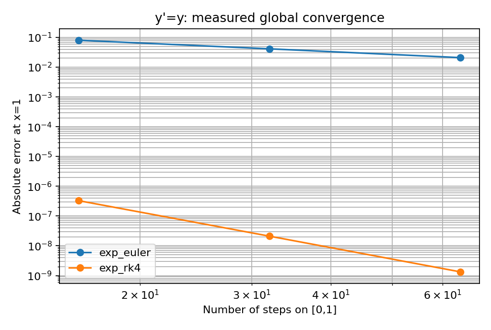

# 근 찾기와 초기값 문제를 수치 계산으로 옮기기

뒤에서 우리는 EOS의 역함수, 목표 질량에 맞는 중심압력, 진동 주파수를 각각 찾아야 한다. 겉모습은 다르지만 필요한 기본 연산은 근 찾기와 초기값 적분이다. 먼저 무차원 해석 예제로 그 원리를 분리한다. 일반 커널에 돌아오면 독립변수와 각 상태 성분의 단위를 호출자가 정하며, 절대 허용오차도 해당 성분의 단위를 갖는다. 별 구조와 Cowling의 SI 정의는 그대로다.

## 근을 포함한 구간을 보존한다

연속인 실함수 $F$에서 $F(a)$와 $F(b)$의 부호가 반대이면 그 사이에 적어도 하나의 근이 있다. 이분법은 이 사실을 반복해서 사용한다. 중점을 평가하고 반대 부호가 남는 절반을 보존하면, 정확한 실수 연산에서 $k$회 뒤의 폭은 $(b-a)2^{-k}$다. 여기서 버려서는 안 되는 전제는 연속성이다. 불연속이나 계산하지 못한 구간을 가로지른 부호 변화에는 같은 보장을 붙일 수 없다.

컴퓨터에서는 $F(a)F(b)<0$을 곱셈으로 검사할 필요가 없다. 두 값의 부호를 비교하면 큰 값의 곱이 넘치거나 작은 값의 곱이 0으로 반올림되는 문제를 피한다. 마찬가지로 매우 큰 양수와 음수를 끝점으로 삼을 때 $(a+b)/2$ 또는 $a+(b-a)/2$가 항상 안전한 것도 아니다. 구현은 같은 부호와 반대 부호의 끝점을 구분해 중점을 계산한다.

기본 좌표 조건은 반구간 폭이 $x_{\rm atol}+x_{\rm rtol}\max(|a|,|b|)$ 이하인지 보는 것이다. 별도로 $|F(x)|\le f_{\rm atol}$을 사용할 수 있으나, 작은 함수값과 작은 좌표 오차는 다른 명제다. 함수 전체에 작은 상수를 곱하면 근은 같지만 잔차 크기는 달라진다. 따라서 결과에는 `exact`, `coordinate`, `residual` 중 어떤 조건으로 종료했는지 남긴다. `exact`는 계산된 부동소수점 잔차가 0이라는 뜻이며, 무한정밀도 실수의 근을 증명했다는 뜻은 아니다.

입력 구간, 허용오차, callback의 유한성을 먼저 확인한다. 양 끝이 같은 부호이면 `no_bracket`, 유한 반복 예산을 소진하면 `max_iterations`, 양 끝 사이에 더 이상 표현 가능한 중점이 없으면 `stagnation`으로 반환한다. 실패 결과에는 마지막 구간과 평가 횟수를 남기지만 성공한 근의 출력으로 재사용하지 않는다. 바깥 근 찾기의 callback에서 또 다른 근 찾기를 호출할 수 있도록 구현은 재진입을 허용하고 각 호출의 상태를 분리한다.

## 미분방정식은 국소 예측을 반복하여 적분한다

초기값 문제 $y'=f(x,y)$, $y(x_0)=y_0$에서 Euler 방법은

$$y_{n+1}=y_n+h f(x_n,y_n)$$

를 사용한다. 충분히 매끄러운 해의 Taylor 전개와 비교하면 한 단계의 국소 절단오차는 $O(h^2)$이다. 고정된 유한 구간에서 안정적으로 적용할 때 전체 오차가 보통 $O(h)$인 것은 단계 수가 $O(h^{-1})$로 증가하기 때문이다. 이러한 차수 관계는 해와 알고리즘의 적용 조건에 대한 진술이지, 임의로 큰 단계 크기의 안정성을 보장하지 않는다.

고전적 RK4는

$$
\begin{aligned}
k_1&=f(x,y),& k_2&=f(x+h/2,y+hk_1/2),\\
k_3&=f(x+h/2,y+hk_2/2),& k_4&=f(x+h,y+hk_3),\\
y_{n+1}&=y+h(k_1+2k_2+2k_3+k_4)/6
\end{aligned}
$$

로 정의한다. 미분을 여러 번 구하는 대신 네 위치에서의 기울기를 조합한 것이다. 충분히 매끄럽고 안정적인 문제에서는 국소 오차가 $O(h^5)$, 전체 오차가 $O(h^4)$다. 이제 $y'=y$뿐 아니라 $y'=x^3$도 시험해 보자. 두 번째 예제가 필요한 이유는 무엇일까? 자율방정식만으로는 중간 단계의 $x$ 좌표를 잘못 넣은 오류를 놓칠 수 있기 때문이다.

$y'=y$, $y(0)=1$의 정확한 해는 $e^x$이고, $q'=v$, $v'=-q$, $(q,v)(0)=(1,0)$의 해는 $(\cos x,-\sin x)$이다. 전자는 값의 오차를, 후자는 진폭과 위상의 오차를 함께 확인하는 데 사용한다. RK4는 조화진동자의 에너지나 위상을 유한 단계에서 정확히 보존하는 방법이 아니므로, 보존을 오차 0으로 요구하지 않고 해상도 변화에 따른 감소를 조사한다.

그림은 동반 패키지의 Fortran 커널을 실제 실행해 얻은 결과다. 계산 조건과 값은 동반 수치실험의 저장 결과와 `fixed_steps.csv`에 기록되어 있다. 다른 수학 문제나 별의 주파수 정확도를 이 그림에서 보증하지 않는다.

## 단계 크기는 오차 추정으로 선택한다

Dormand-Prince 5(4) 쌍은 공통 단계 평가로 5차 상태 $y^{(5)}$와 4차 embedded 상태의 차이를 추정한다.[N1] 제공된 `ns_dopri_stages`는 표의 계수와 단계 평가를 담당한다. 독자가 확인할 핵심은 성분별 오차의 정규화, 단계 수락·거절과 다음 단계 크기이다.

$$
e_i=y_i^{(5)}-y_i^{(4)},\quad
s_i=a_i+r\max(|y_i^{\rm old}|,|y_i^{(5)}|),\quad
E=\max_i\frac{|e_i|}{s_i}.
$$

$a_i>0$는 성분별 절대 허용오차이며 $r\ge0$는 무차원 상대 허용오차다. 크기가 $1$인 성분과 $10^{-20}$인 성분을 하나의 절대 오차로 다루면 작은 성분의 부정확함을 감출 수 있다. 본 구현은 maximum norm을 사용한다. 원전 DOPRI5 프로그램의 RMS norm·안정화 controller 등 전체 기능과 동일한 프로그램이라고 주장하지 않는다.

새 상태와 좌표는 $E\le1$일 때만 수락한다. 거절한 상태를 다음 초기값으로 사용하면, 오차를 검사하고도 그 검사 결과를 무시한 셈이 된다. 제공 커널은 두 큰 상태의 차이 대신 embedded 가중치와 기울기로 $e_i$를 구한다. 이 방식은 불필요한 상쇄를 줄이지만 roundoff와 오차 추정의 한계까지 없애지는 않는다.

embedded 차이의 선도 크기가 $h^5$로 감소한다는 점에서 기본 비례 제어는

$$f_h=\operatorname{clip}(0.9E^{-1/5},0.2,5)$$

로 정한다. $E=0$에서는 최대 배율을 사용하고, 이전 시도가 거절되었다면 바로 다음 배율을 1 이하로 제한한다. 실제 계산에서는 로그와 제한 범위를 사용해 극단적인 $E$의 거듭제곱 평가를 피한다. 최소·최대 단계, 총 시도 횟수, 비유한 callback과 좌표 정체를 각각 별도로 처리한다.

## ‘최종 좌표를 기록했다’와 ‘그곳까지 적분했다’는 다르다

마지막 단계는 남은 길이로 제한한다. 알려진 중간 좌표 목록을 제공하면 그 위치에서도 정확히 멈춘다. 이 기능은 지정된 좌표의 정지 일정일 뿐이다. 압력으로 정의되는 별의 표면을 찾거나 불연속 계면의 전달조건을 적용하는 기능은 뒤의 절에서 별도로 다룬다.

극단적으로 큰 $x$와 작은 최종 좌표를 섞으면, 계산한 $h=x_{\rm end}-x$를 더해도 $x+h\ne x_{\rm end}$일 수 있다. 이때 출력 좌표만 목표값으로 바꾸어 성공으로 표시하지 않는다. 현재 구현은 `stagnation`을 반환하므로 더 적절한 단계와 좌표 규모를 선택해야 한다. 실제 부동소수점 진행이 없는 문제를 작은 잔차로 은폐하지 않는다.

결과 profile에는 초기 상태와 수락한 상태만 들어간다. 거절 내역은 선택적인 진단 trace로 별도 저장한다. Trace를 기록하지 않았다면 rollback 검사를 수행했다는 출력도 만들지 않는다. Callback 실패나 시도 횟수 소진 때에는 마지막 수락 상태까지의 prefix를 진단용으로 보존하지만, 목표 구간의 성공한 해는 반환하지 않는다.

## 구현과 학습의 구분

직접 구현을 선택할 때 비교할 커널은 `solutions/src/numerics/`, 누적 학습자의 커널은 `learner/src/numerics/`에 둔다. 공개 시험은 선택한 작업공간을 검사한다. 아직 구현하지 않은 학습자 커널은 `not_implemented`를 반환하며 해설로 우회하지 않는다. 공용 record와 DOPRI 단계표를 사용하는 것은 허용된 제공 기반의 재사용이지 solver 대체가 아니다.

**판단해 보자.** 틀린 우변을 매우 작은 허용오차로 적분한 계산과, 옳은 우변을 너무 거친 단계로 적분한 계산을 구별할 검사 하나씩을 고른다. 두 경우에 모두 “허용오차를 줄인다”라고 답했다면, 한 점의 우변 검사와 해상도 검사가 묻는 질문부터 다시 비교하자.

적분기가 한 단계를 수락했다. 그렇다면 무엇이 확인된 것일까? 해당 단계의 오차 추정이 지정한 기준 안에 들어왔다는 뜻이다. 잘못된 초기조건이나 우변, 다른 물리 모델이 바로잡혔다는 뜻은 아니다. 그래서 우리는 독립 해석해, 여러 단계 크기, callback 실패와 결함 주입을 함께 사용한다. 국소 오차 제어와 전체 해의 검산은 서로 맡은 일이 다르다.

**[N1]** E. Hairer and G. Wanner, DOPRI5 / CDOPRI, Université de Genève. Dormand-Prince (1980) 계수의 1차 자료 대조에 사용했다. 공식 소스의 마지막 수정 표시는 2005-08-08이다. <https://www.unige.ch/~hairer/prog/nonstiff/dopri5.f>. 제공 표와 단계는 본 패키지에서 새로 작성했으며 원전의 dense output, FSAL cache, stiffness detection, 안정화 제어를 복제하지 않았다.

## 제공 적분기를 호출할 때 정해야 할 것

기본 계산에서는 `use ns_numerical_methods`로 `adaptive_integrate`와 `bisect`를 가져온다. 독자는 우변, 적분 구간, 초기값, 성분별 절대 허용오차와 상대 허용오차를 정한다. Runge–Kutta 계수, 거절 단계의 복구, 구간 끝에서의 정지는 제공 함수가 처리한다. 내부 구현을 재작성하지 않아도 이 선택이 어떤 오차를 제어하는지 설명해야 한다.

Euler와 RK4의 한 단계는 손으로 따라가 보자. 그러면 제공 적분기가 무엇을 반복하는지 알 수 있다. 반면 고급 controller를 처음부터 작성하는 것은 선택 연습이다. EOS·TOV·Cowling으로 넘어가기 위해 그 구현을 기다릴 필요는 없다. 제공 함수를 쓰더라도 해상도를 바꿔 보고 다른 단계법과 비교해야 한다는 책임은 남는다.